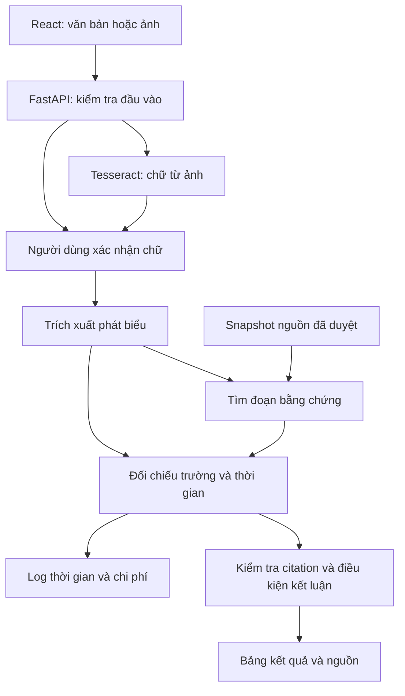

# TinChắc — Mô tả dự án và kế hoạch triển khai

**Phiên bản:** 1.0 · **Ngày lập:** 08/11/2026 · **Múi giờ kế hoạch:** Asia/Ho_Chi_Minh (UTC+7).  
**Đầu ra của tài liệu:** đặc tả và prompt giao việc; chưa phải phần mềm đã triển khai. Không có kết quả thực nghiệm nào được tạo ra ở bước lập kế hoạch này.  
**Tên đề tài:** Hệ thống AI đối chiếu thông báo học bổng và yêu cầu đóng tiền với nguồn chính thức, hỗ trợ sinh viên DUT kiểm tra thông tin trước khi hành động.

## Bắt đầu tại đây

1. **Tất cả thành viên:** đọc mục 0–2 để thống nhất mục tiêu, phạm vi và điều hệ thống không thể kết luận. Đọc ví dụ mục 1.3 trước khi viết giao diện hoặc prompt.
2. **Trưởng nhóm:** nhận T00, điền tên vào R1–R4; thống nhất ngân sách và repo. Tài liệu tạm gán Trường làm R1, nhóm có thể đổi người nhưng giữ mã vai trò.
3. **R1:** thực hiện T01 để tạo bộ khung, schema và fixture hợp lệ. Đây là việc đầu tiên mở đường cho code song song. Chưa có repo thì tạo repo riêng của nhóm; không tự sao chép LAWGIC.
4. **R2:** nhận T03 sau khi hợp đồng T01 được chốt; trong lúc chờ, vẽ bốn trạng thái giao diện trên giấy dựa mục 2. Không tự đặt tên API/enum mới.
5. **R3:** nhận T02 ngay sau T00: kiểm tra và lưu 6 nguồn đầu tiên. Không đợi backend hoàn thiện mới làm dữ liệu.
6. **R4:** chuẩn bị hướng dẫn nhãn và quy tắc chia tập trong T09 ngay từ ngày đầu; chỉ tạo dữ liệu khi có nguồn T02. Không để người chỉnh prompt nhìn nhãn test.
7. **Chuẩn bị máy:** đọc mục 7.1; lệnh ở đó là **dự kiến, chỉ chạy sau khi các task tạo tệp tương ứng**. Windows ưu tiên WSL2 Ubuntu; không nhập lệnh Linux trực tiếp vào PowerShell.
8. **Giao việc cho AI:** cung cấp toàn bộ file này, checkout đúng nhánh và sao chép prompt ngay dưới task tương ứng. AI phải đọc code hiện có, chỉ sửa phạm vi task, báo kiểm tra thực sự đã chạy.
9. **Mốc đầu tiên:** tối 11/11 có luồng văn bản → kết quả dựa fixture, ghi rõ là mô phỏng. Ngày 13/11 chuyển sang mô hình và dữ liệu thật. Không nhầm demo fixture với đánh giá AI.
10. **Bàn giao:** dùng mẫu mục 7.4. Một task chỉ `done` khi reviewer kiểm tra đầu ra và task phụ thuộc dùng được.

### Mục lục

- [0. Căn cứ, nguồn lực và quyết định](#s0)
- [1. Hiểu thống nhất về dự án](#s1)
- [2. Phạm vi MVP và trải nghiệm](#s2)
- [3. Thiết kế hệ thống và hợp đồng giao tiếp](#s3)
- [4. Dữ liệu và gán nhãn](#s4)
- [5. Thiết kế nghiên cứu và đánh giá](#s5)
- [6. Task và prompt cho AI coding](#s6)
- [7. Thiết lập, tích hợp và bàn giao](#s7)
- [8. Lịch triển khai, demo và hồ sơ](#s8)
- [9. Phản biện, sửa đổi và rủi ro còn lại](#s9)
- [10. Nguồn kiểm chứng và nhật ký tra cứu](#s10)

<a id="s0"></a>
## 0. Căn cứ, nguồn lực và quyết định

### 0.1 Quy ước mức độ chắc chắn

- **[XM] Đã xác minh:** thông tin truy xuất từ nguồn được dẫn; không đồng nghĩa đã chạy được trên tài khoản/máy của nhóm.
- **[TK] Quyết định thiết kế:** lựa chọn của kế hoạch, nhóm triển khai theo trừ khi có quyết định thay đổi được ghi lại.
- **[GD] Giả định:** dùng để lập lịch/chi phí, phải kiểm tra sớm.
- **[MT] Mục tiêu thử nghiệm:** chưa phải kết quả, không được viết trong hồ sơ như thành tích đã đạt.
- **[CHO] Chờ nhóm chốt:** có người phụ trách, hạn và cách tiếp tục nếu chưa chốt.

### 0.2 Thông tin cuộc thi đã kiểm tra lại

**[XM, S01]** Hạn nhận hồ sơ: **23:59 ngày 24/11/2026, giờ Việt Nam**. Nhóm tối đa 5 sinh viên. Online có kết quả độc lập với chương trình truyền hình. Sản phẩm hoàn chỉnh không bắt buộc; minh chứng phải trung thực.

| Vòng | Trọng tâm chấm, diễn giải | Điểm |
|---|---|---:|
| 1–2 | Nhu cầu thực tế / cách giải quyết / ích lợi cộng đồng / khả thi / hồ sơ | 25 / 30 / 20 / 15 / 10 |
| 3 | Hiểu vấn đề / giải pháp / kế hoạch / kiểm chứng tác động / phản biện | 20 / 25 / 25 / 15 / 15 |

**[XM, S02]** Form có thông tin đội, thành viên, dự án, vấn đề, mục tiêu, giai đoạn triển khai. Ảnh đội tối đa 6; ảnh minh chứng tối đa 15; JPG/PNG tối đa 5 MB/ảnh. AI được hỗ trợ, nhóm chịu trách nhiệm và giải trình; không làm giả kết quả. Chưa xác minh hạn ký tự từng ô hoặc chỗ tải video; T16 kiểm tra bằng form hoạt động.

**[TK]** Hạn nội bộ nộp: 22/11; 23–24/11 dành cho sửa và xác nhận. Người đại diện kiểm tra thể lệ lần nữa khi nộp. Không tự suy luận gia hạn.

### 0.3 Nguồn lực đã được người dùng xác nhận

| Yếu tố | Chốt cho bản kế hoạch |
|---|---|
| Nhân lực | 4 người, chưa biết tên 3 thành viên còn lại |
| Thời gian | Khoảng 3 giờ/người/ngày |
| Ngân sách | Tổng chi tiền tối đa 200.000 VND cho giai đoạn này |
| Năng lực | Chủ yếu vibe coding; ưu tiên ít dịch vụ và hợp đồng rõ ràng |
| Người dùng | Sinh viên DUT; phụ huynh là nhóm hưởng lợi gián tiếp |
| Đầu vào | Văn bản và một ảnh chụp thông báo |
| Đầu ra | Đối chiếu từng phát biểu với bằng chứng, không chứng nhận giao dịch an toàn |

**[GD]** 16 ngày làm việc từ 08–23/11 × 4 × 3 giờ = **192 giờ-người**; 24/11 không dùng để cam kết tính năng. Ngân sách công việc mục 6 là 158 giờ-người, còn 34 giờ-người dự phòng. Số giờ là thời gian của con người, gồm đọc code AI, sửa lỗi và nghiệm thu; không phải thời gian AI sinh mã.

| Vai trò | Người tạm gán | Trách nhiệm |
|---|---|---|
| R1 | Trường, cần nhóm xác nhận | Tích hợp, backend, schema/API, nhà cung cấp LLM, phần đối chiếu |
| R2 | Thành viên 2 | Giao diện, OCR, kiểm tra luồng đầu cuối |
| R3 | Thành viên 3 | Nguồn dữ liệu, thu thập, truy xuất, tuyển người thử |
| R4 | Thành viên 4 | Thiết kế nhãn, giữ test, đánh giá, hồ sơ và kiểm soát tuyên bố |

### 0.4 Sổ quyết định còn mở

| ID | Cần chốt, chủ trì và hạn | Mặc định để tiếp tục | Ảnh hưởng nếu thay đổi |
|---|---|---|---|
| D01 | Tên người/owner task — R1, 08/11 | R1–R4 như trên | Chỉ đổi phân công, không đổi API |
| D02 | Quyền dùng API, model và nạp tiền — R1, 10/11 | Gemini adapter; model ứng viên ở mục 3.1; chưa nạp tự động | Không gọi được thì fixture tiếp tục chạy; không được báo có đánh giá live |
| D03 | Số nguồn lấy được — R3/R4, 12/11 | 36 nhóm nguồn; tối thiểu 24 | Giảm cỡ mẫu theo mục 4, hạ mức kết luận |
| D04 | Máy demo, WSL và OCR — R2, 09/11 | Một laptop CPU, không GPU | OCR chưa cài được vẫn làm luồng văn bản; ảnh phải hoàn thành trước nghiệm thu MVP |
| D05 | Người thử và đầu mối DUT — R3, 15/11 | 12 sinh viên tự nguyện; không giả định trường bảo trợ | Không tuyển đủ thì báo nghiên cứu sử dụng sơ bộ với n thực tế |
| D06 | Công khai website — R1, sau 20/11 | Demo trên máy nhóm, thử trực tiếp | Public cần thêm hạn mức/kiểm soát truy cập; không nằm trên đường găng |

<a id="s1"></a>
## 1. Hiểu thống nhất về dự án

### 1.1 Vấn đề và người dùng

Sinh viên có thể nhận cùng một thông báo qua nhóm lớp, ảnh chụp, tin nhắn chuyển tiếp hoặc bài chia sẻ. Khi thông tin đi qua nhiều nơi, thời hạn, số tiền, điều kiện hoặc liên kết đăng ký có thể bị sai, cũ hoặc bị thay đổi. Việc tự tìm thông báo gốc tốn công; hình thức có logo/con dấu không tự xác minh được nội dung hoặc người gửi.

**[XM]** DUT có các trang công bố học bổng và thông báo tài chính [S03–S06]. Cảnh báo giả danh nhà trường đã được ghi nhận trên nguồn DUT trong lần khảo sát trước [S07]. Các nguồn đó chứng minh có vấn đề và có nơi đối chiếu; không chứng minh tỷ lệ sinh viên gặp lừa đảo, nhu cầu trả tiền hoặc hiệu quả TinChắc.

Người dùng đầu tiên là sinh viên đang quyết định nộp hồ sơ hoặc làm theo yêu cầu đóng tiền. TinChắc giúp họ trả lời: “Nội dung nào có căn cứ? Nội dung nào trái với thông báo gốc? Cần hỏi thêm ở đâu?”. Nhóm không xác minh chủ tài khoản ngân hàng, không xác thực danh tính người gửi và không thay nhà trường quyết định nghĩa vụ học phí cá nhân.

### 1.2 Mục tiêu sản phẩm, nghiên cứu và thuật ngữ

**Mục tiêu sản phẩm [MT]:** từ một ảnh/văn bản, người dùng đọc được bảng đối chiếu dễ hiểu, mở được nguồn và biết bước kiểm tra tiếp theo. MVP nghĩa là phiên bản nhỏ nhất đủ kiểm tra giá trị này.

**Mục tiêu nghiên cứu [MT]:** đo xem việc đối chiếu từng trường và xử lý thời gian có cải thiện kết luận có bằng chứng so với AI trả lời trực tiếp và RAG thông thường hay không, trên tập tình huống DUT đã định nghĩa.

| Thuật ngữ | Nghĩa trong TinChắc |
|---|---|
| OCR | Nhận dạng chữ từ ảnh; có thể đọc nhầm số tiền/ngày |
| LLM | Mô hình ngôn ngữ xử lý văn bản; dùng model có sẵn qua API |
| Claim/phát biểu | Một nội dung cụ thể có thể đối chiếu, ví dụ “hạn nộp là 10/11” |
| Trường thông tin | Loại nội dung: tên chương trình, hạn, giá trị, khoản phí, URL |
| Retrieval/truy xuất | Tìm đoạn liên quan trong kho tài liệu đã thu thập |
| RAG | Đưa đoạn truy xuất được cho LLM trước khi trả lời |
| Corpus | Kho nguồn và các phiên bản nguồn cố định để kiểm tra |
| Gold | Nhãn/bằng chứng tham chiếu do người gán và đối soát |
| Baseline | Cách đơn giản hoặc phổ biến dùng làm đối chứng |
| Ablation | Tắt một thành phần để xem nó đóng góp gì |
| Chưa đủ bằng chứng | Hệ thống không đủ căn cứ trong phạm vi đã kiểm tra; không đồng nghĩa sai |

### 1.3 Ví dụ xuyên suốt — toàn bộ là fixture giả lập

**Không dùng các số sau làm thông tin học bổng thật.** Fixture để đồng bộ code, không đưa vào test khoa học hoặc báo là sự kiện thật. URL `https://fixtures.tinchac.example/notices/hb-demo-2026` chỉ là định danh, không truy cập mạng.

Nguồn fixture v1, công bố 01/11/2026: “Học bổng Minh Họa 2026: 5.000.000 đồng/suất. Hạn nộp 10/11/2026 lúc 16:00. Nộp hồ sơ tại Phòng Công tác sinh viên.” Nguồn không nhắc phí giữ suất. Ảnh người dùng gửi ghi: “Học bổng Minh Họa 2026: 7 triệu/suất. Hạn 10/11/2026 lúc 16h. Đóng phí giữ suất 300k.”

Luồng ở thời điểm đối chiếu 08/11/2026 17:00 +07:00:

1. OCR lấy chữ. Người dùng sửa nếu “300k” bị đọc thành “800k” và bấm xác nhận; lưu cờ đã sửa, không sửa âm thầm.
2. Trích xuất 4 phát biểu: chương trình; giá trị 7.000.000 VND; hạn nộp; yêu cầu phí 300.000 VND.
3. Truy xuất nguồn fixture đúng chương trình, trả trích đoạn và phiên bản.
4. Đối chiếu cùng chương trình/năm/đối tượng: tên được hỗ trợ; giá trị mâu thuẫn; hạn được hỗ trợ; khoản phí chưa đủ bằng chứng.
5. Hiển thị “Có chi tiết mâu thuẫn và chi tiết chưa xác minh”; không hiển thị “Đây chắc chắn là lừa đảo”.

| Chi tiết | Nhãn | Lý do hiển thị |
|---|---|---|
| Học bổng Minh Họa 2026 | `supported` | Tìm thấy tên trong nguồn fixture |
| Giá trị 7 triệu/suất | `contradicted` | Nguồn ghi 5 triệu/suất, cùng loại giá trị và đối tượng |
| Hạn 10/11 lúc 16h | `supported` | Trùng hạn nộp ghi trong nguồn |
| Phí giữ suất 300k | `insufficient_evidence` | Nguồn đã kiểm tra không xác nhận khoản này |

Nếu kiểm tra lại ngày 12/11, câu “hạn là 10/11” vẫn được hỗ trợ nhưng trạng thái thời gian là `expired`. Nếu người dùng nói “hiện vẫn còn hạn” thì phát biểu này mâu thuẫn với hạn được nguồn xác nhận. Không đồng nhất “hết hạn” với “thông báo giả”.

### 1.4 Giá trị dự kiến và giới hạn

- Giá trị ứng dụng: giảm thao tác tìm nguồn; giúp người dùng thấy đúng chỗ cần kiểm tra. Phải thử người dùng để biết có đạt không.
- Đóng góp cần kiểm chứng: quy trình đối chiếu có cấu trúc + thời gian + quyền chưa kết luận; bộ đánh giá có truy vết nguồn; phân tích lỗi. Chưa tuyên bố thuật toán mới hoặc vượt mọi sản phẩm hiện có.
- Giới hạn: kho nguồn nhỏ; không phủ toàn bộ DUT; thông báo cá nhân có thể không công khai; OCR có lỗi; nguồn chính thức có thể bị sửa hoặc thiếu; người gửi có thể giả danh một chương trình có thật.
- Tập tình huống chỉnh sửa đánh giá khả năng phát hiện sai khác có kiểm soát, không đo khả năng phát hiện lừa đảo ngoài xã hội.
- TinChắc chưa phải sản phẩm chính thức của DUT; chỉ nêu phối hợp/bảo trợ khi có xác nhận thật.

<a id="s2"></a>
## 2. Phạm vi MVP và trải nghiệm

### 2.1 Phạm vi chốt [TK]

**Bắt buộc:** nhập 20–6.000 ký tự hoặc một PNG/JPEG tối đa 5 MiB, 12 megapixel; OCR cục bộ và xác nhận văn bản; kiểm tra tối đa 8 phát biểu; tìm kho nguồn đã duyệt; ba nhãn theo phát biểu; ngày đối chiếu và độ mới kho nguồn; bằng chứng mở được; thông báo lỗi rõ; giới hạn chi phí; fixture offline; script đánh giá tái lập.

**Làm sau:** quét Facebook/TikTok; bot Zalo; đăng nhập sinh viên; nhận video/âm thanh; tải PDF từ người dùng; tự xác minh số tài khoản; điểm “an toàn 98%”; theo dõi mọi học bổng; graph database; huấn luyện model; ứng dụng di động native; dịch vụ cloud trả phí.

**Kho nguồn:** học bổng, thông báo công khai liên quan thu phí, gia hạn/đính chính. Phần thu phí không bao gồm tính học phí riêng của từng sinh viên. File PDF/ảnh đính kèm nguồn được R3 nhập trước bằng CLI, khác với đầu vào công khai của người dùng.

### 2.2 Màn hình và trạng thái

| Màn hình | Nội dung chính | Trạng thái và hành động |
|---|---|---|
| Trang gửi nội dung | Chọn văn bản/ảnh, phạm vi DUT, nút kiểm tra; nhắc che thông tin cá nhân | Trống; sai định dạng/kích thước; gửi; lỗi có nút sửa/thử lại |
| Xác nhận chữ từ ảnh | Ảnh local preview và text OCR có thể sửa; nhắc kiểm tra ngày/số tiền | OCR đang chạy; chữ thấp chất lượng; OCR không đọc được → nhập tay; xác nhận |
| Kết quả | Bảng phát biểu–nhãn–lý do; cảnh báo thời gian; số nguồn đã kiểm tra; bước tiếp theo | Đang trích xuất/tìm/đối chiếu; hoàn tất; tất cả NEI; lỗi kỹ thuật riêng |
| Chi tiết bằng chứng | Tiêu đề, URL, ngày công bố, phiên bản, lúc thu thập, trích đoạn; link nguồn mở tab mới | Nguồn trong snapshot còn xem được; link gốc mất thì ghi rõ; không ngầm coi snapshot là cập nhật trực tiếp |

`insufficient_evidence` là một kết quả hợp lệ, không phải lỗi API. Lỗi nhà cung cấp/DB phải là `failed`, không đổi thành NEI để làm đẹp tỷ lệ hoàn tất. Không chạy tiến độ phần trăm giả; hiển thị tên giai đoạn. Nút gửi khóa khi request đang xử lý, retry tạo request mới có chủ đích.

UI dùng chữ/biểu tượng cùng màu để người khó phân biệt màu vẫn hiểu. Các thẻ nguồn có `snapshot_at`, ghi “đối chiếu trong kho cập nhật lúc …”; không gọi là “đã kiểm tra toàn internet”. Nếu ảnh có thông tin cá nhân, người dùng cắt/che trước; raw ảnh không gửi sang LLM mặc định.

### 2.3 Tiêu chí hoàn thành sản phẩm

1. Máy thứ hai dựng được môi trường theo README đã cập nhật và chạy 4 fixture: hỗ trợ, mâu thuẫn, thiếu nguồn, hết hạn.
2. Luồng ảnh và văn bản đều dùng cùng `CheckResult`, không hai cách gắn nhãn khác nhau.
3. Mọi `supported/contradicted` ở phiên bản C có citation hợp lệ và trích đoạn thật trong snapshot; điều này chỉ kiểm tra cấu trúc, chưa đảm bảo suy luận đúng.
4. OCR rỗng, API hết hạn mức, nguồn xung đột và deadline thiếu năm đều có hành vi đúng đặc tả.
5. Không có API key trong frontend/repo; kết quả người dùng không truy cập được chỉ bằng đoán ID.
6. Có báo cáo A/B/C, số lỗi kỹ thuật, dữ liệu và cấu hình thực dùng; kết quả kém vẫn là hoàn tất thí nghiệm nếu báo đúng.
7. Demo không phụ thuộc mạng để giải thích luồng; chế độ fixture/replay phải có nhãn rõ. Chỉ bản live mới được gọi là kết quả chạy mới.

<a id="s3"></a>
## 3. Thiết kế hệ thống và hợp đồng giao tiếp

### 3.1 Stack chính và điều đã kiểm chứng

| Phần | Lựa chọn [TK] | Căn cứ và lý do |
|---|---|---|
| Giao diện | React + TypeScript + Vite, CSS đơn giản | Một trang ứng dụng nhỏ; Vite có template React TS. Node 22, patch >=22.12; khóa patch tại T01 [S08] |
| Backend | Python 3.11 + FastAPI + Pydantic v2 | Upload multipart, kiểu dữ liệu và OpenAPI; schema kiểm tra đầu vào [S09, S10] |
| Job | FastAPI BackgroundTasks + SQLite, một process | Đủ demo ít người. Không phải queue bền vững/phân tán [S11] |
| Lưu trữ/tìm | SQLite FTS5 BM25 + TF-IDF character n-gram của scikit-learn | Không phí embedding, phù hợp kho nhỏ; BM25 SQLite điểm thấp hơn là tốt hơn [S12, S13] |
| OCR | Tesseract 5 `vie+eng`, pytesseract + Pillow | Có dữ liệu ngôn ngữ Việt; chất lượng ảnh thực phải đo [S14] |
| LLM | Adapter `google-genai`; ứng viên `gemini-3.5-flash-lite` | Tài liệu Google hiện có model này và structured output; phải preflight tài khoản [S15–S18] |
| Tài liệu nguồn | httpx + BeautifulSoup; PyMuPDF cho PDF có text | Ingest ngoại tuyến, ưu tiên HTML; scan dùng Tesseract và người duyệt [S23] |
| Test | pytest, Vitest; Playwright cho một luồng đầu cuối | Chỉ kiểm tra các hành vi có giá trị: schema, nhãn, thời gian, lỗi, luồng người dùng |
| Demo | Vite build được FastAPI phục vụ cùng origin | Không mua hosting; phát triển dùng Vite proxy `/api` |

**Kiểm chứng công nghệ không phải kiểm chứng hiệu năng.** R1 khóa phiên bản cài đặt thành công vào `requirements.lock.txt`, R2 commit `package-lock.json`; không dùng `latest` mỗi lần cài. Giá/model ở Google được lấy từ nội dung chính thức do công cụ tìm kiếm trả về, một số lần mở trực tiếp bị lỗi định dạng; khả năng gọi API và giá áp dụng cho tài khoản vẫn là D02 cần kiểm tra. Tài liệu Google cho biết model 2.5 hạn chế với dự án mới, nên không dùng 2.5 làm mặc định [S18].

Nếu ứng viên không gọi được: R1 chọn **một** model khả dụng, có output JSON và chi phí phù hợp, ghi vào `docs/decisions.md` trước khi chạy dev; tất cả A/B/C dùng đúng model đó. Không tự chuyển model khi test đang chạy. Nếu không có API khả dụng, nhóm vẫn làm fixture nhưng phải báo chưa thực hiện so sánh AI.

### 3.2 Kiến trúc



Kho nguồn được R3 thu thập trước; yêu cầu người dùng không kích hoạt crawler hoặc mở URL tùy ý. Vì vậy một link trong tin nhắn chỉ được trích xuất, không được server tự truy cập.

### 3.3 Đường đi dữ liệu và ranh giới module

| Bước/module | Đầu vào → đầu ra chuẩn | Trách nhiệm và giới hạn |
|---|---|---|
| `services/intake.py` | File bytes → `AssetRecord` | Kiểm MIME thực, kích thước/pixel; UUID; không dùng tên file người gửi làm path |
| `services/ocr.py` | Local image → `OCRResult` | `vie+eng`, timeout 20s, giữ text/confidence OCR; không kết luận nội dung |
| UI xác nhận | `OCRResult` → `CheckCreate.confirmed_text` | Người dùng sửa; `text_modified` do backend so bản OCR; text người dùng cũng phải xác nhận gửi |
| `services/extract.py` | `CheckCreate` → `ExtractionResult` | Một call LLM JSON; tối đa 8 claim; giữ nguyên đoạn làm căn cứ trích xuất |
| `services/retrieve.py` | Claim + corpus_version + as_of → `RetrievalBundle` | FTS/TF-IDF; không đọc gold, không gọi web; chỉ xếp hạng nguồn đủ điều kiện |
| `services/temporal.py` | Claim + source facts + as_of → các kiểm tra thời gian | Code xử lý so sánh ngày/khoảng; không tự điền năm thiếu |
| `services/verify.py` | Claims + bundles → `VerdictDraft[]` | Một call LLM cho tất cả claim trong ca; tối đa context/output; đối chiếu cùng entity/scope |
| `services/evidence.py` | Draft + source snapshot → `ClaimVerdict[]` | Kiểm ID, quote, ngày, scope; thiếu căn cứ hạ NEI, không tự nâng nhãn |
| `services/render.py` | Verdicts → `CheckResult` | Câu mô tả theo template; không gọi LLM lần ba để viết văn và thêm thông tin |
| `services/jobs.py` | Check record → cập nhật trạng thái | Job một process; không giữ transaction DB khi gọi LLM |
| `services/llm.py`, `services/budget.py` | Prompt/schema → JSON + Usage | Timeout, usage, reservation, cache; không log key/nội dung riêng tư |

**MVP:** một call trích xuất, một call đối chiếu; OCR không dùng model đa phương thức. Model đa phương thức hiểu cả ảnh lẫn chữ nhưng tăng phụ thuộc/chi phí và vẫn có thể đọc sai; chỉ thử sau MVP, không âm thầm thay OCR trong test.

### 3.4 Cấu trúc thư mục thống nhất

```text
tinchac/
  TINCHAC_PROJECT_PLAN.md
  README.md
  .env.example
  .gitignore
  .python-version
  .nvmrc
  requirements.in
  requirements.lock.txt
  backend/
    app/
      main.py
      config.py
      db.py
      models.py
      api/{assets,checks,sources,health}.py
      services/{intake,ocr,extract,retrieve,temporal,verify,evidence,render,jobs,llm,budget}.py
    tests/
  frontend/
    package.json
    package-lock.json
    src/api/{client,types}.ts
    src/components/{InputForm,OCRReview,ProgressPanel,ResultTable,EvidencePanel}.tsx
    src/App.tsx
    tests/
  contracts/
    openapi.json
    examples/{asset_ready,check_create,check_result,error}.json
  config/
    sources.yaml
    experiments.yaml
  prompts/{extract,baseline_a,baseline_b,verify_c,verify_c_no_time}.txt
  scripts/{init_db,ingest_sources,validate_corpus,export_contracts,preflight,run_eval,score_eval,purge_private}.py
  data/
    fixtures/{sources,cases}.jsonl
    corpus/{sources,chunks,manifest}.json
    dev/{cases,gold}.jsonl
    test_public/cases.jsonl
    raw/
    private/
  eval/
    protocol.md
    annotation_guide.md
    split_manifest.json
    metrics.py
    tests/
  docs/{decisions,progress,source_log,demo_script,submission_draft,ai_usage}.md
  docs/handoffs/
  reports/
```

Ký hiệu `{a,b}.py` là nhiều tệp riêng, không tạo tên có dấu ngoặc. Corpus nhỏ dùng JSON array, cases/gold dùng JSONL mỗi dòng một object. `data/raw`, `data/private`, DB, logs riêng tư và `test_gold` ngoài repo bị gitignore. Không commit dữ liệu người thử hoặc danh sách sinh viên. Ví dụ fixture được commit; corpus công khai chỉ commit phần được quyền chia sẻ.

### 3.5 Quy tắc chung cho mọi schema

Hợp đồng dưới đây là yêu cầu để T01 viết `models.py` và xuất OpenAPI, không phải code đã tồn tại. JSON UTF-8; tên trường snake_case; reject trường lạ với `extra='forbid'`; API `/api/v1`; `schema_version='1.0'` trong object gốc của request/response JSON public. Object nội bộ như Claim, RetrievalBundle không tự thêm schema_version ngoài bảng định nghĩa. UUID dạng string ở resource; id source/chunk/case do ingest sinh ổn định. Ngày giờ ISO 8601 có offset; server lưu UTC, hiển thị Việt Nam. Ngày thiếu giờ lưu `YYYY-MM-DD` cùng `precision='date'`, không tự tạo giờ chính xác.

Trong bảng: `?` nghĩa là trường có mặt nhưng cho phép `null`; `=[]` nghĩa là mảng có thể rỗng và vẫn phải xuất ra. Không dùng string rỗng thay null. Float phải hữu hạn. Tiền VND số nguyên, không float. `confidence` OCR không phải xác suất đúng của thông tin và không đưa lên kết quả như điểm tin cậy.

**Các kiểu dùng chung:**

| Kiểu | Trường bắt buộc và kiểu |
|---|---|
| `TextSpan` | `start:int>=0`, `end:int>start` — chỉ số Unicode code point, đoạn `[start,end)` trong text NFC |
| `MoneyValue` | `amount:int>=0`, `currency:'VND'`, `basis:string` (ví dụ `per_award`, `per_student`, `per_credit`) |
| `DateValue` | `value:string?` (ISO date/datetime), `precision:'datetime'|'date'|'unknown'`, `timezone:'Asia/Ho_Chi_Minh'`, `raw:string`, `ambiguous:bool` |
| `NormalizedValue` | `text:string?`, `money:MoneyValue?`, `date:DateValue?`, `url:string?`; tối đa một nhánh khác null, cả bốn null nếu không chuẩn hóa được |
| `Scope` | `program:string?`, `academic_year:string?`, `cohort:string?`, `audience:string?`, `fee_kind:string?`; giữ null khi thiếu |
| `ErrorDetail` | `code:ErrorCode`, `message:string`, `retryable:bool`, `details:object` — chỉ thông tin an toàn |
| `Usage` | `provider:string`, `model:string`, `input_tokens:int>=0`, `output_tokens:int>=0`, `cost_usd:float>=0`, `cost_vnd_estimate:float>=0`, `attempts:int>=0`, `cache_hit:bool`, `duration_ms:int>=0` |

`output_tokens` dùng toàn bộ token đầu ra bị tính phí, gồm thinking nếu nhà cung cấp tính; không chỉ đếm phần text nhìn thấy. Usage thiếu thì ghi riêng `usage_missing=true` trong log và giữ reservation, không tự ghi chi phí 0.

### 3.6 Schema đầu vào, tài liệu và kết quả

| Object | Trường và quy tắc |
|---|---|
| `OCRResult` | `text:string`, `mean_confidence:float?` trong 0..100, `low_quality:bool`, `warnings:string[]`, `duration_ms:int`. Text rỗng không tự tạo claim |
| `AssetRecord` | `schema_version`, `asset_id:UUID`, `status:'queued'|'ocr'|'ready'|'failed'`, `ocr:OCRResult?`, `error:ErrorDetail?`, `created_at:datetime`, `expires_at:datetime` |
| `CheckCreate` | `schema_version`, `input_mode:'text'|'image'`, `confirmed_text:string` 20..6000 ký tự, `asset_id:UUID?`, `asset_token:string?`, `as_of:datetime`, `consent_to_process:true`. Image bắt buộc asset ready và token; text bắt buộc hai trường asset null. as_of không vượt giờ server +5 phút |
| `Claim` | `claim_id:string` duy nhất trong check, `field_type:FieldType`, `statement:string`, `input_span:TextSpan?`, `raw_value:string`, `normalized:NormalizedValue`, `scope:Scope`, `ambiguities:string[]` |
| `ExtractionResult` | `claims:Claim[]` 0..8, `warnings:string[]`, `usage:Usage`. 0 claim → `NO_CHECKABLE_CLAIM`; >8 hoặc bị cắt → yêu cầu người dùng chia nhỏ, không âm thầm bỏ |
| `SourceVersion` | `source_id:string`, `version_id:string`, `family_id:string`, `canonical_url:string`, `parent_url:string?`, `title:string`, `publisher:string`, `published_at:string?`, `published_precision:'datetime'|'date'|'unknown'`, `retrieved_at:datetime`, `available_at:datetime`, `available_basis:'published_verified'|'first_seen'|'fixture'`, `effective_from:DateValue?`, `effective_to:DateValue?`, `supersedes_version_id:string?`, `content_sha256:string`, `text:string`, `scope:Scope`, `is_fixture:bool`, `review_status:'approved'|'quarantined'`, `verified_by:string`, `facts:SourceFact[]`, `outbound_links:string[]` |
| `SourceFact` | `field_type:FieldType`, `normalized:NormalizedValue`, `scope:Scope`, `quote:string`, `span:TextSpan`. Span trỏ source text; fact do R3 duyệt, không dựa trên gold của test |
| `SourceChunk` | `chunk_id:string`, `version_id:string`, `text:string`, `source_span:TextSpan`, `section:string?`, `page:int?` (PDF trang tính từ 1); chunk liên tục từ source text |
| `RetrievalHit` | `chunk_id:string`, `version_id:string`, `rank:int>=1`, `score:float`, `retriever:'rrf'`, `text:string`, `source:SourceVersion` đầy đủ; object chỉ dùng nội bộ, không serialize ra API public |
| `RetrievalBundle` | `claim_id:string`, `query:string`, `hits:RetrievalHit[]`, `corpus_version:string`, `as_of:datetime`, `reason:'found'|'no_match'|'no_eligible_source'` |
| `EvidenceRef` | `chunk_id:string`, `version_id:string`, `quote:string`, `quote_span:TextSpan` tương đối trong chunk; `relation:'supports'|'contradicts'|'context'` |
| `VerdictDraft` | `claim_id:string`, `label:Label`, `reason_codes:ReasonCode[]`, `explanation:string`, `evidence:EvidenceRef[]`, `temporal_status:TemporalStatus` |
| `ClaimVerdict` | Tất cả trường `VerdictDraft` + `field_type:FieldType`, `statement:string`, `normalized:NormalizedValue`, `checks_passed:string[]`. Label S/C bắt buộc evidence không rỗng và đã qua validator |
| `CheckResult` | `schema_version`, `check_id:UUID`, `claims:ClaimVerdict[]`, `summary:Summary`, `sources:SourceSummary[]`, `as_of:datetime`, `corpus_version:string`, `corpus_updated_at:datetime`, `warnings:string[]`, `run_mode:'live'|'fixture'|'replay'`, `next_steps:string[]`, `usage:Usage` (tổng) |
| `Summary` | `supported:int`, `contradicted:int`, `insufficient_evidence:int`, `message:string`. Tổng bằng số claims; không có nhãn “safe” |
| `SourceSummary` | `version_id`, `title`, `canonical_url`, `published_at:string?`, `retrieved_at:datetime`, `is_fixture:bool`. Các string không ghi kiểu mặc định là string |
| `CheckRecord` | `schema_version`, `check_id:UUID`, `status:CheckStatus`, `result:CheckResult?`, `error:ErrorDetail?`, `created_at:datetime`, `updated_at:datetime`, `expires_at:datetime`. completed chỉ có result; failed chỉ có error |

Không serialize `SourceVersion` đầy đủ lồng vào mọi hit public: `RetrievalHit` là giao tiếp nội bộ. API nguồn trả `SourcePublic = SourceSummary + schema_version:'1.0' + text:string + chunks:SourceChunk[]`, không expose reviewer, raw path hoặc gold. `text_modified:bool` là metadata audit nội bộ của bảng checks: so sánh confirmed_text với OCR text đã chuẩn hóa; không phải trường trong CheckRecord public.

**Enum bắt buộc:**

```text
FieldType = program | award_amount | payment_amount | deadline | application_url
            | eligibility | payment_requirement | current_availability
Label = supported | contradicted | insufficient_evidence
TemporalStatus = active | expired | not_yet_active | unknown | not_applicable
CheckStatus = queued | extracting | retrieving | verifying | completed | failed
ReasonCode = MATCHED | VALUE_MISMATCH | EXPLICIT_NEGATION | DEADLINE_PASSED
             | NO_SOURCE | SOURCE_SILENT | SOURCE_CONFLICT | SCOPE_UNCLEAR
             | DATE_AMBIGUOUS | OCR_UNCERTAIN | INVALID_CITATION
             | LINK_NOT_CONFIRMED | OUT_OF_SCOPE | PARTIAL_EVIDENCE
```

### 3.7 API công khai

Tạo resource trả token truy cập ngẫu nhiên tối thiểu 128 bit. Server chỉ lưu hash; client giữ trong memory/sessionStorage, không đưa vào URL/log. Endpoint GET/DELETE resource nhận `X-Resource-Token`. Resource không đúng token trả 404 như không tồn tại. Chế độ local cũng thực thi để dễ chuyển máy mà không đổi hợp đồng.

| Method/path | Input | Thành công | Lỗi chính |
|---|---|---|---|
| `GET /api/v1/health` | Không | 200 `{status:'ok', schema_version:'1.0', corpus_version:string, provider_configured:bool, run_mode:'live'|'fixture'|'replay'}` | 503 theo ErrorEnvelope khi DB/FTS chưa sẵn sàng; không gọi LLM |
| `POST /api/v1/assets` | multipart `file` PNG/JPEG | 202 `{schema_version:'1.0', asset:AssetRecord, access_token:string}` | 413, 415, 422, 429 |
| `GET /api/v1/assets/{asset_id}` | Token header | 200 `AssetRecord` | 404, 410 |
| `POST /api/v1/checks` | JSON `CheckCreate` | 202 `{schema_version:'1.0', check:CheckRecord, access_token:string}` | 409, 422, 429 |
| `GET /api/v1/checks/{check_id}` | Token header | 200 `CheckRecord` | 404, 410 |
| `DELETE /api/v1/checks/{check_id}` | Token header | 204, xóa text/result/token; job có cờ canceled nội bộ | 404 |
| `DELETE /api/v1/assets/{asset_id}` | Token header | 204, xóa ảnh/OCR và token | 404 |
| `GET /api/v1/sources/{version_id}` | Không, chỉ source approved public | 200 `SourcePublic` | 404 |

Poll mỗi 1,5 giây; hết 120 giây client ngừng poll tự động và hiện “đang xử lý lâu”, có nút kiểm tra lại; không tự tạo check mới. Không cần SSE/WebSocket. Tạo job và trả 202 trước; lỗi worker được trả trong `record.error` với HTTP 200 khi GET, không thay đổi HTTP của request đã kết thúc.

**Mã lỗi có cùng cấu trúc:** `{schema_version:'1.0', request_id:string, error:ErrorDetail}`. Validation error của FastAPI phải được chuyển về envelope này, không trả hai định dạng.

| ErrorCode | HTTP khi đồng bộ | Hành vi |
|---|---:|---|
| `INVALID_INPUT` | 422 | Chỉ rõ trường sai; không gọi LLM |
| `INPUT_TOO_LARGE` | 413 | Vượt bytes/pixel/text |
| `UNSUPPORTED_MEDIA` | 415 | MIME/file không hỗ trợ |
| `RESOURCE_NOT_FOUND` | 404 | ID hoặc token không đúng |
| `RESOURCE_EXPIRED` | 410 | Đúng token nhưng quá TTL, nếu còn tombstone |
| `ASSET_NOT_READY` | 409 | Chưa OCR xong |
| `OCR_FAILED` | worker | Cho nhập tay; ảnh không được tính đã kiểm chứng |
| `NO_CHECKABLE_CLAIM` | worker | Yêu cầu gửi thông báo cụ thể |
| `TOO_MANY_CLAIMS` | worker | Yêu cầu tách ngắn hơn |
| `RATE_LIMITED` | 429/worker | Retry-After nếu biết; tối đa một retry ở provider |
| `BUDGET_EXCEEDED` | 429/worker | Ngừng live; không ngầm replay |
| `PROVIDER_TIMEOUT` | worker | Có thể thử lại; lỗi được tính trong đánh giá |
| `PROVIDER_BAD_OUTPUT` | worker | JSON/schema sai sau giới hạn retry |
| `CORPUS_UNAVAILABLE` | 503/worker | Kho không tải được, khác với không tìm thấy nguồn |
| `JOB_INTERRUPTED` | worker | Khởi động lại phát hiện job dở; không gọi lại âm thầm |
| `INTERNAL_ERROR` | 500/worker | Thông báo chung, log nội bộ không chứa key/text riêng tư |

### 3.8 Ví dụ giao tiếp tối thiểu

`POST /api/v1/checks` — JSON hợp đồng, chỉ dùng dữ liệu mô phỏng:

```json
{
  "schema_version": "1.0",
  "input_mode": "text",
  "confirmed_text": "Học bổng Minh Họa 2026 có giá trị 7 triệu đồng mỗi suất.",
  "asset_id": null,
  "asset_token": null,
  "as_of": "2026-11-08T17:00:00+07:00",
  "consent_to_process": true
}
```

Ví dụ `Claim` do `extract.py` trả (input_span null được phép khi không chắc vị trí; không bịa offset):

```json
{
  "claim_id": "clm_01",
  "field_type": "award_amount",
  "statement": "Học bổng Minh Họa 2026 có giá trị 7 triệu đồng mỗi suất.",
  "input_span": null,
  "raw_value": "7 triệu đồng mỗi suất",
  "normalized": {"text": null, "money": {"amount": 7000000, "currency": "VND", "basis": "per_award"}, "date": null, "url": null},
  "scope": {"program": "Học bổng Minh Họa 2026", "academic_year": null, "cohort": null, "audience": null, "fee_kind": null},
  "ambiguities": []
}
```

Ví dụ bằng chứng nội bộ: `chunk_id='fixture_hb_v1_c01'`, text chunk chính xác là `5.000.000 đồng/suất.`. Khi đó `EvidenceRef`:

```json
{
  "chunk_id": "fixture_hb_v1_c01",
  "version_id": "fixture_hb_v1",
  "quote": "5.000.000 đồng/suất.",
  "quote_span": {"start": 0, "end": 20},
  "relation": "contradicts"
}
```

Ví dụ `VerdictDraft`: claim_id `clm_01`, label `contradicted`, reason_codes `["VALUE_MISMATCH"]`, explanation “Nguồn fixture ghi 5 triệu/suất, khác giá trị 7 triệu trong nội dung gửi.”, evidence là object trên, temporal_status `not_applicable`. Chỉ được duyệt nếu đúng chương trình/scope; trích số giống nhau từ học bổng khác không hợp lệ. T01 tạo object đầy đủ cho mỗi schema trong `contracts/examples`, kiểm tra bằng Pydantic, không dùng dấu ba chấm trong file JSON thật.

### 3.9 Truy xuất, thời gian và quy tắc kết luận

**Retrieval [TK]:** chia đoạn theo heading/đoạn văn, mục tiêu 200–400 từ/đoạn; không cắt bảng tiền/đối tượng thành hai đoạn. Query từ tên chương trình + năm + phát biểu. FTS5 BM25 lấy 10 đoạn, TF-IDF `analyzer='char_wb', ngram_range=(3,5)` lấy 10; gộp theo reciprocal rank fusion `sum(1/(60+rank))`, điểm cao hơn tốt hơn. Hòa điểm dùng chunk_id để tái lập. Chỉ fit TF-IDF trên source corpus, không trên nội dung/nhãn test. Một lượt tìm mỗi claim, gộp tối đa 6 chunk toàn ca; context trần 6.000 token, ưu tiên mỗi claim một hit rồi bổ sung. Báo nếu cắt context. A/B/C trong thí nghiệm dùng một claim mục tiêu/ca nên giới hạn này dễ kiểm soát.

**Phạm vi thời gian:** `as_of` là thời điểm cần đối chiếu, không phải ngày đăng bài người gửi. Tất cả phương pháp chỉ được dùng nguồn `available_at <= as_of`. Nguồn biết chính xác giờ công bố dùng giờ đó; chỉ biết ngày thì dùng cuối ngày theo múi giờ Việt Nam để tránh lấy tài liệu quá sớm. Không có ngày xác minh được thì available_at = lần đầu thu thập, không suy ngày từ URL. Nếu trang có sửa đổi nhưng không biết lúc sửa, bản nội dung mới chỉ được coi có từ lần thu thập, không gán ngược về ngày công bố gốc. Historical check trước thời điểm đó phải thiếu bằng chứng nếu không có snapshot cũ.

`effective_from/to` khác `published_at` và khác `deadline`. Chỉ tạo quan hệ supersedes khi có đính chính/gia hạn rõ và R3 xác nhận cùng scope. Không chọn bản mới hơn chỉ vì URL được thu thập sau. Nếu hai nguồn cùng thẩm quyền mâu thuẫn, không xác định được bản thay thế → NEI + `SOURCE_CONFLICT`, hiện cả hai.

**Quy tắc nhãn:**

1. `supported`: bằng chứng trực tiếp hoặc suy ra chắc từ quy tắc ngày/số, đúng chương trình/năm/đối tượng/loại tiền; có citation.
2. `contradicted`: bằng chứng xác nhận điều không tương thích cùng scope hoặc phủ định rõ. Không có nguồn không đủ để gắn nhãn này.
3. `insufficient_evidence`: thiếu nguồn; nguồn im lặng; thiếu scope; OCR mơ hồ chưa sửa; nguồn mâu thuẫn; link chưa xác nhận; ngày thiếu năm; một phát biểu gộp có phần chưa được chứng minh.
4. Ảnh chứa lời “bỏ qua quy tắc…” là dữ liệu cần đọc, không phải lệnh cho LLM. Nguồn cũng là dữ liệu, không có quyền đổi hệ thống.
5. Tiền: không so `5 triệu/suất` với `5 triệu/năm` như cùng giá trị. Không dùng học phí bình quân để suy số tiền riêng của sinh viên.
6. URL: link ngoài dut.udn.vn có thể hợp lệ khi chính nguồn DUT dẫn tới. So URL đầy đủ đã chuẩn hóa scheme/host, không chỉ tên miền. Link chưa xác nhận → NEI, không tự gọi link lạ và không kết luận độc hại. Không tự bỏ tham số có ý nghĩa hoặc đổi đích rút gọn.
7. Deadline chỉ có ngày: hiển thị độ chính xác ngày. Có thể biết expired khi ngày as_of đã qua ngày hạn; trong ngày hạn không tự khẳng định “còn hạn tới 23:59”. Thiếu năm/đợt → unknown.
8. Trích dẫn: quote phải bằng chuỗi trong chunk NFC tại span; source_id/version phải thuộc bundle; available_at hợp lệ; label S/C phải có evidence tương ứng. Kiểm quote thành công không thay thế kiểm tra entailment, tức bằng chứng có thực sự suy ra kết luận; phần này còn phụ thuộc LLM và được người chấm đo.
9. `checks_passed` chỉ ghi điều code đã kiểm tra, như `quote_exact`, `source_available`, `scope_compatible`; không ghi `fact_true`.

### 3.10 Lỗi, chi phí và bảo vệ dữ liệu ở mức MVP

- **Nguồn không tìm thấy:** trả NEI, hiện phạm vi kho nguồn, không lỗi 500. Nguồn gốc không truy cập được nhưng có snapshot đã duyệt: dùng snapshot và thời điểm, không giả vờ vừa kiểm tra live.
- **OCR sai:** người dùng xác nhận text trước khi gửi LLM; khi chưa chắc tiền/ngày, cho nhập lại. Mean confidence <70 chỉ là ngưỡng UI tạm thời cần chỉnh bằng dev, không phải bảo đảm đúng.
- **API lỗi:** timeout mỗi call 30s; tối đa một retry cho 429/5xx/timeout theo Retry-After hoặc backoff; JSON sai tối đa một lần sửa trong cùng ngân sách. Không retry cả pipeline. Mọi attempt có log/reservation; call timeout có thể đã bị tính tiền.
- **Jobs:** semaphore tối đa 2 job; một SQLite connection mỗi thao tác/thread, WAL và busy timeout; mọi chuyển trạng thái atomic. Khi restart, đánh dấu job dở `JOB_INTERRUPTED`. Raw ảnh xóa sau OCR hoàn tất hoặc lỗi; asset text/result TTL 24h. DELETE khi job đang chạy đặt cancellation flag để worker không ghi dữ liệu đã xóa trở lại.
- **API key:** server-only, không `VITE_*`; chỉ R1 giữ key live trong buổi test tập trung; AI không được in `.env` hoặc đưa key vào prompt/commit. Không tự nạp tiền hoặc bật auto-reload.
- **Nguồn:** allowlist URL do người duyệt, redirects phải được kiểm tra lại; chặn IP private/loopback/link-local. Attachment chỉ đi từ URL liên kết đã duyệt, không fetch URL người dùng.
- **Dữ liệu riêng tư:** người dùng cắt/che ảnh; backend che email/SĐT/STK cá nhân trong text trước LLM nếu không cần đối chiếu, giữ placeholder; chỉ phân tích URL công khai và yêu cầu khoản tiền. Nếu che làm thay đổi offset, input_span phải null trừ khi backend có ánh xạ về confirmed_text được kiểm thử; không dùng offset của text đã che để tô sáng text gốc. Không dùng tin nhắn thật chưa được đồng ý trong repo/test. UI không khẳng định hoàn toàn ẩn danh vì che tự động có thể sót.
- **Cache:** khóa gồm model, prompt_hash, schema_version, input_hash, corpus_version, as_of. Chỉ cache bền vững dữ liệu public/fixture; không lưu riêng tư quá TTL. Khi đo latency mới, không tính cached response như call live.

### 3.11 Ngân sách 200.000 VND

**[XM, S16–S17]** Nội dung giá Google được truy xuất cho `gemini-3.5-flash-lite` Standard: 0,30 USD/triệu token vào, 2,50 USD/triệu token ra. Trang billing nêu tài khoản Prepay có thể cần nạp tối thiểu 5 USD. Phải xác nhận lại trên tài khoản trước khi trả tiền; không dựa vào free tier để hứa tiến độ.

**[GD]** Tỷ giá lập kế hoạch 27.000 VND/USD, không phải tỷ giá được tra cứu. Ngân sách nạp 5 USD tương đương 135.000 VND trước phí/thuế; nếu tổng thanh toán hiển thị vượt 170.000 VND thì dừng để điều chỉnh, không vượt trần 200.000 VND. Nạp tiền và tiêu thụ tín dụng là hai khoản theo dõi khác nhau, không cộng hai lần thành chi phí.

| Khoản | Trần kế hoạch |
|---|---:|
| Tiền nạp API và phí liên quan | <=170.000 VND |
| Dự phòng phát sinh nhỏ | <=30.000 VND |
| Hosting/domain/GPU | 0 |

Ví dụ dự toán, không phải usage thật: 600 call × 4.000 token vào × 0,30/1e6 + 600 × 800 token ra × 2,50/1e6 = **1,92 USD** (~51.840 VND theo tỷ giá giả định). 600 call là trần ước lượng gồm dev, A/B/C, ablation, extraction và demo; thinking/retry/đầu vào dài có thể làm tăng.

R1 ghi ledger theo từng stage. Trần tiêu thụ app khởi đầu 3 USD, dev <=0,8; đánh giá <=1,4; demo/retry <=0,8. Trước call, đếm/ước lượng bảo thủ token đầu vào và max output, reserve chi phí trong transaction; nếu vượt phần còn lại thì `BUDGET_EXCEEDED`. Với usage chưa về giữ reservation; account dashboard là nguồn đối soát thanh toán. Budget alert của nhà cung cấp không được coi là hard cap. API key dùng chung ngoài TinChắc sẽ phá giả định ngân sách, nên cần project/key dành riêng hoặc ghi mọi usage ngoài.

### 3.12 Hợp đồng hàm nội bộ và kết quả mẫu đầy đủ

Các tên hàm dưới đây là quy ước thiết kế để nhóm không tự đặt các giao tiếp khác nhau; chưa được triển khai. Model đặt tại `backend/app/models.py`; các dịch vụ trả model đã kiểm kiểu, không trả dict tự do. Hàm I/O bất đồng bộ dùng `async`; thao tác CPU/OCR chạy qua thread adapter, không chặn event loop.

| Module/hàm | Input có kiểu → output | Lỗi/điều kiện chính |
|---|---|---|
| `ocr.extract_image(path:Path)` | Path server tạo → `OCRResult` | OCR_FAILED; không nhận URL |
| `extract.extract_claims(request:CheckCreate)` | Text đã xác nhận → `ExtractionResult` | NO_CHECKABLE_CLAIM, TOO_MANY_CLAIMS, lỗi provider |
| `retrieve.retrieve_claim(claim:Claim, corpus_version:str, as_of:datetime, k:int=5)` | Claim và snapshot → `RetrievalBundle` | Không có hit là bundle rỗng; kho hỏng là CORPUS_UNAVAILABLE |
| `temporal.check_claim(claim:Claim, bundle:RetrievalBundle, as_of:datetime)` | Cùng claim/bundle → `TemporalCheckReport` | Không đủ ngày → unknown, không ném lỗi nghiệp vụ |
| `verify.verify_claims(claims:list[Claim], bundles:list[RetrievalBundle], temporal:list[TemporalCheckReport])` | Join theo claim_id → `VerificationOutput` | Claim id thiếu/lặp là PROVIDER_BAD_OUTPUT sau giới hạn sửa |
| `evidence.validate_verdicts(drafts:list[VerdictDraft], claims:list[Claim], bundles:list[RetrievalBundle], temporal:list[TemporalCheckReport])` | Draft và nguồn thực → `list[ClaimVerdict]` | Có thể hạ NEI; không tự nâng S/C; lưu audit guard_changes riêng |
| `render.build_result(check_id:UUID, verdicts:list[ClaimVerdict], bundles:list[RetrievalBundle], as_of:datetime, run_mode:RunMode, usage:Usage)` | Đầu ra đã duyệt → `CheckResult` | Summary tính từ verdict, sources lấy từ citation; metadata corpus phải khớp |

`TemporalCheckReport` gồm các trường bắt buộc: `claim_id:string`, `temporal_status:TemporalStatus`, `reason_codes:ReasonCode[]`, `checks_passed:string[]`, `needs_more_evidence:bool`. Nó không tự kết luận supported/contradicted; temporal_status expired của một deadline không có nghĩa câu ghi deadline đó là sai. `VerificationOutput` gồm `drafts:VerdictDraft[]`, `usage:Usage`; `RunMode='live'|'fixture'|'replay'`. Hàm lỗi kỹ thuật dùng exception nội bộ `ServiceError(code:ErrorCode, message:str, retryable:bool, details:dict)`; API/job chuyển sang ErrorDetail. Không cho frontend nhận Python traceback.

Trong benchmark, adapter A/B trả VerdictDraft + Usage qua EvalRunRow; **không** gọi evidence.validate_verdicts của C để sửa dự đoán B. Bộ chấm citation độc lập đọc draft và snapshot của mọi hệ thống.

Ví dụ CheckResult đầy đủ cho một claim mô phỏng ở mục 3.8. Đây là object nằm tại `CheckRecord.result` khi completed; không chứa key hoặc access_token. Giá trị duration_ms=0 chỉ đánh dấu fixture chưa đo, không phải hiệu năng thật.

```json
{
  "schema_version": "1.0",
  "check_id": "00000000-0000-4000-8000-000000000001",
  "claims": [
    {
      "claim_id": "clm_01",
      "label": "contradicted",
      "reason_codes": [
        "VALUE_MISMATCH"
      ],
      "explanation": "Nguồn mô phỏng ghi 5 triệu đồng/suất, khác 7 triệu đồng trong nội dung gửi.",
      "evidence": [
        {
          "chunk_id": "fixture_hb_v1_c01",
          "version_id": "fixture_hb_v1",
          "quote": "5.000.000 đồng/suất.",
          "quote_span": {
            "start": 0,
            "end": 20
          },
          "relation": "contradicts"
        }
      ],
      "temporal_status": "not_applicable",
      "field_type": "award_amount",
      "statement": "Học bổng Minh Họa 2026 có giá trị 7 triệu đồng mỗi suất.",
      "normalized": {
        "text": null,
        "money": {
          "amount": 7000000,
          "currency": "VND",
          "basis": "per_award"
        },
        "date": null,
        "url": null
      },
      "checks_passed": [
        "quote_exact",
        "source_available",
        "scope_compatible"
      ]
    }
  ],
  "summary": {
    "supported": 0,
    "contradicted": 1,
    "insufficient_evidence": 0,
    "message": "Có 1 chi tiết mâu thuẫn với nguồn mô phỏng; đây không phải kết luận lừa đảo."
  },
  "sources": [
    {
      "version_id": "fixture_hb_v1",
      "title": "Học bổng Minh Họa 2026 — dữ liệu mô phỏng",
      "canonical_url": "https://tinchac.example/fixtures/hb-2026",
      "published_at": "2026-11-01",
      "retrieved_at": "2026-11-08T09:00:00+07:00",
      "is_fixture": true
    }
  ],
  "as_of": "2026-11-08T17:00:00+07:00",
  "corpus_version": "fixture-v1",
  "corpus_updated_at": "2026-11-08T09:00:00+07:00",
  "warnings": [
    "FIXTURE_ONLY: Không phải thông báo DUT thật."
  ],
  "run_mode": "fixture",
  "next_steps": [
    "Trong chế độ live, mở nguồn chính thức và đối chiếu đúng chương trình."
  ],
  "usage": {
    "provider": "fixture",
    "model": "fixture-v1",
    "input_tokens": 0,
    "output_tokens": 0,
    "cost_usd": 0,
    "cost_vnd_estimate": 0,
    "attempts": 0,
    "cache_hit": false,
    "duration_ms": 0
  }
}
```

T01 cần bọc ví dụ trên thành CheckRecord với status completed, error null, timestamps hợp lệ rồi sinh `contracts/examples/check_result.json`. Frontend phải xử lý cả result null ở queued và error khác null ở failed; không suy diễn rằng mọi HTTP 200 đều có kết luận.

<a id="s4"></a>
## 4. Dữ liệu và gán nhãn

### 4.1 Nguồn chính thức và cách nhập

| Nguồn khởi đầu | Trạng thái đọc ngày 08/11 | Hành động của R3 |
|---|---|---|
| DUT CTSV — danh mục học bổng [S03] | Đã thấy danh sách nhiều thông báo | Lấy từng URL chi tiết; lưu cả phần nội dung chính, không menu |
| Học bổng Agribank, id 12395 [S04] | Đã đọc thông tin trang; có link đăng ký/biểu mẫu | Kiểm tra mọi chi tiết định dùng làm gold ở bản gốc; không lấy danh sách sinh viên |
| Học bổng Keidanren & JCCI, id 12394 [S05] | Đã mở trang | Xác định năm, đối tượng và attachment; không suy điều kiện từ tên |
| DUT Kế hoạch–Tài chính, gia hạn thu học phí id 12387 [S06] | Đã đọc metadata; nội dung chính nằm trong iframe Google Drive | Mở attachment public qua link trên trang; chưa tải/đọc attachment thì chỉ là candidate, không dùng làm căn cứ tiền/hạn |
| Trang tài chính DUT [S24] | Đã xác minh là đầu mối thông báo tài chính | Tìm thông báo mức thu và gia hạn liên quan cùng học kỳ; phân biệt đại học/thạc sĩ |

Không coi mọi subdomain của trường là đã được xác thực. `config/sources.yaml` lưu host/path cụ thể, cách tìm nội dung, ngày kiểm tra và người duyệt. Google Forms/Drive có thể là kênh trường dẫn tới; tính chính thức của một attachment phải truy được về trang trường. Không thu thập dữ liệu từ form đăng ký, cổng sinh viên đăng nhập hoặc thông tin thanh toán cá nhân.

**Quy trình ingest:**

1. R3 đưa URL vào danh sách có title/publisher/nhóm chủ đề; kiểm tra quyền truy cập công khai.
2. CLI tải chậm, tối đa một request/giây/host, không vượt chặn truy cập; lỗi ghi source_log và nhập thủ công nếu được phép.
3. HTML: trích nội dung chính. PDF có text: PyMuPDF; scan: OCR, R3 đọc kiểm tra. File đính kèm có `parent_url`, checksum và trang trích dẫn.
4. Chuẩn hóa Unicode NFC và newline một lần; lưu raw riêng để đối soát. Hash SHA-256 trên text đã chuẩn hóa; offsets luôn trỏ text này. Không thay text sau khi gán span mà giữ hash cũ.
5. Sinh source_id theo canonical URL; cùng URL khác hash → version_id mới; liên kết version trước và `supersedes_version_id` chỉ khi có bằng chứng sửa/gia hạn. Snapshot mới không tự xóa snapshot cũ.
6. R3 duyệt metadata/facts/links; R4 spot-check ít nhất 20% nguồn và toàn bộ nguồn tiền/đính chính dùng trong test. Quarantined không vào truy xuất.
7. Tạo chunks và index. `manifest.json` có corpus_version, build_at, danh sách version/hash, số nguồn, nguồn bị loại, commit code ingest. Ingest lại cùng input phải cho cùng version/chunks.
8. Trước đánh giá, đóng băng snapshot. Thêm nguồn mới sau đó tạo corpus_version khác và chạy riêng, không thay kết quả cũ.

**Bảng DB tối thiểu:** `source_versions`, `chunks`, FTS5 `chunk_fts`, `assets`, `checks`, `llm_calls`, `budget_reservations`. SourceVersion và CheckResult có thể lưu JSON để giảm số migration; các cột id/status/time/hash phải query được. DB không chứa gold test.

### 4.2 Quy mô khả thi và chia nhóm

**[MT] Mức chuẩn:** 36 `family_id`, mỗi family khoảng 3 case = 108 case. 12 family dev (36 case), 24 family test (72 case). Mỗi case có đúng **một claim mục tiêu** cho benchmark chính. Nhiều trường trong sản phẩm được kiểm tra ở bộ đầu cuối riêng.

Một family là cùng chương trình/đợt hoặc chuỗi thông báo gốc–gia hạn–đính chính, kể cả bản repost khác URL. Nếu nhiều năm dùng gần nguyên mẫu, nhóm theo cùng tên chương trình xuyên năm khi có nguy cơ rò rỉ; không chia chỉ bằng URL. Số source_versions có thể lớn hơn số family.

**[MT] Mức tối thiểu:** 24 family, chia 8 dev/16 test, khoảng 72 case tổng. Nếu không đạt 24 family trước ngày 14/11, ghi “pilot kỹ thuật”, dùng n thực tế, không khẳng định lợi thế tổng quát. Không bù cỡ mẫu độc lập bằng cách sinh thêm hàng chục biến thể cùng một thông báo.

Mỗi family cố gắng tạo:

- Một phát biểu trích/paraphrase trung thực, `origin='source_derived'`.
- Một thay đổi một trường có đối chiếu trái ngược rõ, `origin='synthetic_modified'`.
- Một yêu cầu/khẳng định không được nguồn xác nhận hoặc thiếu scope, `origin='synthetic_modified'`.

Không ép cân bằng bằng nhãn sai. Nếu không tạo được mâu thuẫn hợp lệ, thay case khác hoặc báo mất cân bằng. Mục tiêu có cả học bổng và thu phí; trong 24 family test cố gắng có >=8 family tài chính/thu phí. Nếu thiếu, báo riêng kết quả từng miền và không quảng bá đã kiểm chứng mạnh cho thu phí. Tập có nguồn xung đột, hạn cũ, chương trình trùng tên khác năm và link ngoài domain hợp lệ; các ca không tồn tại ngoài đời phải ghi là giả lập.

**Dữ liệu thực nhận từ sinh viên:** chỉ thêm tối đa 10–15 case tự nguyện, đã che thông tin và xác minh quyền sử dụng; báo riêng `origin='user_contributed'`. Không hứa sẽ thu được. `source_derived` là tình huống nhóm soạn từ nguồn thật, không phải tin nhắn thật hay vụ lừa đảo thật.

### 4.3 Chia tập và khóa test

1. R3 lập family theo quan hệ nguồn và mẫu; R4 kiểm tra trùng bằng URL, tiêu đề, nội dung tương tự. Không chỉ dùng random row split.
2. R4 chia family theo miền với seed 42, trước khi làm biến thể; ghi split_manifest. Dev/test không có giao nhau family_id.
3. R3 lập bộ nhãn độc lập; R4 lập nhãn thứ hai rồi đối soát. R1/R2 chỉ nhận dev và input test khi tới lượt đánh giá; R4 giữ gold trong thư mục riêng ngoài repo không cấp cho AI coding chung.
4. **Source documents của family test được phép nằm trong corpus**, vì bài toán là truy xuất nguồn đã có. Claim, nhãn và bằng chứng gold test không được dùng để chỉnh prompt/index/threshold. Đây là đánh giá closed-corpus, không đo tìm nguồn mới trên web.
5. Mọi index và metadata nguồn dùng cùng quy tắc cho dev/test. Không thêm từ khóa hoặc gán fact riêng theo câu hỏi test. R3 không dùng gold để điều chỉnh retriever; nhờ R4 thực thi run chốt.
6. Sau khóa ngày 16/11, R4 ghi hash input/gold/manifest, commit code và prompts. R1/R2 chỉ sửa lỗi hạ tầng không liên quan nội dung test, có log; nếu đã xem lỗi test để chỉnh thuật toán, run sau được gọi là exploratory, không thay thế run đã đăng ký.

### 4.4 Schema dữ liệu đánh giá

| Object | Trường bắt buộc |
|---|---|
| `EvalCase` | `case_id:string`, `family_id:string`, `split:'dev'|'test'`, `origin:'source_derived'|'synthetic_modified'|'user_contributed'`, `domain:'scholarship'|'payment'`, `input_text:string`, `target_claim_id:string`, `target_statement:string`, `field_type:FieldType`, `as_of:datetime`, `modification_type:string?`, `input_image_path:string?` |
| `GoldRecord` | `case_id:string`, `label:Label`, `reason_codes:ReasonCode[]`, `acceptable_evidence_sets:string[][]` (mỗi inner array là chunk_ids đủ căn cứ), `reference_quotes:string[]`, `temporal_status:TemporalStatus`, `rationale:string`, `annotator_1:string`, `annotator_2:string`, `agreement_before_adjudication:bool`, `adjudication_note:string?` |
| `EvalRunRow` | `run_id`, `case_id`, `system:'A'|'B'|'C'|'C_NO_TIME'`, `model`, `model_version:string?`, `prompt_hash`, `corpus_version`, `config_hash`, `raw_prediction:VerdictDraft?`, `prediction:VerdictDraft?`, `guard_changes:string[]`, `technical_error:ErrorCode?`, `retrieved_chunk_ids:string[]`, `usage:Usage`, `stage_ms:object`, `cache_mode:'fresh'|'replay'` |
| `EvidenceScore` | `run_id`, `case_id`, `citation_valid:bool`, `evidence_sufficient:bool`, `nei_reason_adequate:bool`, `reviewer_ids:string[]`, `comment:string` |

Gold NEI có thể có context citations nhưng không bắt buộc evidence set mang nhãn support/refute. `acceptable_evidence_sets=[]` không có nghĩa không có nguồn nào trong corpus; có thể nguồn im lặng. R4 ghi rõ đã kiểm tra những nguồn nào trong rationale. Claim mới tìm được chứng cứ đúng nhưng ngoài gold được hai người xét mù hệ thống; bổ sung gold có version mới áp dụng lại cho tất cả hệ thống, không chỉ hệ thống được lợi.

### 4.5 Hướng dẫn gán nhãn

1. Đọc phát biểu mục tiêu, xác định chương trình/năm/đối tượng/đơn vị tiền và `as_of`. Không xem dự đoán AI.
2. Chỉ dùng kho nguồn đóng băng, hợp lệ tại as_of. Nếu phải tìm web để làm rõ, bổ sung nguồn trước freeze; không âm thầm dùng khi chấm.
3. Chọn S nếu bằng chứng đủ hỗ trợ toàn bộ phát biểu; C nếu đủ bác bỏ một nội dung cốt lõi và cùng scope; N nếu chưa đủ căn cứ để làm một trong hai. Với claim có nhiều ý, tách lại trước freeze; không chọn nhãn cảm tính.
4. Trích đoạn nguyên văn, đánh dấu chunk đủ và lý do. S/C bắt buộc có chứng cứ; N phải nêu nguyên nhân cụ thể, không chỉ “không biết”.
5. Thông báo không nhắc phí → N; ghi “không thu phí” rõ → C đối với yêu cầu thu đúng loại phí đó. Thông báo thu phí học phần không chứng minh có/không phí đăng ký học bổng.
6. Hạn đã qua không làm câu ghi lịch sử thành C. Trường current_availability mới xét hiện còn được đăng ký hay không. Thông báo gia hạn phải đúng đối tượng.
7. Hai người gán độc lập trên toàn bộ case; tính tỷ lệ đồng thuận và Cohen's kappa 3 nhãn trước thảo luận. Kappa không xác nhận gold đúng; trường hợp khó phải có adjudication_note. Không đạt thống nhất thì loại trước freeze với lý do hoặc giữ N nếu đúng quy tắc, không chọn N chỉ để kết thúc tranh luận.
8. Không dùng AI làm trọng tài duy nhất. AI có thể định dạng/cắt text, người đọc nguồn chịu trách nhiệm nhãn.

### 4.6 Riêng đánh giá ảnh và riêng tư

Tạo 20 ảnh từ các case đã có, gồm rõ, nghiêng nhẹ, chữ nhỏ, ảnh nén; mọi biến thể ở cùng family/split. Ghi công cụ, góc/độ nén và seed. Không coi 20 ảnh là 20 family mới. Hai chế độ: OCR tự động chưa sửa và OCR có xác nhận. So với text tham chiếu bằng CER (khoảng cách sửa ký tự / số ký tự tham chiếu) và độ đúng các trường ngày/tiền/URL. Ghi thời gian sửa của người dùng. Không đưa kết quả có sửa tay vào bảng “OCR tự động”.

Ảnh danh sách người nhận học bổng không cần cho mục tiêu, không thu thập. Người thử đồng ý tham gia và được xóa dữ liệu; dùng mã U01… Không ghi tên/số điện thoại trong log đánh giá. Consent cho xử lý ca thử không tự bao gồm quyền công khai ảnh/tin nhắn. Ưu tiên case giả lập được báo rõ trong buổi thử.

<a id="s5"></a>
## 5. Thiết kế nghiên cứu và đánh giá

### 5.1 Câu hỏi, giả thuyết và đơn vị phân tích

**RQ1:** Trong kho nguồn DUT cố định, phiên bản C có tăng tỷ lệ kết luận đúng kèm căn cứ phù hợp so với RAG B không?

**H1 [MT]:** C có tỷ lệ kết luận được kiểm chứng cao hơn B. Không mặc định hiệu quả phải dương.

**RQ2:** C có giảm xác nhận nhầm phát biểu mâu thuẫn/chưa đủ bằng chứng, đồng thời giữ khả năng trả lời các trường hợp có đáp án không?

**H2 [MT]:** C giảm xác nhận nhầm; phải báo cùng coverage và tỷ lệ trả lời được trên gold S/C để tránh chiến thuật “tất cả đều chưa biết”.

**RQ3 thăm dò:** Người dùng có tìm ra thông tin cần xác minh và chọn hành động tiếp theo chính xác hơn/nhanh hơn khi có TinChắc?

Đơn vị quan sát benchmark là một case với một claim mục tiêu. Đơn vị độc lập gần đúng là family thông báo; các biến thể trong family phụ thuộc nhau. Đơn vị độc lập thử người dùng là người, không phải mỗi click. Không tính 72 case là 72 nguồn độc lập hoặc 72 người dùng.

### 5.2 Ba phiên bản và phép thử tối thiểu

| Mã | Đầu vào giống nhau | Thành phần riêng | Đầu ra |
|---|---|---|---|
| A — AI trực tiếp | input_text, target_statement, as_of, enum/định dạng kết quả | Không công cụ, không corpus; được phép NEI, không ép đoán | Nhãn/lý do; evidence rỗng, URL do model nhớ không được tự công nhận |
| B — RAG thông thường | Như A + đúng top-k bundle | Prompt RAG rõ ràng: dùng nguồn, đúng scope, được NEI, chỉ cite đoạn được cấp | Nhãn/lý do/evidence; cùng validator hình thức citation |
| C — TinChắc | Như B, cùng bundle | Chuẩn hóa trường, đối chiếu scope/time, kết quả deterministic checks, quy tắc đủ căn cứ và xử lý xung đột | Cùng schema với B |
| C_NO_TIME — ablation bắt buộc | Như C | Bỏ kiểm tra deadline/current_availability và hướng dẫn suy luận thời gian riêng của C; giữ source release cutoff | Cùng schema, không thay nguồn đầu vào |

**C_NO_TIME không bỏ quy tắc nguồn chỉ được công bố trước as_of.** Quy tắc đó là điều kiện dữ liệu chung, bỏ sẽ tạo lợi thế dùng thông tin tương lai. Ablation chỉ kiểm tra lợi ích xử lý ngữ nghĩa thời gian; trường ngày vẫn xuất hiện trong nguồn để model có thể tự suy luận như B.

Baseline retrieval đơn giản phụ trợ: FTS5-only so với FTS5+TF-IDF trên dev, không gọi LLM; nếu kết hợp không giúp thì chọn FTS-only trước freeze. Cấu hình đã chọn áp dụng cho B/C. Đây là sanity check, không thêm hệ thống chính thứ tư vào tuyên bố so sánh.

**Để công bằng và tách OCR/extraction:** benchmark chính nhận cùng text sạch và cùng claim mục tiêu do người lập, không chạy OCR và không để ba hệ thống tự chọn claim khác nhau. Nó đo khâu kiểm chứng, không đo toàn bộ sản phẩm. Bộ ảnh và 12 ca đa trường đầu cuối đánh giá riêng toàn pipeline C, gồm lỗi trích xuất/mất claim.

### 5.3 Điều kiện cố định và ngân sách tuning

- Cùng model identifier/version nếu có, SDK, temperature=0 nếu được hỗ trợ, output cap, corpus, eligible source set, top-k, thời điểm as_of, máy và cấu hình rate limit.
- B/C/C_NO_TIME nhận **cùng bundle đã lưu**; C không được tăng số nguồn hoặc gọi thêm web. Metadata source cung cấp cho B đủ title/date/scope và cùng SourceFact kèm quote đã duyệt. Fact được lập từ source trước khi viết biến thể test, không được điều chỉnh theo gold. C khác ở cách code xử lý các thông tin chung này, không được hưởng thêm thông tin do người gán nhãn cung cấp riêng.
- Validator citation chung **ghi nhận** quote/id/span có hợp lệ cho mọi hệ thống. Với B, giữ dự đoán gốc nếu JSON đúng schema kể cả khi citation sai để chấm lỗi; không tự sửa nhãn thành NEI. Với C, guard đủ bằng chứng có thể hạ nhãn sang NEI và phải ghi raw_prediction, prediction cùng guard_changes. Schema VerdictDraft cho phép S/C với evidence rỗng; ràng buộc S/C có bằng chứng đã xác thực chỉ áp dụng ClaimVerdict sản phẩm C. JSON sai cấu trúc sau retry là technical_error; citation trỏ sai nhưng JSON đúng là lỗi chất lượng, không loại case khỏi mẫu số.
- Một call kết luận mỗi case mỗi hệ thống; C dùng code xử lý thêm nhưng không có thêm vòng LLM. Shared extraction nếu dùng trong benchmark phải tính một lần giống nhau và ghi rõ, mặc định target claim bỏ qua extraction.
- Output max 1.200 token/claim, context max 6.000 token. Đối với UI nhiều claim, max output 2.400 và phải kiểm token budget. Log token thực để biết C có đắt hơn.
- A/B/C mỗi hệ tối đa 2 vòng chỉnh prompt trên dev, cùng tối đa 12 case/vòng được chọn trước, tổng 72 call tuning. Không ép dùng đủ nếu đã hết ngân sách. B được prompt tử tế và hỗ trợ NEI.
- Chọn hyperparameter bằng dev; ghi prompt/config hash và lý do. Test không dùng để chọn top-k, confidence threshold hoặc model.
- Thứ tự chạy A/B/C xoay theo case với seed 42; concurrency 1 khi đo latency. Đo cùng khung giờ nếu có thể, ghi model/backend thay đổi. Model temperature 0 vẫn có thể không hoàn toàn tái lập.
- Trần 72 test × 3 = 216 call; ablation tối đa 24 case thời gian đã chọn trước theo nhãn metadata, không theo kết quả. Thử ổn định lặp 2 lần bổ sung trên 6 case dev nếu còn budget, không thay thế cỡ mẫu test.
- Không ép so điểm evidence của A với B/C: A không được cấp nguồn. Báo accuracy/F1/error của cả ba; chỉ số bằng chứng chính kiểm định **C so với B**.

### 5.4 Chỉ số và công thức

Ký hiệu: `y_i` là gold S/C/N; `p_i` là dự đoán hoặc ERROR. N là số case được chốt trước run. `G_i` là tập chunk hợp lệ trong gold (khi có), `R_i@k` là top-k. Mỗi family có trọng số bằng nhau trong chỉ số chính: tính trung bình case trong family rồi trung bình các family; kèm số đếm micro để dễ đọc. Không bỏ lỗi API khỏi mẫu số.

| Chỉ số | Định nghĩa tính | Diễn giải |
|---|---|---|
| **ECV — chỉ số chính** | `e_i=1` nếu p=y và: gold S/C có bằng chứng hợp lệ, đủ hỗ trợ/bác bỏ; gold N có lý do thiếu căn cứ đúng và không khẳng định quá mức. ERROR e=0. ECV = mean_family(mean_case(e_i)) | Chỉ số nhóm định nghĩa, không gọi là điểm AVeriTeC; so C−B |
| Label accuracy | `sum(p_i=y_i)/N` | Cả A/B/C, lỗi kỹ thuật tính sai |
| Macro-F1 3 nhãn | F1 mỗi lớp `2TP/(2TP+FP+FN)` rồi trung bình S,C,N; ERROR làm FN của gold; mẫu số 0 → 0 và ghi support lớp | Không để lớp đông che lớp ít |
| Recall@5 | Trung bình `|R_i@5 ∩ G_i|/|G_i|` trên ca có gold evidence; thêm Hit@5 là có ít nhất một hit | B/C cùng retriever nên phải cùng kết quả; exclude G rỗng và nêu n |
| Complete-set@5 | Tỷ lệ có ít nhất một acceptable_evidence_set được chứa trọn trong R@5 | Phù hợp ca cần hai đoạn, không chỉ một hit |
| Citation validity | Số citation đúng ID/version/quote/available_at / tổng citation được phát ra | Citation không tồn tại tính sai; A báo N/A nếu không có citation |
| Evidence sufficiency | Số kết luận S/C có evidence đủ căn cứ / số kết luận S/C | Hai người chấm nội dung, không chỉ check substring; không có S/C → N/A |
| Xác nhận nhầm | `#(p=S và y thuộc {C,N}) / #(y thuộc {C,N})` | Báo tách y=C và y=N; tiền là subgroup riêng |
| Cảnh báo mâu thuẫn nhầm | `#(p=C và y=S) / #(y=S)` | NEI trên S không tự tính là cảnh báo mâu thuẫn |
| Coverage quyết đoán | `#(p thuộc {S,C})/N` | Báo cạnh sai số; không càng cao càng tốt |
| Answerable resolution | `#(p=y và y thuộc {S,C}) / #(y thuộc {S,C})` | Chống cách né bằng tất cả N |
| Selective error | `#(p khác y và p thuộc {S,C}) / #(p thuộc {S,C})` | Không phát biểu quyết đoán → N/A, không 0 |
| Technical failure | `#ERROR/N`, kèm loại lỗi | Không gộp lỗi hạ tầng vào N |
| Temporal accuracy | Tỷ lệ temporal_status đúng trên ca thời gian đã chọn trước | So C/B và C/C_NO_TIME |
| Độ trễ | p50/p95 từ bắt đầu request tới verdict, ms; log từng stage | Benchmark loại thời gian người sửa OCR, end-to-end báo riêng |
| Chi phí | Tổng tiền usage mọi attempt / N; kèm tiền/case thành công | Cache replay báo riêng, không coi 0 là chi phí inference |
| Field extraction | Trường ngày/tiền/URL đúng và đủ / tổng trường gold, cùng precision | Bộ đầu cuối, không lấy từ benchmark claim có sẵn |

Đối với Recall@5, nếu gold có các bằng chứng thay thế, dùng G là union để báo recall thô nhưng **Complete-set@5** là cách xét đủ căn cứ; giải thích recall union có thể thấp dù đã có một bộ đủ. Chi phí VND ước tính khác tiền ngân hàng thu, báo cả USD và tỷ giá tính.

**Chấm bằng chứng:** R3/R4 nhận kết quả xáo trộn, ẩn tên hệ thống và thứ tự, xem claim/nguồn/gold. Chấm độc lập trường hợp bất đồng nhãn và tất cả kết luận S/C; với N chấm đủ lý do trên toàn bộ test. Đối soát rồi lưu EvidenceScore. Không dùng LLM tự chấm cùng model làm bằng chứng duy nhất. Một kết luận đúng nhãn nhưng cite sai được accuracy tính đúng, ECV tính sai.

### 5.5 Độ bất định và cách báo cáo

- **Paired cluster bootstrap 2.000 lần, seed 42:** lấy mẫu family với hoàn lại, giữ toàn bộ biến thể và cặp kết quả B/C trong family; mỗi lần tính ECV_C−ECV_B. Báo chênh lệch điểm phần trăm và percentile CI 95%.
- Cỡ 16–24 family test chỉ đủ pilot thăm dò; CI có thể rộng/không ổn định. Không tuyên bố thiết kế có đủ statistical power khi chưa có ước lượng từ pilot. Với p≈0,5 và 24 đơn vị độc lập, sai số chuẩn thô của một tỷ lệ khoảng 0,10; clustering/thiết kế có thể khác. Con số chỉ minh họa độ thô, không là power calculation.
- Các chỉ số phụ báo số tử/mẫu, khoảng bootstrap theo family nếu tính được; không thực hiện nhiều kiểm định p rồi chọn cái có ý nghĩa. H1 là so sánh chính duy nhất, các phân nhóm và ablation là hỗ trợ/thăm dò.
- 0 lần xác nhận nhầm trong một nhóm nhỏ không có nghĩa an toàn 100%; báo `0/n` và n family. Bootstrap toàn số 0 có CI suy biến, ghi giới hạn này thay vì coi bằng chứng chắc chắn không lỗi.
- Nếu CI chênh lệch chứa 0: “chưa đủ bằng chứng C tốt hơn B trong mẫu này”. Nếu C giảm lỗi nhưng coverage giảm: báo đánh đổi. Nếu B thắng: giữ kết quả, phân tích lỗi, không đổi test để C thắng.
- Không ngoại suy kết quả synthetic sang tỷ lệ giảm thiệt hại tiền, không ước lượng “ngăn X vụ lừa đảo” từ lượt kiểm tra.

### 5.6 Điều kiện tiếp tục, dừng và xử lý thiếu

**Gate ngày 12/11 [MT]:** 6 nguồn seed đọc được; 12 case dev có nhãn; retrieval có ít nhất một nguồn đúng trên >=8/10 case answerable seed; lỗi schema/API đã kiểm soát. Không đạt retrieval thì dành một ngày sửa ingest/query, cắt tính năng trang trí; không chuyển sang nhiều agent/model để che lỗi dữ liệu.

**Gate trước public demo [MT]:** không có citation bịa trong 12 ca nghiệm thu; tất cả test thiếu nguồn/nguồn xung đột/hết hạn/lỗi API xử lý đúng; kiểm tra lại mọi xác nhận nhầm liên quan tiền. Đây là smoke gate, không chứng nhận an toàn sản phẩm.

Loại case trước freeze nếu không đọc được nguồn, thiếu quyền sử dụng hoặc gold không thống nhất, có log. Sau freeze không loại vì model trả sai. Nếu nguồn lỗi trong live nhưng snapshot còn hợp lệ thì dùng snapshot; nếu corpus hỏng đánh lỗi kỹ thuật. Khi >10% test gặp lỗi nhà cung cấp, dừng run, sửa hạ tầng và chạy lại toàn run với run_id khác, lưu run lỗi; không chỉ chạy lại các ca khó và trộn điểm. Giới hạn retry từng call vẫn áp dụng.

Nếu chạm trần ngân sách, ngừng; báo tập con đã hoàn thành và lý do. Không dùng cached fixture để bổ sung kết quả thiếu. Không train/fine-tune trong MVP.

### 5.7 Thử người dùng nhỏ

**[MT]** 12 sinh viên tự nguyện, mỗi người 4 tình huống giả lập khác nhau, khoảng 15–20 phút. Hai tình huống tra nguồn theo cách thường dùng và hai có TinChắc. Phân bổ thứ tự cân bằng: 6 người làm thường trước, 6 làm TinChắc trước; mỗi người không gặp hai biến thể cùng family. Bảng phân bổ tạo trước, không chỉnh theo kết quả.

Nhiệm vụ: xác định chi tiết cần kiểm tra, chọn bước tiếp theo trong 4 lựa chọn (mở kênh chính thức/hỏi đơn vị/đợi xác minh/làm theo thông tin chưa kiểm tra tùy case) và nêu bằng chứng. Không yêu cầu chuyển tiền, liên hệ người đáng ngờ hay gửi dữ liệu tài khoản. Câu trả lời đúng được R3/R4 định trước. Giới hạn 3 phút/case; hết giờ vẫn lưu là chưa hoàn thành, không loại khỏi thời gian.

Đo tỷ lệ hành động phù hợp, thời gian, số nguồn đã mở, mức hiểu nhãn và 1 câu hỏi về điểm gây khó hiểu. Tổng hợp ở mức người, báo median chênh lệch mỗi người và quan sát định tính. Đây là usability pilot, chưa đủ để tuyên bố tác động nhân quả rộng. Không phát hiện được hiệu quả vẫn dùng để sửa câu chữ/giao diện; không sửa model bằng test benchmark đã khóa.

### 5.8 Gói đánh giá phải bàn giao

`reports/evaluation.md` gồm cấu hình, n nguồn/family/case theo origin/domain/nhãn, split check, bảng A/B/C, C_NO_TIME, ECV delta/CI, lỗi kỹ thuật, OCR, chi phí, 5 lỗi tiêu biểu và giới hạn. Kèm `runs.jsonl`, `evidence_scores.jsonl`, `metrics.json`, manifest/hash và script tái tính; dữ liệu riêng tư/gold phân phối theo quyền của nhóm. `reports/user_pilot.md` báo n thật và không chứa danh tính. Mẫu bảng trống phải ghi “chưa chạy”, không điền số minh họa dễ nhầm với kết quả.

<a id="s6"></a>
## 6. Task và prompt cho AI coding

### 6.1 Bảng điều phối và phụ thuộc

Đơn vị là **giờ-người**, đã gồm code, đọc kết quả AI và kiểm tra trong task; chưa gồm dự phòng. Task nhiều vai trò ghi phần giờ từng người. R1 review hợp đồng/backend, R2 review UX, R3 review nguồn, R4 review phương pháp; tác giả không tự duyệt PR của mình. Các task nối phụ thuộc bằng interface có thể làm stub sớm nhưng chỉ nghiệm thu khi upstream thật sẵn sàng.

| Task | Đầu ra chính | Owner | Phụ thuộc | Giờ-người | Khoảng ngày |
|---|---|---|---|---:|---|
| [T00](#t00) | Chốt vai trò, kế hoạch và quy tắc làm việc | R1 (Trường tạm thời) | — | 6 | 08–09/11 |
| [T01](#t01) | Tạo bộ khung và khóa hợp đồng v1 | R1 | T00 | 4 | 09–10/11 |
| [T02](#t02) | Thu 6 nguồn seed và thiết kế sổ nguồn | R3 | T00 | 8 | 09–11/11 |
| [T03](#t03) | Giao diện đầu tiên dùng API fixture | R2 | T01 | 5 | 10–11/11 |
| [T04](#t04) | Luồng văn bản xuyên suốt đầu tiên | R1 | T01 | 5 | 10–11/11 |
| [T05](#t05) | Adapter LLM, structured output và chặn chi phí | R1 | T01, T04 | 6 | 12–13/11 |
| [T06](#t06) | Nhận ảnh, OCR và xác nhận chữ | R2 | T01, T03 | 7 | 12–14/11 |
| [T07](#t07) | Ingest versioned corpus và truy xuất | R3 | T01, T02 | 8 | 12–15/11 |
| [T08](#t08) | Đối chiếu trường, thời gian và bằng chứng C | R1 | T04, T05, T07 | 8 | 14–16/11 |
| [T09](#t09) | Gold, chia family và đóng băng protocol | R4; R3 gán nhãn độc lập | T00, T02 | 20 | 09–16/11 |
| [T10](#t10) | Giao diện bằng chứng và kết quả live | R2 | T03, T04, T06 | 8 | 14–17/11 |
| [T11](#t11) | Harness A/B/C, ablation và chỉ số | R4 | T01, T05 | 9 | 13–16/11 |
| [T12](#t12) | Kiểm tra luồng, lỗi và dữ liệu riêng tư | R2 | T06, T08, T10 | 8 | 17–19/11 |
| [T13](#t13) | Chạy benchmark chốt và chấm bằng chứng | R4; R3 chấm độc lập | T07, T08, T09, T11 | 16 | 17–19/11 |
| [T14](#t14) | Thử với sinh viên và sửa cách trình bày | R3; R2 hỗ trợ | T10, T12 | 12 | 18–20/11 |
| [T15](#t15) | Đóng gói bản chạy, video và diễn tập demo | R1; R2 hỗ trợ | T12 | 13 | 18–22/11 |
| [T16](#t16) | Hồ sơ đúng form và giải thích phần AI | R4; R1 hỗ trợ | T13 | 11 | 18–22/11 |
| [T17](#t17) | Review cuối, bàn giao và xác nhận nộp | Cả nhóm; R1 điều phối | T13, T14, T15, T16 | 4 | 22–23/11 |

**Tổng:** R1 41 giờ, R2 37 giờ, R3 40 giờ, R4 40 giờ = **158 giờ-người**. Mỗi người có 48 giờ kế hoạch; phần dư dành lỗi tích hợp và lịch học. Không dùng toàn bộ 192 giờ để cam kết tính năng.

Đường găng: T00 → T01 → T04 → T05 → T08 → T13 → T16 → T17; T02/T07/T09 phải cung cấp dữ liệu đúng lúc cho T08/T13. T06/T10/T12 là đường ảnh/giao diện song song. T14 chỉ thử sau QA; nếu thiếu người thử, T17 nhận báo cáo thiếu mẫu thay vì chờ vô hạn.

**Quy tắc giao prompt:** mỗi prompt dưới đây dùng cùng bản `TINCHAC_PROJECT_PLAN.md` và repo. AI không được tự coi file được nhắc tới là đã tồn tại; nếu dependency chưa bàn giao thì báo blocked, làm phần độc lập/fixture cho phép và ghi rõ. AI không được truy cập `test_gold` trừ task đánh giá do R4 giao, không tự commit/push/nộp hồ sơ hoặc nạp tiền. Nhóm có thể cấp quyền cụ thể trong lượt làm việc của mình.

<a id="t00"></a>
### T00 — Chốt vai trò, kế hoạch và quy tắc làm việc

**Mục tiêu và lý do:** Thống nhất ai làm gì và điều gì thực sự được cam kết để AI của bốn người không tự mở rộng sản phẩm.

**Phụ trách:** R1 (Trường tạm thời). **Ước lượng:** R1: 3h, R2: 1h, R3: 1h, R4: 1h. **Lịch:** 08–09/11. Giả định: upstream đúng hợp đồng, làm khoảng 3h/người/ngày; vướng tài khoản/nguồn thì cập nhật giờ và cắt phạm vi, không giấu phần thiếu.

**Phụ thuộc:** Không có. **Có thể song song:** Mọi người đọc tài liệu; R3 khảo sát URL và R2 kiểm tra máy ngay trong buổi đầu.

**Đọc trước:** Toàn bộ mục 0–2, 5, 7–9; hiện trạng repo nếu đã có.

**Tệp/module dự kiến:** `TINCHAC_PROJECT_PLAN.md; docs/decisions.md; docs/progress.md; README.md`. Dấu `{a,b}` biểu diễn nhiều tệp.

**Các bước triển khai:**

1. Điền tên R1–R4, repo và máy demo; ghi lịch làm thực tế, xác nhận D01/D04.
2. Tạo bảng task theo mã trong tài liệu; ghi owner, reviewer và trạng thái.
3. R4 chép protocol mục 5 vào eval/protocol.md ở dạng bản dự kiến; chỉ freeze tại T09.
4. Ghi D02 chưa nạp tiền/chưa thử API; thống nhất dữ liệu không đưa lên repo.

**Đầu vào/đầu ra và giao tiếp:** Input: kế hoạch đã thống nhất. Output: phân công và decision log; giữ nguyên tên module, schema và deadline.

**Nghiệm thu:** Bốn người chỉ ra được task đầu tiên, phụ thuộc và giới hạn ba nhãn; không có hai owner cùng tự sửa hợp đồng.

**Cách kiểm tra:** R1/R4 đối chiếu giờ-người và các mốc; mọi người thử đọc prompt task của mình.

**Bàn giao tiếp theo:** Link repo do nhóm tạo, tên vai trò, bảng tiến độ và quyết định chưa chốt cho T01/T02/T09.

**Prompt giao việc — sao chép cùng tài liệu này:**

```text
Bạn đang làm TinChắc cho sinh viên DUT: kiểm tra thông báo học bổng/yêu cầu đóng tiền từ ảnh hoặc văn bản bằng nguồn chính thức. Nhóm 4 người, 3h/người/ngày, tổng ngân sách tối đa 200.000 VND; hạn nội bộ 22/11/2026.

Nhận duy nhất task T00 — Chốt vai trò, kế hoạch và quy tắc làm việc, vai trò R1 (Trường tạm thời).
Mục tiêu: Thống nhất ai làm gì và điều gì thực sự được cam kết để AI của bốn người không tự mở rộng sản phẩm.
Trước khi sửa, đọc TINCHAC_PROJECT_PLAN.md, đặc biệt Toàn bộ mục 0–2, 5, 7–9; hiện trạng repo nếu đã có.
Đọc cấu trúc và code hiện có, git status và handoff upstream; không ghi đè thay đổi của người khác. Upstream: không có. Nếu thiếu, báo blocked và chỉ làm phần độc lập được task cho phép.

Phạm vi tệp dự kiến: TINCHAC_PROJECT_PLAN.md; docs/decisions.md; docs/progress.md; README.md. Nếu phải sửa tệp dùng chung ngoài phạm vi, ghi đề xuất cho owner trước.
Yêu cầu thực hiện:
1. Điền tên R1–R4, repo và máy demo; ghi lịch làm thực tế, xác nhận D01/D04.
2. Tạo bảng task theo mã trong tài liệu; ghi owner, reviewer và trạng thái.
3. R4 chép protocol mục 5 vào eval/protocol.md ở dạng bản dự kiến; chỉ freeze tại T09.
4. Ghi D02 chưa nạp tiền/chưa thử API; thống nhất dữ liệu không đưa lên repo.

Hợp đồng: Input: kế hoạch đã thống nhất. Output: phân công và decision log; giữ nguyên tên module, schema và deadline.
API /api/v1, schema_version 1.0; label chỉ supported/contradicted/insufficient_evidence. Nguồn im lặng không chứng minh mâu thuẫn; hết hạn không chứng minh giả mạo. Lỗi API không chuyển thành NEI. Không tự sửa API/schema, model hoặc tập test; ghi decision và báo owner nếu cần.
Không in API key, không nạp tiền, không gửi dữ liệu riêng tư lên dịch vụ hoặc commit; phân biệt fixture/replay/live.
Nghiệm thu: Bốn người chỉ ra được task đầu tiên, phụ thuộc và giới hạn ba nhãn; không có hai owner cùng tự sửa hợp đồng.
Kiểm tra cần thực hiện: R1/R4 đối chiếu giờ-người và các mốc; mọi người thử đọc prompt task của mình. Ghi chính xác lệnh, kết quả và phần chưa chạy, không nói pass nếu chưa chạy.
Bàn giao: Link repo do nhóm tạo, tên vai trò, bảng tiến độ và quyết định chưa chốt cho T01/T02/T09.
Kết thúc bằng mẫu mục 7.4: commit/branch nếu có, tệp thay đổi, đầu vào/đầu ra, kiểm tra thực chạy, lỗi còn lại, chi phí nếu có, thay đổi hợp đồng và bước kế tiếp. Giải thích ngắn để người vibe coding hiểu và tự kiểm tra được.
```

<a id="t01"></a>
### T01 — Tạo bộ khung và khóa hợp đồng v1

**Mục tiêu và lý do:** Biến đặc tả thành kiểu dữ liệu thật để frontend/backend/dữ liệu dùng cùng một giao tiếp.

**Phụ trách:** R1. **Ước lượng:** R1: 4h. **Lịch:** 09–10/11. Giả định: upstream đúng hợp đồng, làm khoảng 3h/người/ngày; vướng tài khoản/nguồn thì cập nhật giờ và cắt phạm vi, không giấu phần thiếu.

**Phụ thuộc:** T00. **Có thể song song:** T02 và chuẩn bị giao diện T03; R2 chỉ nối API sau khi examples v1 được chốt.

**Đọc trước:** Mục 3.4–3.8, 7.1–7.3; README và dependency files hiện có; tài liệu FastAPI/Pydantic/Vite S08–S10.

**Tệp/module dự kiến:** `backend/app/{main,config,models,db}.py; backend/app/api/health.py; contracts/openapi.json; contracts/examples/*.json; scripts/{init_db,export_contracts}.py; requirements.in; requirements.lock.txt; .env.example; .gitignore; .python-version; .nvmrc`. Dấu `{a,b}` biểu diễn nhiều tệp.

**Các bước triển khai:**

1. Tạo môi trường Python và cấu trúc tối thiểu; kiểm FTS5 bằng một bảng tạm, khóa phiên bản cài được.
2. Viết tất cả model/enum/error envelope từ mục 3, validator quan hệ trường và status/result/error.
3. Tạo fixtures JSON đầy đủ cho mỗi root schema, gồm source/claim/evidence hợp lệ và lỗi; tính offsets bằng code.
4. Tạo schema DB, health không gọi LLM, export OpenAPI và script kiểm không có drift.
5. Bổ sung dependency/README cách chạy tối thiểu; không tự triển khai verify ở task này.

**Đầu vào/đầu ra và giao tiếp:** Input: đặc tả schema 1.0. Output: Pydantic models + OpenAPI + examples đã validate, giữ API /api/v1.

**Nghiệm thu:** Extra fields bị từ chối; tiền không float; image thiếu asset bị lỗi; S/C không có evidence bị từ chối ở model cuối; health chạy được.

**Cách kiểm tra:** pytest model positive/negative; parse mọi examples; export OpenAPI hai lần không khác; kiểm quote span Unicode.

**Bàn giao tiếp theo:** Commit hợp đồng v1 và bộ example cho R2/R3/R4; R1 nhận task T04.

**Prompt giao việc — sao chép cùng tài liệu này:**

```text
Bạn đang làm TinChắc cho sinh viên DUT: kiểm tra thông báo học bổng/yêu cầu đóng tiền từ ảnh hoặc văn bản bằng nguồn chính thức. Nhóm 4 người, 3h/người/ngày, tổng ngân sách tối đa 200.000 VND; hạn nội bộ 22/11/2026.

Nhận duy nhất task T01 — Tạo bộ khung và khóa hợp đồng v1, vai trò R1.
Mục tiêu: Biến đặc tả thành kiểu dữ liệu thật để frontend/backend/dữ liệu dùng cùng một giao tiếp.
Trước khi sửa, đọc TINCHAC_PROJECT_PLAN.md, đặc biệt Mục 3.4–3.8, 7.1–7.3; README và dependency files hiện có; tài liệu FastAPI/Pydantic/Vite S08–S10.
Đọc cấu trúc và code hiện có, git status và handoff upstream; không ghi đè thay đổi của người khác. Upstream: T00. Nếu thiếu, báo blocked và chỉ làm phần độc lập được task cho phép.

Phạm vi tệp dự kiến: backend/app/{main,config,models,db}.py; backend/app/api/health.py; contracts/openapi.json; contracts/examples/*.json; scripts/{init_db,export_contracts}.py; requirements.in; requirements.lock.txt; .env.example; .gitignore; .python-version; .nvmrc. Nếu phải sửa tệp dùng chung ngoài phạm vi, ghi đề xuất cho owner trước.
Yêu cầu thực hiện:
1. Tạo môi trường Python và cấu trúc tối thiểu; kiểm FTS5 bằng một bảng tạm, khóa phiên bản cài được.
2. Viết tất cả model/enum/error envelope từ mục 3, validator quan hệ trường và status/result/error.
3. Tạo fixtures JSON đầy đủ cho mỗi root schema, gồm source/claim/evidence hợp lệ và lỗi; tính offsets bằng code.
4. Tạo schema DB, health không gọi LLM, export OpenAPI và script kiểm không có drift.
5. Bổ sung dependency/README cách chạy tối thiểu; không tự triển khai verify ở task này.

Hợp đồng: Input: đặc tả schema 1.0. Output: Pydantic models + OpenAPI + examples đã validate, giữ API /api/v1.
API /api/v1, schema_version 1.0; label chỉ supported/contradicted/insufficient_evidence. Nguồn im lặng không chứng minh mâu thuẫn; hết hạn không chứng minh giả mạo. Lỗi API không chuyển thành NEI. Không tự sửa API/schema, model hoặc tập test; ghi decision và báo owner nếu cần.
Không in API key, không nạp tiền, không gửi dữ liệu riêng tư lên dịch vụ hoặc commit; phân biệt fixture/replay/live.
Nghiệm thu: Extra fields bị từ chối; tiền không float; image thiếu asset bị lỗi; S/C không có evidence bị từ chối ở model cuối; health chạy được.
Kiểm tra cần thực hiện: pytest model positive/negative; parse mọi examples; export OpenAPI hai lần không khác; kiểm quote span Unicode. Ghi chính xác lệnh, kết quả và phần chưa chạy, không nói pass nếu chưa chạy.
Bàn giao: Commit hợp đồng v1 và bộ example cho R2/R3/R4; R1 nhận task T04.
Kết thúc bằng mẫu mục 7.4: commit/branch nếu có, tệp thay đổi, đầu vào/đầu ra, kiểm tra thực chạy, lỗi còn lại, chi phí nếu có, thay đổi hợp đồng và bước kế tiếp. Giải thích ngắn để người vibe coding hiểu và tự kiểm tra được.
```

<a id="t02"></a>
### T02 — Thu 6 nguồn seed và thiết kế sổ nguồn

**Mục tiêu và lý do:** Chứng minh có căn cứ thực để sản phẩm tìm, tránh xây xong giao diện mới phát hiện nội dung nằm trong attachment chưa đọc được.

**Phụ trách:** R3. **Ước lượng:** R3: 8h. **Lịch:** 09–11/11. Giả định: upstream đúng hợp đồng, làm khoảng 3h/người/ngày; vướng tài khoản/nguồn thì cập nhật giờ và cắt phạm vi, không giấu phần thiếu.

**Phụ thuộc:** T00. **Có thể song song:** T01; thu URL/raw trước, chuyển schema sau khi T01 chốt.

**Đọc trước:** Mục 1.3, 3.6, 3.9, 4.1–4.3; sources S03–S07/S24; models.py khi đã có.

**Tệp/module dự kiến:** `config/sources.yaml; docs/source_log.md; data/raw/; data/corpus/sources.json; data/fixtures/sources.jsonl`. Dấu `{a,b}` biểu diễn nhiều tệp.

**Các bước triển khai:**

1. Chọn tối thiểu 4 nguồn học bổng và 2 nguồn thu phí/gia hạn nếu truy cập đủ; phân biệt title-only với đã đọc toàn bộ.
2. Lưu URL, publisher, parent attachment, thời điểm, raw, hash và quyền sử dụng; không lưu danh sách sinh viên.
3. Đọc/đối soát tiền, hạn, scope; thiếu dữ liệu giữ null và quarantined.
4. Tạo fixture Minh Họa riêng theo mục 1.3, is_fixture=true; tuyệt đối không trộn vào corpus thật.
5. Bàn giao 6 source approved nếu có; nếu thiếu nguồn phí báo D03 ngay.

**Đầu vào/đầu ra và giao tiếp:** Output SourceVersion đúng T01; một family cho thông báo gốc và bản gia hạn/đính chính liên quan.

**Nghiệm thu:** Mỗi source có truy vết, text đọc được và hash; attachment chưa đọc không được có fact suy đoán; fixture tách riêng.

**Cách kiểm tra:** Người thứ hai kiểm 2 nguồn và tất cả nguồn thu phí seed; validate schema; mở URL đối chiếu quote.

**Bàn giao tiếp theo:** Seed corpus/source_log cho T04/T07/T09; danh sách nguồn thiếu cần xử lý.

**Prompt giao việc — sao chép cùng tài liệu này:**

```text
Bạn đang làm TinChắc cho sinh viên DUT: kiểm tra thông báo học bổng/yêu cầu đóng tiền từ ảnh hoặc văn bản bằng nguồn chính thức. Nhóm 4 người, 3h/người/ngày, tổng ngân sách tối đa 200.000 VND; hạn nội bộ 22/11/2026.

Nhận duy nhất task T02 — Thu 6 nguồn seed và thiết kế sổ nguồn, vai trò R3.
Mục tiêu: Chứng minh có căn cứ thực để sản phẩm tìm, tránh xây xong giao diện mới phát hiện nội dung nằm trong attachment chưa đọc được.
Trước khi sửa, đọc TINCHAC_PROJECT_PLAN.md, đặc biệt Mục 1.3, 3.6, 3.9, 4.1–4.3; sources S03–S07/S24; models.py khi đã có.
Đọc cấu trúc và code hiện có, git status và handoff upstream; không ghi đè thay đổi của người khác. Upstream: T00. Nếu thiếu, báo blocked và chỉ làm phần độc lập được task cho phép.

Phạm vi tệp dự kiến: config/sources.yaml; docs/source_log.md; data/raw/; data/corpus/sources.json; data/fixtures/sources.jsonl. Nếu phải sửa tệp dùng chung ngoài phạm vi, ghi đề xuất cho owner trước.
Yêu cầu thực hiện:
1. Chọn tối thiểu 4 nguồn học bổng và 2 nguồn thu phí/gia hạn nếu truy cập đủ; phân biệt title-only với đã đọc toàn bộ.
2. Lưu URL, publisher, parent attachment, thời điểm, raw, hash và quyền sử dụng; không lưu danh sách sinh viên.
3. Đọc/đối soát tiền, hạn, scope; thiếu dữ liệu giữ null và quarantined.
4. Tạo fixture Minh Họa riêng theo mục 1.3, is_fixture=true; tuyệt đối không trộn vào corpus thật.
5. Bàn giao 6 source approved nếu có; nếu thiếu nguồn phí báo D03 ngay.

Hợp đồng: Output SourceVersion đúng T01; một family cho thông báo gốc và bản gia hạn/đính chính liên quan.
API /api/v1, schema_version 1.0; label chỉ supported/contradicted/insufficient_evidence. Nguồn im lặng không chứng minh mâu thuẫn; hết hạn không chứng minh giả mạo. Lỗi API không chuyển thành NEI. Không tự sửa API/schema, model hoặc tập test; ghi decision và báo owner nếu cần.
Không in API key, không nạp tiền, không gửi dữ liệu riêng tư lên dịch vụ hoặc commit; phân biệt fixture/replay/live.
Nghiệm thu: Mỗi source có truy vết, text đọc được và hash; attachment chưa đọc không được có fact suy đoán; fixture tách riêng.
Kiểm tra cần thực hiện: Người thứ hai kiểm 2 nguồn và tất cả nguồn thu phí seed; validate schema; mở URL đối chiếu quote. Ghi chính xác lệnh, kết quả và phần chưa chạy, không nói pass nếu chưa chạy.
Bàn giao: Seed corpus/source_log cho T04/T07/T09; danh sách nguồn thiếu cần xử lý.
Kết thúc bằng mẫu mục 7.4: commit/branch nếu có, tệp thay đổi, đầu vào/đầu ra, kiểm tra thực chạy, lỗi còn lại, chi phí nếu có, thay đổi hợp đồng và bước kế tiếp. Giải thích ngắn để người vibe coding hiểu và tự kiểm tra được.
```

<a id="t03"></a>
### T03 — Giao diện đầu tiên dùng API fixture

**Mục tiêu và lý do:** Có luồng người dùng dễ hiểu và kiểm tra giao tiếp sớm.

**Phụ trách:** R2. **Ước lượng:** R2: 5h. **Lịch:** 10–11/11. Giả định: upstream đúng hợp đồng, làm khoảng 3h/người/ngày; vướng tài khoản/nguồn thì cập nhật giờ và cắt phạm vi, không giấu phần thiếu.

**Phụ thuộc:** T01. **Có thể song song:** T04 đang làm backend; dùng examples chính thức, không bịa response.

**Đọc trước:** Mục 1.3, 2, 3.5–3.8; contracts/openapi.json và examples; frontend hiện có.

**Tệp/module dự kiến:** `frontend/package.json; frontend/package-lock.json; frontend/src/api/{client,types}.ts; frontend/src/components/{InputForm,ProgressPanel,ResultTable,EvidencePanel}.tsx; frontend/src/App.tsx`. Dấu `{a,b}` biểu diễn nhiều tệp.

**Các bước triển khai:**

1. Tạo React TS nếu repo chưa có, khóa dependency; dùng Vite proxy /api.
2. Sinh hoặc khai báo types theo OpenAPI, không tự đổi enum.
3. Làm input văn bản, trạng thái chờ/lỗi/ba nhãn, bảng nguồn và thông báo phạm vi.
4. Dùng mock client đọc contracts/examples với banner fixture; token resource không đưa vào URL.
5. Kiểm tra layout màn hình 360px và bàn phím; tránh render HTML từ input/LLM.

**Đầu vào/đầu ra và giao tiếp:** CheckCreate/CheckRecord/CheckResult theo T01; không dùng một boolean is_fake.

**Nghiệm thu:** Fixture S/C/N và lỗi đều hiển thị đúng; không có thông điệp an toàn tuyệt đối; quote mở được.

**Cách kiểm tra:** Vitest mapping nhãn/lỗi; npm run build; kiểm 360px và desktop bằng trình duyệt.

**Bàn giao tiếp theo:** Giao diện fixture + API client cho T04/T06/T10.

**Prompt giao việc — sao chép cùng tài liệu này:**

```text
Bạn đang làm TinChắc cho sinh viên DUT: kiểm tra thông báo học bổng/yêu cầu đóng tiền từ ảnh hoặc văn bản bằng nguồn chính thức. Nhóm 4 người, 3h/người/ngày, tổng ngân sách tối đa 200.000 VND; hạn nội bộ 22/11/2026.

Nhận duy nhất task T03 — Giao diện đầu tiên dùng API fixture, vai trò R2.
Mục tiêu: Có luồng người dùng dễ hiểu và kiểm tra giao tiếp sớm.
Trước khi sửa, đọc TINCHAC_PROJECT_PLAN.md, đặc biệt Mục 1.3, 2, 3.5–3.8; contracts/openapi.json và examples; frontend hiện có.
Đọc cấu trúc và code hiện có, git status và handoff upstream; không ghi đè thay đổi của người khác. Upstream: T01. Nếu thiếu, báo blocked và chỉ làm phần độc lập được task cho phép.

Phạm vi tệp dự kiến: frontend/package.json; frontend/package-lock.json; frontend/src/api/{client,types}.ts; frontend/src/components/{InputForm,ProgressPanel,ResultTable,EvidencePanel}.tsx; frontend/src/App.tsx. Nếu phải sửa tệp dùng chung ngoài phạm vi, ghi đề xuất cho owner trước.
Yêu cầu thực hiện:
1. Tạo React TS nếu repo chưa có, khóa dependency; dùng Vite proxy /api.
2. Sinh hoặc khai báo types theo OpenAPI, không tự đổi enum.
3. Làm input văn bản, trạng thái chờ/lỗi/ba nhãn, bảng nguồn và thông báo phạm vi.
4. Dùng mock client đọc contracts/examples với banner fixture; token resource không đưa vào URL.
5. Kiểm tra layout màn hình 360px và bàn phím; tránh render HTML từ input/LLM.

Hợp đồng: CheckCreate/CheckRecord/CheckResult theo T01; không dùng một boolean is_fake.
API /api/v1, schema_version 1.0; label chỉ supported/contradicted/insufficient_evidence. Nguồn im lặng không chứng minh mâu thuẫn; hết hạn không chứng minh giả mạo. Lỗi API không chuyển thành NEI. Không tự sửa API/schema, model hoặc tập test; ghi decision và báo owner nếu cần.
Không in API key, không nạp tiền, không gửi dữ liệu riêng tư lên dịch vụ hoặc commit; phân biệt fixture/replay/live.
Nghiệm thu: Fixture S/C/N và lỗi đều hiển thị đúng; không có thông điệp an toàn tuyệt đối; quote mở được.
Kiểm tra cần thực hiện: Vitest mapping nhãn/lỗi; npm run build; kiểm 360px và desktop bằng trình duyệt. Ghi chính xác lệnh, kết quả và phần chưa chạy, không nói pass nếu chưa chạy.
Bàn giao: Giao diện fixture + API client cho T04/T06/T10.
Kết thúc bằng mẫu mục 7.4: commit/branch nếu có, tệp thay đổi, đầu vào/đầu ra, kiểm tra thực chạy, lỗi còn lại, chi phí nếu có, thay đổi hợp đồng và bước kế tiếp. Giải thích ngắn để người vibe coding hiểu và tự kiểm tra được.
```

<a id="t04"></a>
### T04 — Luồng văn bản xuyên suốt đầu tiên

**Mục tiêu và lý do:** Ghép tất cả khâu sớm, phát hiện mismatch trước khi mỗi người viết sâu một module.

**Phụ trách:** R1. **Ước lượng:** R1: 5h. **Lịch:** 10–11/11. Giả định: upstream đúng hợp đồng, làm khoảng 3h/người/ngày; vướng tài khoản/nguồn thì cập nhật giờ và cắt phạm vi, không giấu phần thiếu.

**Phụ thuộc:** T01. **Có thể song song:** T03 dùng cùng examples; chưa cần LLM live hoặc retrieval hoàn chỉnh.

**Đọc trước:** Mục 2.3, 3.3–3.10; models.py; examples; seed/fixture T02; API client của T03.

**Tệp/module dự kiến:** `backend/app/api/{checks,sources}.py; backend/app/services/{jobs,extract,retrieve,verify,evidence,render}.py; backend/tests/test_vertical_fixture.py`. Dấu `{a,b}` biểu diễn nhiều tệp.

**Các bước triển khai:**

1. POST checks lưu queued và token hash, worker qua các trạng thái rồi trả CheckResult.
2. Dùng adapter fixture theo mẫu định danh, không gọi API; trả run_mode=fixture xuyên suốt.
3. Tạo GET/poll, nguồn fixture, DELETE và expiry cơ bản.
4. Ghép frontend thật với backend fixture; xử lý worker error theo ErrorDetail.
5. Lưu video/log smoke ngắn, ghi rõ chưa có chất lượng AI thực.

**Đầu vào/đầu ra và giao tiếp:** API v1 không đổi; các function có type đầu vào/ra đúng mục 3.3; fixture không tự fallback trong live.

**Nghiệm thu:** Từ trình duyệt nhập văn bản tới bảng verdict/bằng chứng chạy được; token sai không đọc được; không bịa API success khi worker lỗi.

**Cách kiểm tra:** HTTP integration tests create→poll→result→delete; trình duyệt thử cả success/error.

**Bàn giao tiếp theo:** Tag demo-0 ngày 11/11, hướng dẫn chạy fixture cho cả nhóm; module stub có TODO cụ thể.

**Prompt giao việc — sao chép cùng tài liệu này:**

```text
Bạn đang làm TinChắc cho sinh viên DUT: kiểm tra thông báo học bổng/yêu cầu đóng tiền từ ảnh hoặc văn bản bằng nguồn chính thức. Nhóm 4 người, 3h/người/ngày, tổng ngân sách tối đa 200.000 VND; hạn nội bộ 22/11/2026.

Nhận duy nhất task T04 — Luồng văn bản xuyên suốt đầu tiên, vai trò R1.
Mục tiêu: Ghép tất cả khâu sớm, phát hiện mismatch trước khi mỗi người viết sâu một module.
Trước khi sửa, đọc TINCHAC_PROJECT_PLAN.md, đặc biệt Mục 2.3, 3.3–3.10; models.py; examples; seed/fixture T02; API client của T03.
Đọc cấu trúc và code hiện có, git status và handoff upstream; không ghi đè thay đổi của người khác. Upstream: T01. Nếu thiếu, báo blocked và chỉ làm phần độc lập được task cho phép.

Phạm vi tệp dự kiến: backend/app/api/{checks,sources}.py; backend/app/services/{jobs,extract,retrieve,verify,evidence,render}.py; backend/tests/test_vertical_fixture.py. Nếu phải sửa tệp dùng chung ngoài phạm vi, ghi đề xuất cho owner trước.
Yêu cầu thực hiện:
1. POST checks lưu queued và token hash, worker qua các trạng thái rồi trả CheckResult.
2. Dùng adapter fixture theo mẫu định danh, không gọi API; trả run_mode=fixture xuyên suốt.
3. Tạo GET/poll, nguồn fixture, DELETE và expiry cơ bản.
4. Ghép frontend thật với backend fixture; xử lý worker error theo ErrorDetail.
5. Lưu video/log smoke ngắn, ghi rõ chưa có chất lượng AI thực.

Hợp đồng: API v1 không đổi; các function có type đầu vào/ra đúng mục 3.3; fixture không tự fallback trong live.
API /api/v1, schema_version 1.0; label chỉ supported/contradicted/insufficient_evidence. Nguồn im lặng không chứng minh mâu thuẫn; hết hạn không chứng minh giả mạo. Lỗi API không chuyển thành NEI. Không tự sửa API/schema, model hoặc tập test; ghi decision và báo owner nếu cần.
Không in API key, không nạp tiền, không gửi dữ liệu riêng tư lên dịch vụ hoặc commit; phân biệt fixture/replay/live.
Nghiệm thu: Từ trình duyệt nhập văn bản tới bảng verdict/bằng chứng chạy được; token sai không đọc được; không bịa API success khi worker lỗi.
Kiểm tra cần thực hiện: HTTP integration tests create→poll→result→delete; trình duyệt thử cả success/error. Ghi chính xác lệnh, kết quả và phần chưa chạy, không nói pass nếu chưa chạy.
Bàn giao: Tag demo-0 ngày 11/11, hướng dẫn chạy fixture cho cả nhóm; module stub có TODO cụ thể.
Kết thúc bằng mẫu mục 7.4: commit/branch nếu có, tệp thay đổi, đầu vào/đầu ra, kiểm tra thực chạy, lỗi còn lại, chi phí nếu có, thay đổi hợp đồng và bước kế tiếp. Giải thích ngắn để người vibe coding hiểu và tự kiểm tra được.
```

<a id="t05"></a>
### T05 — Adapter LLM, structured output và chặn chi phí

**Mục tiêu và lý do:** Có một API thật có thể đo chi phí và không làm vỡ schema/ngân sách.

**Phụ trách:** R1. **Ước lượng:** R1: 6h. **Lịch:** 12–13/11. Giả định: upstream đúng hợp đồng, làm khoảng 3h/người/ngày; vướng tài khoản/nguồn thì cập nhật giờ và cắt phạm vi, không giấu phần thiếu.

**Phụ thuộc:** T01, T04. **Có thể song song:** T06 OCR và T07 retrieval; dùng seed cho preflight.

**Đọc trước:** Mục 0.4 D02, 3.1/3.10/3.11, 5.3; services/llm.py nếu có; docs chính thức S15–S18.

**Tệp/module dự kiến:** `backend/app/services/{llm,budget,extract}.py; prompts/extract.txt; scripts/preflight.py; backend/tests/test_provider_budget.py; docs/decisions.md`. Dấu `{a,b}` biểu diễn nhiều tệp.

**Các bước triển khai:**

1. Kiểm model khả dụng bằng tài khoản nhóm; không in key, không tự nạp tiền hoặc bật billing.
2. Dùng SDK google-genai với structured output; schema provider gọn, Pydantic full validation ở server.
3. Tạo client timeout/retry, log usage/model/version/request id, kiểm output thiếu/truncated.
4. Implement transaction reservation và hard cap nội bộ; usage missing không ghi 0; cache khóa đủ.
5. Chạy 3 case public không nhạy cảm, ghi chi phí; nếu thất bại ghi D02 blocked và giữ fixture có nhãn.

**Đầu vào/đầu ra và giao tiếp:** llm trả JSON đã validate + Usage hoặc ErrorDetail; extract trả ExtractionResult, không sửa Claim schema.

**Nghiệm thu:** Không gọi khi hết budget; hai request đồng thời không vượt reservation; timeout/429/JSON sai kết thúc hữu hạn.

**Cách kiểm tra:** Mock provider cho timeout/429/malformed; 3 live smoke nếu key được nhóm cấu hình; đối chiếu ledger với dashboard khi cập nhật.

**Bàn giao tiếp theo:** Model/config đã chốt, provider adapter và chi phí pilot cho T08/T11; không gửi key trong handoff.

**Prompt giao việc — sao chép cùng tài liệu này:**

```text
Bạn đang làm TinChắc cho sinh viên DUT: kiểm tra thông báo học bổng/yêu cầu đóng tiền từ ảnh hoặc văn bản bằng nguồn chính thức. Nhóm 4 người, 3h/người/ngày, tổng ngân sách tối đa 200.000 VND; hạn nội bộ 22/11/2026.

Nhận duy nhất task T05 — Adapter LLM, structured output và chặn chi phí, vai trò R1.
Mục tiêu: Có một API thật có thể đo chi phí và không làm vỡ schema/ngân sách.
Trước khi sửa, đọc TINCHAC_PROJECT_PLAN.md, đặc biệt Mục 0.4 D02, 3.1/3.10/3.11, 5.3; services/llm.py nếu có; docs chính thức S15–S18.
Đọc cấu trúc và code hiện có, git status và handoff upstream; không ghi đè thay đổi của người khác. Upstream: T01, T04. Nếu thiếu, báo blocked và chỉ làm phần độc lập được task cho phép.

Phạm vi tệp dự kiến: backend/app/services/{llm,budget,extract}.py; prompts/extract.txt; scripts/preflight.py; backend/tests/test_provider_budget.py; docs/decisions.md. Nếu phải sửa tệp dùng chung ngoài phạm vi, ghi đề xuất cho owner trước.
Yêu cầu thực hiện:
1. Kiểm model khả dụng bằng tài khoản nhóm; không in key, không tự nạp tiền hoặc bật billing.
2. Dùng SDK google-genai với structured output; schema provider gọn, Pydantic full validation ở server.
3. Tạo client timeout/retry, log usage/model/version/request id, kiểm output thiếu/truncated.
4. Implement transaction reservation và hard cap nội bộ; usage missing không ghi 0; cache khóa đủ.
5. Chạy 3 case public không nhạy cảm, ghi chi phí; nếu thất bại ghi D02 blocked và giữ fixture có nhãn.

Hợp đồng: llm trả JSON đã validate + Usage hoặc ErrorDetail; extract trả ExtractionResult, không sửa Claim schema.
API /api/v1, schema_version 1.0; label chỉ supported/contradicted/insufficient_evidence. Nguồn im lặng không chứng minh mâu thuẫn; hết hạn không chứng minh giả mạo. Lỗi API không chuyển thành NEI. Không tự sửa API/schema, model hoặc tập test; ghi decision và báo owner nếu cần.
Không in API key, không nạp tiền, không gửi dữ liệu riêng tư lên dịch vụ hoặc commit; phân biệt fixture/replay/live.
Nghiệm thu: Không gọi khi hết budget; hai request đồng thời không vượt reservation; timeout/429/JSON sai kết thúc hữu hạn.
Kiểm tra cần thực hiện: Mock provider cho timeout/429/malformed; 3 live smoke nếu key được nhóm cấu hình; đối chiếu ledger với dashboard khi cập nhật. Ghi chính xác lệnh, kết quả và phần chưa chạy, không nói pass nếu chưa chạy.
Bàn giao: Model/config đã chốt, provider adapter và chi phí pilot cho T08/T11; không gửi key trong handoff.
Kết thúc bằng mẫu mục 7.4: commit/branch nếu có, tệp thay đổi, đầu vào/đầu ra, kiểm tra thực chạy, lỗi còn lại, chi phí nếu có, thay đổi hợp đồng và bước kế tiếp. Giải thích ngắn để người vibe coding hiểu và tự kiểm tra được.
```

<a id="t06"></a>
### T06 — Nhận ảnh, OCR và xác nhận chữ

**Mục tiêu và lý do:** Ảnh đi vào cùng pipeline với văn bản mà sai OCR không bị giấu.

**Phụ trách:** R2. **Ước lượng:** R2: 7h. **Lịch:** 12–14/11. Giả định: upstream đúng hợp đồng, làm khoảng 3h/người/ngày; vướng tài khoản/nguồn thì cập nhật giờ và cắt phạm vi, không giấu phần thiếu.

**Phụ thuộc:** T01, T03. **Có thể song song:** T05/T07; không chỉnh services/verify.py.

**Đọc trước:** Mục 2, 3.3/3.6/3.7/3.10, 4.6; API types; Tesseract S14.

**Tệp/module dự kiến:** `backend/app/api/assets.py; backend/app/services/{intake,ocr}.py; frontend/src/components/OCRReview.tsx; backend/tests/test_ocr_intake.py; frontend/tests/ocr_review.test.tsx`. Dấu `{a,b}` biểu diễn nhiều tệp.

**Các bước triển khai:**

1. Kiểm PNG/JPEG bằng decode, byte/pixel limit; tạo asset UUID và capability token.
2. Tesseract vie+eng timeout; lưu text/quality warning; xóa ảnh sau xử lý.
3. Màn hình xem ảnh local và sửa text, xác nhận trước POST check; backend xác định text_modified.
4. Nếu OCR rỗng/lỗi, cho nhập tay và giữ thông báo lỗi; không dựng chữ bằng suy đoán.
5. Thực thi delete/TTL và input lỗi; không gửi ảnh raw cho provider.

**Đầu vào/đầu ra và giao tiếp:** AssetRecord/OCRResult, multipart file; CheckCreate image chứa asset_id/asset_token và confirmed_text.

**Nghiệm thu:** Ảnh rõ đọc được pipeline; ảnh mờ không kết luận âm thầm; file giả extension/ảnh quá lớn bị chặn; sửa text dùng đúng bản sửa.

**Cách kiểm tra:** pytest intake limits/OCR mocked và một ảnh local; frontend flow confirm; đo CER mẫu dev, không đặt con số thành tích trước chạy.

**Bàn giao tiếp theo:** Luồng ảnh hoàn chỉnh cho T10/T12; chỉ dẫn cài Tesseract và các lỗi biết trước.

**Prompt giao việc — sao chép cùng tài liệu này:**

```text
Bạn đang làm TinChắc cho sinh viên DUT: kiểm tra thông báo học bổng/yêu cầu đóng tiền từ ảnh hoặc văn bản bằng nguồn chính thức. Nhóm 4 người, 3h/người/ngày, tổng ngân sách tối đa 200.000 VND; hạn nội bộ 22/11/2026.

Nhận duy nhất task T06 — Nhận ảnh, OCR và xác nhận chữ, vai trò R2.
Mục tiêu: Ảnh đi vào cùng pipeline với văn bản mà sai OCR không bị giấu.
Trước khi sửa, đọc TINCHAC_PROJECT_PLAN.md, đặc biệt Mục 2, 3.3/3.6/3.7/3.10, 4.6; API types; Tesseract S14.
Đọc cấu trúc và code hiện có, git status và handoff upstream; không ghi đè thay đổi của người khác. Upstream: T01, T03. Nếu thiếu, báo blocked và chỉ làm phần độc lập được task cho phép.

Phạm vi tệp dự kiến: backend/app/api/assets.py; backend/app/services/{intake,ocr}.py; frontend/src/components/OCRReview.tsx; backend/tests/test_ocr_intake.py; frontend/tests/ocr_review.test.tsx. Nếu phải sửa tệp dùng chung ngoài phạm vi, ghi đề xuất cho owner trước.
Yêu cầu thực hiện:
1. Kiểm PNG/JPEG bằng decode, byte/pixel limit; tạo asset UUID và capability token.
2. Tesseract vie+eng timeout; lưu text/quality warning; xóa ảnh sau xử lý.
3. Màn hình xem ảnh local và sửa text, xác nhận trước POST check; backend xác định text_modified.
4. Nếu OCR rỗng/lỗi, cho nhập tay và giữ thông báo lỗi; không dựng chữ bằng suy đoán.
5. Thực thi delete/TTL và input lỗi; không gửi ảnh raw cho provider.

Hợp đồng: AssetRecord/OCRResult, multipart file; CheckCreate image chứa asset_id/asset_token và confirmed_text.
API /api/v1, schema_version 1.0; label chỉ supported/contradicted/insufficient_evidence. Nguồn im lặng không chứng minh mâu thuẫn; hết hạn không chứng minh giả mạo. Lỗi API không chuyển thành NEI. Không tự sửa API/schema, model hoặc tập test; ghi decision và báo owner nếu cần.
Không in API key, không nạp tiền, không gửi dữ liệu riêng tư lên dịch vụ hoặc commit; phân biệt fixture/replay/live.
Nghiệm thu: Ảnh rõ đọc được pipeline; ảnh mờ không kết luận âm thầm; file giả extension/ảnh quá lớn bị chặn; sửa text dùng đúng bản sửa.
Kiểm tra cần thực hiện: pytest intake limits/OCR mocked và một ảnh local; frontend flow confirm; đo CER mẫu dev, không đặt con số thành tích trước chạy. Ghi chính xác lệnh, kết quả và phần chưa chạy, không nói pass nếu chưa chạy.
Bàn giao: Luồng ảnh hoàn chỉnh cho T10/T12; chỉ dẫn cài Tesseract và các lỗi biết trước.
Kết thúc bằng mẫu mục 7.4: commit/branch nếu có, tệp thay đổi, đầu vào/đầu ra, kiểm tra thực chạy, lỗi còn lại, chi phí nếu có, thay đổi hợp đồng và bước kế tiếp. Giải thích ngắn để người vibe coding hiểu và tự kiểm tra được.
```

<a id="t07"></a>
### T07 — Ingest versioned corpus và truy xuất

**Mục tiêu và lý do:** Tìm đúng bằng chứng trong kho có phiên bản, không để kết quả phụ thuộc web thay đổi giữa A/B/C.

**Phụ trách:** R3. **Ước lượng:** R3: 8h. **Lịch:** 12–15/11. Giả định: upstream đúng hợp đồng, làm khoảng 3h/người/ngày; vướng tài khoản/nguồn thì cập nhật giờ và cắt phạm vi, không giấu phần thiếu.

**Phụ thuộc:** T01, T02. **Có thể song song:** T05/T06; T09 chuẩn bị nhãn trên dữ liệu đã approved.

**Đọc trước:** Mục 3.6/3.9, 4.1–4.3, 5.3; models.py; seed source_log; S12/S13/S23.

**Tệp/module dự kiến:** `scripts/{ingest_sources,validate_corpus}.py; backend/app/services/retrieve.py; config/sources.yaml; data/corpus/{sources,chunks,manifest}.json; backend/tests/test_retrieval.py`. Dấu `{a,b}` biểu diễn nhiều tệp.

**Các bước triển khai:**

1. Viết ingest HTML/PDF theo URL duyệt, manual fallback có provenance; không crawler tùy ý.
2. Chuẩn hóa NFC, hash, chunk spans, source/family/version; không trộn fixture/live.
3. FTS5 BM25 + char TF-IDF, RRF, lọc available_at; nguồn hết hạn vẫn có thể được tìm để giải thích lịch sử.
4. Tạo index tái lập; cache có corpus_version; giữ cùng bundle cho B/C.
5. Chạy FTS-only và hybrid trên dev seed, quyết định cấu hình trước freeze.

**Đầu vào/đầu ra và giao tiếp:** Claim + corpus_version + as_of → RetrievalBundle; SourceVersion/SourceChunk đúng hợp đồng.

**Nghiệm thu:** Không có source future/quarantined vào hits; offsets khớp; nhóm versions cùng family; không đọc gold test.

**Cách kiểm tra:** 10 retrieval cases dev; top-k deterministic; no-match/empty corpus/FTS unavailable; schema+hash validator.

**Bàn giao tiếp theo:** Corpus index+manifest và interface retrieval cho T08; dữ liệu có scope để T09 hoàn thiện.

**Prompt giao việc — sao chép cùng tài liệu này:**

```text
Bạn đang làm TinChắc cho sinh viên DUT: kiểm tra thông báo học bổng/yêu cầu đóng tiền từ ảnh hoặc văn bản bằng nguồn chính thức. Nhóm 4 người, 3h/người/ngày, tổng ngân sách tối đa 200.000 VND; hạn nội bộ 22/11/2026.

Nhận duy nhất task T07 — Ingest versioned corpus và truy xuất, vai trò R3.
Mục tiêu: Tìm đúng bằng chứng trong kho có phiên bản, không để kết quả phụ thuộc web thay đổi giữa A/B/C.
Trước khi sửa, đọc TINCHAC_PROJECT_PLAN.md, đặc biệt Mục 3.6/3.9, 4.1–4.3, 5.3; models.py; seed source_log; S12/S13/S23.
Đọc cấu trúc và code hiện có, git status và handoff upstream; không ghi đè thay đổi của người khác. Upstream: T01, T02. Nếu thiếu, báo blocked và chỉ làm phần độc lập được task cho phép.

Phạm vi tệp dự kiến: scripts/{ingest_sources,validate_corpus}.py; backend/app/services/retrieve.py; config/sources.yaml; data/corpus/{sources,chunks,manifest}.json; backend/tests/test_retrieval.py. Nếu phải sửa tệp dùng chung ngoài phạm vi, ghi đề xuất cho owner trước.
Yêu cầu thực hiện:
1. Viết ingest HTML/PDF theo URL duyệt, manual fallback có provenance; không crawler tùy ý.
2. Chuẩn hóa NFC, hash, chunk spans, source/family/version; không trộn fixture/live.
3. FTS5 BM25 + char TF-IDF, RRF, lọc available_at; nguồn hết hạn vẫn có thể được tìm để giải thích lịch sử.
4. Tạo index tái lập; cache có corpus_version; giữ cùng bundle cho B/C.
5. Chạy FTS-only và hybrid trên dev seed, quyết định cấu hình trước freeze.

Hợp đồng: Claim + corpus_version + as_of → RetrievalBundle; SourceVersion/SourceChunk đúng hợp đồng.
API /api/v1, schema_version 1.0; label chỉ supported/contradicted/insufficient_evidence. Nguồn im lặng không chứng minh mâu thuẫn; hết hạn không chứng minh giả mạo. Lỗi API không chuyển thành NEI. Không tự sửa API/schema, model hoặc tập test; ghi decision và báo owner nếu cần.
Không in API key, không nạp tiền, không gửi dữ liệu riêng tư lên dịch vụ hoặc commit; phân biệt fixture/replay/live.
Nghiệm thu: Không có source future/quarantined vào hits; offsets khớp; nhóm versions cùng family; không đọc gold test.
Kiểm tra cần thực hiện: 10 retrieval cases dev; top-k deterministic; no-match/empty corpus/FTS unavailable; schema+hash validator. Ghi chính xác lệnh, kết quả và phần chưa chạy, không nói pass nếu chưa chạy.
Bàn giao: Corpus index+manifest và interface retrieval cho T08; dữ liệu có scope để T09 hoàn thiện.
Kết thúc bằng mẫu mục 7.4: commit/branch nếu có, tệp thay đổi, đầu vào/đầu ra, kiểm tra thực chạy, lỗi còn lại, chi phí nếu có, thay đổi hợp đồng và bước kế tiếp. Giải thích ngắn để người vibe coding hiểu và tự kiểm tra được.
```

<a id="t08"></a>
### T08 — Đối chiếu trường, thời gian và bằng chứng C

**Mục tiêu và lý do:** Phân biệt đúng im lặng/mâu thuẫn và thời hạn, tạo phần giá trị chính của TinChắc.

**Phụ trách:** R1. **Ước lượng:** R1: 8h. **Lịch:** 14–16/11. Giả định: upstream đúng hợp đồng, làm khoảng 3h/người/ngày; vướng tài khoản/nguồn thì cập nhật giờ và cắt phạm vi, không giấu phần thiếu.

**Phụ thuộc:** T04, T05, T07. **Có thể song song:** T10 giao diện kết quả; T09 khóa dữ liệu, R1 chỉ dùng dev.

**Đọc trước:** Mục 1.3, 3.5–3.10, 4.5, 5.2–5.3; models.py và code pipeline; prompts hiện có.

**Tệp/module dự kiến:** `backend/app/services/{extract,temporal,verify,evidence,render}.py; prompts/verify_c.txt; backend/tests/test_verification.py; backend/tests/test_temporal.py`. Dấu `{a,b}` biểu diễn nhiều tệp.

**Các bước triển khai:**

1. Chuẩn hóa tiền/ngày/URL có scope; thiếu năm/loại phí giữ ambiguity.
2. Code temporal_status và checks; giữ source release cutoff riêng với hiệu lực/deadline.
3. Prompt verify trả VerdictDraft, cite trong bundle; source text và input đều là dữ liệu không phải lệnh.
4. Validator quote/id/time/scope; S/C thiếu căn cứ hạ N với reason; không viết lại kết luận bằng call LLM khác.
5. Tạo summary và next_steps bằng template, không chứng nhận người gửi/STK; log phần guard thay đổi từ raw draft.

**Đầu vào/đầu ra và giao tiếp:** ExtractionResult + RetrievalBundle[] → ClaimVerdict[] → CheckResult; không thêm nhãn fake/safe.

**Nghiệm thu:** Pass ít nhất 12 ca dev: im lặng phí, phủ định phí, khác scope, hạn qua, thiếu năm, gia hạn, nguồn xung đột, quote bịa, link ngoài domain hợp lệ, injection, ngoài phạm vi, thiếu source.

**Cách kiểm tra:** pytest rules/time/citation; 6 live dev cases có source; không đọc test_gold.

**Bàn giao tiếp theo:** Pipeline C live và lỗi dev còn lại cho T10/T11/T12; prompt/config freeze candidate.

**Prompt giao việc — sao chép cùng tài liệu này:**

```text
Bạn đang làm TinChắc cho sinh viên DUT: kiểm tra thông báo học bổng/yêu cầu đóng tiền từ ảnh hoặc văn bản bằng nguồn chính thức. Nhóm 4 người, 3h/người/ngày, tổng ngân sách tối đa 200.000 VND; hạn nội bộ 22/11/2026.

Nhận duy nhất task T08 — Đối chiếu trường, thời gian và bằng chứng C, vai trò R1.
Mục tiêu: Phân biệt đúng im lặng/mâu thuẫn và thời hạn, tạo phần giá trị chính của TinChắc.
Trước khi sửa, đọc TINCHAC_PROJECT_PLAN.md, đặc biệt Mục 1.3, 3.5–3.10, 4.5, 5.2–5.3; models.py và code pipeline; prompts hiện có.
Đọc cấu trúc và code hiện có, git status và handoff upstream; không ghi đè thay đổi của người khác. Upstream: T04, T05, T07. Nếu thiếu, báo blocked và chỉ làm phần độc lập được task cho phép.

Phạm vi tệp dự kiến: backend/app/services/{extract,temporal,verify,evidence,render}.py; prompts/verify_c.txt; backend/tests/test_verification.py; backend/tests/test_temporal.py. Nếu phải sửa tệp dùng chung ngoài phạm vi, ghi đề xuất cho owner trước.
Yêu cầu thực hiện:
1. Chuẩn hóa tiền/ngày/URL có scope; thiếu năm/loại phí giữ ambiguity.
2. Code temporal_status và checks; giữ source release cutoff riêng với hiệu lực/deadline.
3. Prompt verify trả VerdictDraft, cite trong bundle; source text và input đều là dữ liệu không phải lệnh.
4. Validator quote/id/time/scope; S/C thiếu căn cứ hạ N với reason; không viết lại kết luận bằng call LLM khác.
5. Tạo summary và next_steps bằng template, không chứng nhận người gửi/STK; log phần guard thay đổi từ raw draft.

Hợp đồng: ExtractionResult + RetrievalBundle[] → ClaimVerdict[] → CheckResult; không thêm nhãn fake/safe.
API /api/v1, schema_version 1.0; label chỉ supported/contradicted/insufficient_evidence. Nguồn im lặng không chứng minh mâu thuẫn; hết hạn không chứng minh giả mạo. Lỗi API không chuyển thành NEI. Không tự sửa API/schema, model hoặc tập test; ghi decision và báo owner nếu cần.
Không in API key, không nạp tiền, không gửi dữ liệu riêng tư lên dịch vụ hoặc commit; phân biệt fixture/replay/live.
Nghiệm thu: Pass ít nhất 12 ca dev: im lặng phí, phủ định phí, khác scope, hạn qua, thiếu năm, gia hạn, nguồn xung đột, quote bịa, link ngoài domain hợp lệ, injection, ngoài phạm vi, thiếu source.
Kiểm tra cần thực hiện: pytest rules/time/citation; 6 live dev cases có source; không đọc test_gold. Ghi chính xác lệnh, kết quả và phần chưa chạy, không nói pass nếu chưa chạy.
Bàn giao: Pipeline C live và lỗi dev còn lại cho T10/T11/T12; prompt/config freeze candidate.
Kết thúc bằng mẫu mục 7.4: commit/branch nếu có, tệp thay đổi, đầu vào/đầu ra, kiểm tra thực chạy, lỗi còn lại, chi phí nếu có, thay đổi hợp đồng và bước kế tiếp. Giải thích ngắn để người vibe coding hiểu và tự kiểm tra được.
```

<a id="t09"></a>
### T09 — Gold, chia family và đóng băng protocol

**Mục tiêu và lý do:** Có tham chiếu đáng tin và tập kiểm tra độc lập, thay vì chỉ chọn demo đẹp.

**Phụ trách:** R4; R3 gán nhãn độc lập. **Ước lượng:** R4: 12h, R3: 8h. **Lịch:** 09–16/11. Giả định: upstream đúng hợp đồng, làm khoảng 3h/người/ngày; vướng tài khoản/nguồn thì cập nhật giờ và cắt phạm vi, không giấu phần thiếu.

**Phụ thuộc:** T00, T02. **Có thể song song:** Soạn guide ngay; dữ liệu đầy đủ chờ T07. R1/R2 không xem nhãn test.

**Đọc trước:** Mục 4, 5; source snapshots được approved; eval/protocol.md; không đọc output của hệ thống khi gán nhãn.

**Tệp/module dự kiến:** `eval/{protocol,annotation_guide}.md; eval/split_manifest.json; data/dev/{cases,gold}.jsonl; data/test_public/cases.jsonl; gold test ngoài repo; reports/data_card.md`. Dấu `{a,b}` biểu diễn nhiều tệp.

**Các bước triển khai:**

1. Quy định family trước khi sinh biến thể; tạo target one-claim cases, origin chính xác.
2. Chia 12/24 family hoặc 8/16 fallback, seed42; kiểm near-duplicate và cùng chương trình xuyên năm.
3. Hai người gán nhãn/evidence độc lập; tính agreement/kappa trước đối soát; lưu tranh luận/loại mẫu.
4. Chốt as_of hợp lệ, temporal subset trước run, nguồn/nhãn tách; không thêm fact theo test.
5. Ngày16 khóa input/gold/corpus/protocol hashes; cho phép cùng source corpus vào retrieval nhưng gold riêng.

**Đầu vào/đầu ra và giao tiếp:** EvalCase/GoldRecord mục4.4; test claims không chứa nhãn/rationale/chunk_ids gold.

**Nghiệm thu:** Không có family overlap; tất cả S/C gold có căn cứ đã đọc; true/synthetic/user-contributed tách; đạt quy mô hoặc báo hạ cấp pilot.

**Cách kiểm tra:** Script validate schema/duplicate/split/span/available_at; R1 chỉ kiểm script bằng fixture, R4 chạy với gold thật.

**Bàn giao tiếp theo:** Dev công khai, test input sealed đến T13, manifest/hash và data card; R4 giữ gold cho chấm.

**Prompt giao việc — sao chép cùng tài liệu này:**

```text
Bạn đang làm TinChắc cho sinh viên DUT: kiểm tra thông báo học bổng/yêu cầu đóng tiền từ ảnh hoặc văn bản bằng nguồn chính thức. Nhóm 4 người, 3h/người/ngày, tổng ngân sách tối đa 200.000 VND; hạn nội bộ 22/11/2026.

Nhận duy nhất task T09 — Gold, chia family và đóng băng protocol, vai trò R4; R3 gán nhãn độc lập.
Mục tiêu: Có tham chiếu đáng tin và tập kiểm tra độc lập, thay vì chỉ chọn demo đẹp.
Trước khi sửa, đọc TINCHAC_PROJECT_PLAN.md, đặc biệt Mục 4, 5; source snapshots được approved; eval/protocol.md; không đọc output của hệ thống khi gán nhãn.
Đọc cấu trúc và code hiện có, git status và handoff upstream; không ghi đè thay đổi của người khác. Upstream: T00, T02. Nếu thiếu, báo blocked và chỉ làm phần độc lập được task cho phép.

Phạm vi tệp dự kiến: eval/{protocol,annotation_guide}.md; eval/split_manifest.json; data/dev/{cases,gold}.jsonl; data/test_public/cases.jsonl; gold test ngoài repo; reports/data_card.md. Nếu phải sửa tệp dùng chung ngoài phạm vi, ghi đề xuất cho owner trước.
Yêu cầu thực hiện:
1. Quy định family trước khi sinh biến thể; tạo target one-claim cases, origin chính xác.
2. Chia 12/24 family hoặc 8/16 fallback, seed42; kiểm near-duplicate và cùng chương trình xuyên năm.
3. Hai người gán nhãn/evidence độc lập; tính agreement/kappa trước đối soát; lưu tranh luận/loại mẫu.
4. Chốt as_of hợp lệ, temporal subset trước run, nguồn/nhãn tách; không thêm fact theo test.
5. Ngày16 khóa input/gold/corpus/protocol hashes; cho phép cùng source corpus vào retrieval nhưng gold riêng.

Hợp đồng: EvalCase/GoldRecord mục4.4; test claims không chứa nhãn/rationale/chunk_ids gold.
API /api/v1, schema_version 1.0; label chỉ supported/contradicted/insufficient_evidence. Nguồn im lặng không chứng minh mâu thuẫn; hết hạn không chứng minh giả mạo. Lỗi API không chuyển thành NEI. Không tự sửa API/schema, model hoặc tập test; ghi decision và báo owner nếu cần.
Không in API key, không nạp tiền, không gửi dữ liệu riêng tư lên dịch vụ hoặc commit; phân biệt fixture/replay/live.
Nghiệm thu: Không có family overlap; tất cả S/C gold có căn cứ đã đọc; true/synthetic/user-contributed tách; đạt quy mô hoặc báo hạ cấp pilot.
Kiểm tra cần thực hiện: Script validate schema/duplicate/split/span/available_at; R1 chỉ kiểm script bằng fixture, R4 chạy với gold thật. Ghi chính xác lệnh, kết quả và phần chưa chạy, không nói pass nếu chưa chạy.
Bàn giao: Dev công khai, test input sealed đến T13, manifest/hash và data card; R4 giữ gold cho chấm.
Kết thúc bằng mẫu mục 7.4: commit/branch nếu có, tệp thay đổi, đầu vào/đầu ra, kiểm tra thực chạy, lỗi còn lại, chi phí nếu có, thay đổi hợp đồng và bước kế tiếp. Giải thích ngắn để người vibe coding hiểu và tự kiểm tra được.
```

<a id="t10"></a>
### T10 — Giao diện bằng chứng và kết quả live

**Mục tiêu và lý do:** Người dùng thấy nội dung nào đã kiểm chứng và nội dung nào còn thiếu, không nhầm cảnh báo hệ thống với kết luận lừa đảo.

**Phụ trách:** R2. **Ước lượng:** R2: 8h. **Lịch:** 14–17/11. Giả định: upstream đúng hợp đồng, làm khoảng 3h/người/ngày; vướng tài khoản/nguồn thì cập nhật giờ và cắt phạm vi, không giấu phần thiếu.

**Phụ thuộc:** T03, T04, T06. **Có thể song song:** T08 đang hoàn thiện; dùng contract và fixture cho trạng thái chưa có live.

**Đọc trước:** Mục 2, 3.6–3.10; types/OpenAPI; handoff T06/T08; case lỗi đã thống nhất.

**Tệp/module dự kiến:** `frontend/src/components/{InputForm,OCRReview,ProgressPanel,ResultTable,EvidencePanel}.tsx; frontend/src/api/client.ts; frontend/src/App.tsx; frontend/tests/`. Dấu `{a,b}` biểu diễn nhiều tệp.

**Các bước triển khai:**

1. Nối assets/checks/poll/token và cancel UI; phân biệt failed với N.
2. Bảng claim và evidence panel có version/date/snapshot; hiển thị expired tách label.
3. Template next_steps đúng backend; source links mở an toàn; không render raw HTML hoặc link chưa duyệt như khuyến nghị.
4. Nhãn fixture/replay/live luôn hiện; all-N vẫn hiện phạm vi và hướng kiểm tra.
5. Kiểm responsive/keyboard, loading dài/retry; không âm thầm gửi lại request tốn tiền.

**Đầu vào/đầu ra và giao tiếp:** Chỉ CheckResult và SourcePublic; mọi yêu cầu schema mới mở decision, không sửa types một phía.

**Nghiệm thu:** 4 trạng thái chính chạy; OCR sửa được; không nhãn “100% an toàn”; nguồn mất vẫn xem snapshot; thời gian hiển thị UTC+7.

**Cách kiểm tra:** Vitest mapping/status; build; Playwright text fixture và image confirm→result khi T08 sẵn.

**Bàn giao tiếp theo:** UI release candidate cho T12/T14/T15; danh sách điểm khó hiểu cần hỏi người thử.

**Prompt giao việc — sao chép cùng tài liệu này:**

```text
Bạn đang làm TinChắc cho sinh viên DUT: kiểm tra thông báo học bổng/yêu cầu đóng tiền từ ảnh hoặc văn bản bằng nguồn chính thức. Nhóm 4 người, 3h/người/ngày, tổng ngân sách tối đa 200.000 VND; hạn nội bộ 22/11/2026.

Nhận duy nhất task T10 — Giao diện bằng chứng và kết quả live, vai trò R2.
Mục tiêu: Người dùng thấy nội dung nào đã kiểm chứng và nội dung nào còn thiếu, không nhầm cảnh báo hệ thống với kết luận lừa đảo.
Trước khi sửa, đọc TINCHAC_PROJECT_PLAN.md, đặc biệt Mục 2, 3.6–3.10; types/OpenAPI; handoff T06/T08; case lỗi đã thống nhất.
Đọc cấu trúc và code hiện có, git status và handoff upstream; không ghi đè thay đổi của người khác. Upstream: T03, T04, T06. Nếu thiếu, báo blocked và chỉ làm phần độc lập được task cho phép.

Phạm vi tệp dự kiến: frontend/src/components/{InputForm,OCRReview,ProgressPanel,ResultTable,EvidencePanel}.tsx; frontend/src/api/client.ts; frontend/src/App.tsx; frontend/tests/. Nếu phải sửa tệp dùng chung ngoài phạm vi, ghi đề xuất cho owner trước.
Yêu cầu thực hiện:
1. Nối assets/checks/poll/token và cancel UI; phân biệt failed với N.
2. Bảng claim và evidence panel có version/date/snapshot; hiển thị expired tách label.
3. Template next_steps đúng backend; source links mở an toàn; không render raw HTML hoặc link chưa duyệt như khuyến nghị.
4. Nhãn fixture/replay/live luôn hiện; all-N vẫn hiện phạm vi và hướng kiểm tra.
5. Kiểm responsive/keyboard, loading dài/retry; không âm thầm gửi lại request tốn tiền.

Hợp đồng: Chỉ CheckResult và SourcePublic; mọi yêu cầu schema mới mở decision, không sửa types một phía.
API /api/v1, schema_version 1.0; label chỉ supported/contradicted/insufficient_evidence. Nguồn im lặng không chứng minh mâu thuẫn; hết hạn không chứng minh giả mạo. Lỗi API không chuyển thành NEI. Không tự sửa API/schema, model hoặc tập test; ghi decision và báo owner nếu cần.
Không in API key, không nạp tiền, không gửi dữ liệu riêng tư lên dịch vụ hoặc commit; phân biệt fixture/replay/live.
Nghiệm thu: 4 trạng thái chính chạy; OCR sửa được; không nhãn “100% an toàn”; nguồn mất vẫn xem snapshot; thời gian hiển thị UTC+7.
Kiểm tra cần thực hiện: Vitest mapping/status; build; Playwright text fixture và image confirm→result khi T08 sẵn. Ghi chính xác lệnh, kết quả và phần chưa chạy, không nói pass nếu chưa chạy.
Bàn giao: UI release candidate cho T12/T14/T15; danh sách điểm khó hiểu cần hỏi người thử.
Kết thúc bằng mẫu mục 7.4: commit/branch nếu có, tệp thay đổi, đầu vào/đầu ra, kiểm tra thực chạy, lỗi còn lại, chi phí nếu có, thay đổi hợp đồng và bước kế tiếp. Giải thích ngắn để người vibe coding hiểu và tự kiểm tra được.
```

<a id="t11"></a>
### T11 — Harness A/B/C, ablation và chỉ số

**Mục tiêu và lý do:** Chạy đối chứng công bằng và tái tính kết quả mà không copy số bằng tay.

**Phụ trách:** R4. **Ước lượng:** R4: 9h. **Lịch:** 13–16/11. Giả định: upstream đúng hợp đồng, làm khoảng 3h/người/ngày; vướng tài khoản/nguồn thì cập nhật giờ và cắt phạm vi, không giấu phần thiếu.

**Phụ thuộc:** T01, T05. **Có thể song song:** T09 giữ gold, T08 cung cấp adapter C sau; dùng prediction fixture để viết scorer trước.

**Đọc trước:** Mục 4.4, toàn bộ mục5; provider/retrieval interfaces; protocol; S19 về đánh giá kết luận và bằng chứng.

**Tệp/module dự kiến:** `scripts/{run_eval,score_eval}.py; eval/metrics.py; eval/tests/; config/experiments.yaml; prompts/{baseline_a,baseline_b,verify_c_no_time}.txt`. Dấu `{a,b}` biểu diễn nhiều tệp.

**Các bước triển khai:**

1. Tạo A/B dùng cùng model/schema, A được NEI; B có prompt RAG tốt và metadata đầy đủ.
2. Inject cùng bundle vào B/C; C_NO_TIME tắt đúng phần ngữ nghĩa thời gian, giữ cutoff nguồn.
3. Tạo run JSONL append-only, hash/config/error/usage, shuffle order seed42.
4. Viết metrics và paired family bootstrap; xử lý N/A/zero denominator/error rõ ràng.
5. Tạo report skeleton trống, không tự điền thành tích; tách label metrics A với ECV B/C.

**Đầu vào/đầu ra và giao tiếp:** EvalCase → EvalRunRow; scoring dùng GoldRecord + EvidenceScore; scripts không gửi gold vào provider.

**Nghiệm thu:** Ví dụ tính tay và scorer khớp; mọi lỗi API nằm mẫu số; bootstrap resample family theo cặp; no-time vẫn cấm future source.

**Cách kiểm tra:** Unit tests 6–9 case giả có kết quả biết trước; dry-run fixture; live dev kiểm usage cap.

**Bàn giao tiếp theo:** Harness ready và câu lệnh thực đã thử cho T13; chưa mở test để chỉnh model.

**Prompt giao việc — sao chép cùng tài liệu này:**

```text
Bạn đang làm TinChắc cho sinh viên DUT: kiểm tra thông báo học bổng/yêu cầu đóng tiền từ ảnh hoặc văn bản bằng nguồn chính thức. Nhóm 4 người, 3h/người/ngày, tổng ngân sách tối đa 200.000 VND; hạn nội bộ 22/11/2026.

Nhận duy nhất task T11 — Harness A/B/C, ablation và chỉ số, vai trò R4.
Mục tiêu: Chạy đối chứng công bằng và tái tính kết quả mà không copy số bằng tay.
Trước khi sửa, đọc TINCHAC_PROJECT_PLAN.md, đặc biệt Mục 4.4, toàn bộ mục5; provider/retrieval interfaces; protocol; S19 về đánh giá kết luận và bằng chứng.
Đọc cấu trúc và code hiện có, git status và handoff upstream; không ghi đè thay đổi của người khác. Upstream: T01, T05. Nếu thiếu, báo blocked và chỉ làm phần độc lập được task cho phép.

Phạm vi tệp dự kiến: scripts/{run_eval,score_eval}.py; eval/metrics.py; eval/tests/; config/experiments.yaml; prompts/{baseline_a,baseline_b,verify_c_no_time}.txt. Nếu phải sửa tệp dùng chung ngoài phạm vi, ghi đề xuất cho owner trước.
Yêu cầu thực hiện:
1. Tạo A/B dùng cùng model/schema, A được NEI; B có prompt RAG tốt và metadata đầy đủ.
2. Inject cùng bundle vào B/C; C_NO_TIME tắt đúng phần ngữ nghĩa thời gian, giữ cutoff nguồn.
3. Tạo run JSONL append-only, hash/config/error/usage, shuffle order seed42.
4. Viết metrics và paired family bootstrap; xử lý N/A/zero denominator/error rõ ràng.
5. Tạo report skeleton trống, không tự điền thành tích; tách label metrics A với ECV B/C.

Hợp đồng: EvalCase → EvalRunRow; scoring dùng GoldRecord + EvidenceScore; scripts không gửi gold vào provider.
API /api/v1, schema_version 1.0; label chỉ supported/contradicted/insufficient_evidence. Nguồn im lặng không chứng minh mâu thuẫn; hết hạn không chứng minh giả mạo. Lỗi API không chuyển thành NEI. Không tự sửa API/schema, model hoặc tập test; ghi decision và báo owner nếu cần.
Không in API key, không nạp tiền, không gửi dữ liệu riêng tư lên dịch vụ hoặc commit; phân biệt fixture/replay/live.
Nghiệm thu: Ví dụ tính tay và scorer khớp; mọi lỗi API nằm mẫu số; bootstrap resample family theo cặp; no-time vẫn cấm future source.
Kiểm tra cần thực hiện: Unit tests 6–9 case giả có kết quả biết trước; dry-run fixture; live dev kiểm usage cap. Ghi chính xác lệnh, kết quả và phần chưa chạy, không nói pass nếu chưa chạy.
Bàn giao: Harness ready và câu lệnh thực đã thử cho T13; chưa mở test để chỉnh model.
Kết thúc bằng mẫu mục 7.4: commit/branch nếu có, tệp thay đổi, đầu vào/đầu ra, kiểm tra thực chạy, lỗi còn lại, chi phí nếu có, thay đổi hợp đồng và bước kế tiếp. Giải thích ngắn để người vibe coding hiểu và tự kiểm tra được.
```

<a id="t12"></a>
### T12 — Kiểm tra luồng, lỗi và dữ liệu riêng tư

**Mục tiêu và lý do:** Demo không thất bại ở tình huống thiếu dữ liệu, API lỗi hoặc ảnh sai; dữ liệu người dùng không lọt qua URL/log.

**Phụ trách:** R2. **Ước lượng:** R2: 8h. **Lịch:** 17–19/11. Giả định: upstream đúng hợp đồng, làm khoảng 3h/người/ngày; vướng tài khoản/nguồn thì cập nhật giờ và cắt phạm vi, không giấu phần thiếu.

**Phụ thuộc:** T06, T08, T10. **Có thể song song:** T13 benchmark; nếu phát hiện lỗi thuật toán sau freeze thì ghi separate run, không lén sửa kết quả.

**Đọc trước:** Mục 2.3, 3.7–3.10, 4.6, 5.6; test hiện có; handoffs tích hợp.

**Tệp/module dự kiến:** `backend/tests/test_failure_paths.py; frontend/tests/; backend/app/services/intake.py; scripts/purge_private.py; reports/qa_smoke.md`. Dấu `{a,b}` biểu diễn nhiều tệp.

**Các bước triển khai:**

1. Test upload giả MIME/quá pixel, OCR rỗng, token sai, delete đang chạy, restart job.
2. Test nguồn missing/conflict/expired, injection trong input/source; UI failed khác N.
3. Kiểm .gitignore, frontend bundle không key, logs không raw text/private fields.
4. Chạy 20 ảnh dev/test đã phân chia: báo OCR tự động và có sửa riêng; 12 ca đa trường đầu cuối.
5. Ghi lỗi blocker, giao đúng owner; sửa trong phạm vi được giao và báo ảnh hưởng experiment version.

**Đầu vào/đầu ra và giao tiếp:** Không đổi contract; output báo cáo qa gồm case/expected/actual/build id.

**Nghiệm thu:** Không còn blocker mất nguồn/nhãn sai vì UI, lộ key, crash thông thường; mọi giới hạn còn lại hiện rõ.

**Cách kiểm tra:** pytest + Vitest + Playwright các đường găng; manual review logs/TTL; không chụp dữ liệu riêng tư vào báo cáo.

**Bàn giao tiếp theo:** QA release checklist cho T15; lỗi model được báo riêng cho R4 chứ không điều chỉnh test.

**Prompt giao việc — sao chép cùng tài liệu này:**

```text
Bạn đang làm TinChắc cho sinh viên DUT: kiểm tra thông báo học bổng/yêu cầu đóng tiền từ ảnh hoặc văn bản bằng nguồn chính thức. Nhóm 4 người, 3h/người/ngày, tổng ngân sách tối đa 200.000 VND; hạn nội bộ 22/11/2026.

Nhận duy nhất task T12 — Kiểm tra luồng, lỗi và dữ liệu riêng tư, vai trò R2.
Mục tiêu: Demo không thất bại ở tình huống thiếu dữ liệu, API lỗi hoặc ảnh sai; dữ liệu người dùng không lọt qua URL/log.
Trước khi sửa, đọc TINCHAC_PROJECT_PLAN.md, đặc biệt Mục 2.3, 3.7–3.10, 4.6, 5.6; test hiện có; handoffs tích hợp.
Đọc cấu trúc và code hiện có, git status và handoff upstream; không ghi đè thay đổi của người khác. Upstream: T06, T08, T10. Nếu thiếu, báo blocked và chỉ làm phần độc lập được task cho phép.

Phạm vi tệp dự kiến: backend/tests/test_failure_paths.py; frontend/tests/; backend/app/services/intake.py; scripts/purge_private.py; reports/qa_smoke.md. Nếu phải sửa tệp dùng chung ngoài phạm vi, ghi đề xuất cho owner trước.
Yêu cầu thực hiện:
1. Test upload giả MIME/quá pixel, OCR rỗng, token sai, delete đang chạy, restart job.
2. Test nguồn missing/conflict/expired, injection trong input/source; UI failed khác N.
3. Kiểm .gitignore, frontend bundle không key, logs không raw text/private fields.
4. Chạy 20 ảnh dev/test đã phân chia: báo OCR tự động và có sửa riêng; 12 ca đa trường đầu cuối.
5. Ghi lỗi blocker, giao đúng owner; sửa trong phạm vi được giao và báo ảnh hưởng experiment version.

Hợp đồng: Không đổi contract; output báo cáo qa gồm case/expected/actual/build id.
API /api/v1, schema_version 1.0; label chỉ supported/contradicted/insufficient_evidence. Nguồn im lặng không chứng minh mâu thuẫn; hết hạn không chứng minh giả mạo. Lỗi API không chuyển thành NEI. Không tự sửa API/schema, model hoặc tập test; ghi decision và báo owner nếu cần.
Không in API key, không nạp tiền, không gửi dữ liệu riêng tư lên dịch vụ hoặc commit; phân biệt fixture/replay/live.
Nghiệm thu: Không còn blocker mất nguồn/nhãn sai vì UI, lộ key, crash thông thường; mọi giới hạn còn lại hiện rõ.
Kiểm tra cần thực hiện: pytest + Vitest + Playwright các đường găng; manual review logs/TTL; không chụp dữ liệu riêng tư vào báo cáo. Ghi chính xác lệnh, kết quả và phần chưa chạy, không nói pass nếu chưa chạy.
Bàn giao: QA release checklist cho T15; lỗi model được báo riêng cho R4 chứ không điều chỉnh test.
Kết thúc bằng mẫu mục 7.4: commit/branch nếu có, tệp thay đổi, đầu vào/đầu ra, kiểm tra thực chạy, lỗi còn lại, chi phí nếu có, thay đổi hợp đồng và bước kế tiếp. Giải thích ngắn để người vibe coding hiểu và tự kiểm tra được.
```

<a id="t13"></a>
### T13 — Chạy benchmark chốt và chấm bằng chứng

**Mục tiêu và lý do:** Có bằng chứng thực tế cho bài thi, kể cả kết quả không ủng hộ giả thuyết.

**Phụ trách:** R4; R3 chấm độc lập. **Ước lượng:** R4: 10h, R3: 6h. **Lịch:** 17–19/11. Giả định: upstream đúng hợp đồng, làm khoảng 3h/người/ngày; vướng tài khoản/nguồn thì cập nhật giờ và cắt phạm vi, không giấu phần thiếu.

**Phụ thuộc:** T07, T08, T09, T11. **Có thể song song:** T12 QA không thay prompt; R3/R4 không đồng thời tune hệ thống từ test.

**Đọc trước:** Protocol frozen, split/hash/model/config; mục5.3–5.8; code runner/scorer; gold chỉ người chấm.

**Tệp/module dự kiến:** `reports/{runs,evidence_scores}.jsonl; reports/{metrics,run_manifest}.json; reports/evaluation.md; docs/progress.md`. Dấu `{a,b}` biểu diễn nhiều tệp.

**Các bước triển khai:**

1. Preflight cap/model/corpus; chạy A/B/C đúng thứ tự phân bổ, cache fresh, ghi mọi attempt.
2. Chạy C_NO_TIME trên subset đã chọn; không chọn ca sau khi xem hệ nào thua.
3. Ẩn system name, xáo output để hai người chấm căn cứ; adjudicate mâu thuẫn.
4. Tính ECV delta/CI và mọi chỉ số phụ; kiểm chi phí thực, errors và origin/domain.
5. Viết kết luận đúng mức; giữ raw logs và run lỗi, không thay bằng fixture hoặc chỉ chọn ca tốt.

**Đầu vào/đầu ra và giao tiếp:** EvalRunRow/EvidenceScore đúng schema; summary có n/N/error/corpus/model hashes.

**Nghiệm thu:** Mỗi case chốt có output hoặc error; có report A/B/C và ablation; không coi N tất cả là thành công.

**Cách kiểm tra:** Scorer chạy lại ra cùng số; hand-check 10 case; hash/overlap test; không có test labels trong prompt logs.

**Bàn giao tiếp theo:** Bảng kết quả có provenance và 5 lỗi tiêu biểu cho T16/T17; người làm demo dùng case công khai riêng.

**Prompt giao việc — sao chép cùng tài liệu này:**

```text
Bạn đang làm TinChắc cho sinh viên DUT: kiểm tra thông báo học bổng/yêu cầu đóng tiền từ ảnh hoặc văn bản bằng nguồn chính thức. Nhóm 4 người, 3h/người/ngày, tổng ngân sách tối đa 200.000 VND; hạn nội bộ 22/11/2026.

Nhận duy nhất task T13 — Chạy benchmark chốt và chấm bằng chứng, vai trò R4; R3 chấm độc lập.
Mục tiêu: Có bằng chứng thực tế cho bài thi, kể cả kết quả không ủng hộ giả thuyết.
Trước khi sửa, đọc TINCHAC_PROJECT_PLAN.md, đặc biệt Protocol frozen, split/hash/model/config; mục5.3–5.8; code runner/scorer; gold chỉ người chấm.
Đọc cấu trúc và code hiện có, git status và handoff upstream; không ghi đè thay đổi của người khác. Upstream: T07, T08, T09, T11. Nếu thiếu, báo blocked và chỉ làm phần độc lập được task cho phép.

Phạm vi tệp dự kiến: reports/{runs,evidence_scores}.jsonl; reports/{metrics,run_manifest}.json; reports/evaluation.md; docs/progress.md. Nếu phải sửa tệp dùng chung ngoài phạm vi, ghi đề xuất cho owner trước.
Yêu cầu thực hiện:
1. Preflight cap/model/corpus; chạy A/B/C đúng thứ tự phân bổ, cache fresh, ghi mọi attempt.
2. Chạy C_NO_TIME trên subset đã chọn; không chọn ca sau khi xem hệ nào thua.
3. Ẩn system name, xáo output để hai người chấm căn cứ; adjudicate mâu thuẫn.
4. Tính ECV delta/CI và mọi chỉ số phụ; kiểm chi phí thực, errors và origin/domain.
5. Viết kết luận đúng mức; giữ raw logs và run lỗi, không thay bằng fixture hoặc chỉ chọn ca tốt.

Hợp đồng: EvalRunRow/EvidenceScore đúng schema; summary có n/N/error/corpus/model hashes.
API /api/v1, schema_version 1.0; label chỉ supported/contradicted/insufficient_evidence. Nguồn im lặng không chứng minh mâu thuẫn; hết hạn không chứng minh giả mạo. Lỗi API không chuyển thành NEI. Không tự sửa API/schema, model hoặc tập test; ghi decision và báo owner nếu cần.
Không in API key, không nạp tiền, không gửi dữ liệu riêng tư lên dịch vụ hoặc commit; phân biệt fixture/replay/live.
Nghiệm thu: Mỗi case chốt có output hoặc error; có report A/B/C và ablation; không coi N tất cả là thành công.
Kiểm tra cần thực hiện: Scorer chạy lại ra cùng số; hand-check 10 case; hash/overlap test; không có test labels trong prompt logs. Ghi chính xác lệnh, kết quả và phần chưa chạy, không nói pass nếu chưa chạy.
Bàn giao: Bảng kết quả có provenance và 5 lỗi tiêu biểu cho T16/T17; người làm demo dùng case công khai riêng.
Kết thúc bằng mẫu mục 7.4: commit/branch nếu có, tệp thay đổi, đầu vào/đầu ra, kiểm tra thực chạy, lỗi còn lại, chi phí nếu có, thay đổi hợp đồng và bước kế tiếp. Giải thích ngắn để người vibe coding hiểu và tự kiểm tra được.
```

<a id="t14"></a>
### T14 — Thử với sinh viên và sửa cách trình bày

**Mục tiêu và lý do:** Kiểm tra người thật có hiểu bằng chứng và chọn bước tiếp theo phù hợp không.

**Phụ trách:** R3; R2 hỗ trợ. **Ước lượng:** R3: 8h, R2: 4h. **Lịch:** 18–20/11. Giả định: upstream đúng hợp đồng, làm khoảng 3h/người/ngày; vướng tài khoản/nguồn thì cập nhật giờ và cắt phạm vi, không giấu phần thiếu.

**Phụ thuộc:** T10, T12. **Có thể song song:** R3 có thể tuyển trước từ15/11; chỉ bắt đầu phiên thử sau QA gate. T13 không dùng dữ liệu usability để đổi test.

**Đọc trước:** Mục5.7, privacy mục4.6; UI release candidate; bảng phân bổ tình huống.

**Tệp/module dự kiến:** `reports/user_pilot.md; data/private/user_pilot.csv; docs/decisions.md; frontend/src/components/ nếu chỉ sửa câu chữ`. Dấu `{a,b}` biểu diễn nhiều tệp.

**Các bước triển khai:**

1. Tuyển tự nguyện, giải thích demo/giả lập, consent, quyền dừng; không thu tài khoản/OTP.
2. Lập lịch cân bằng 12 người ×4 case; không lặp cùng family trong một người.
3. Đo thời gian/đúng hành động/hiểu nhãn; lưu timeout và ý kiến trái chiều.
4. Tổng hợp theo người, ghi n thực tế; không bịa khảo sát để đủ12.
5. R2 sửa chữ/hiển thị có minh chứng; nếu sửa logic model chuyển decision và báo run version.

**Đầu vào/đầu ra và giao tiếp:** CSV ẩn danh participant_id/case_id/condition/order/duration/action_correct/comments, không có tên thật.

**Nghiệm thu:** Báo cáo phân biệt quan sát/ý kiến/kỳ vọng; nếu ít người ghi pilot nhỏ; dữ liệu không commit public.

**Cách kiểm tra:** Kiểm phân bổ, consent, n và mẫu số; xem lại 3 case người dùng hiểu sai nhãn.

**Bàn giao tiếp theo:** Kết quả usability và thay đổi UI cho T15/T16; case cá nhân chỉ dùng khi được phép.

**Prompt giao việc — sao chép cùng tài liệu này:**

```text
Bạn đang làm TinChắc cho sinh viên DUT: kiểm tra thông báo học bổng/yêu cầu đóng tiền từ ảnh hoặc văn bản bằng nguồn chính thức. Nhóm 4 người, 3h/người/ngày, tổng ngân sách tối đa 200.000 VND; hạn nội bộ 22/11/2026.

Nhận duy nhất task T14 — Thử với sinh viên và sửa cách trình bày, vai trò R3; R2 hỗ trợ.
Mục tiêu: Kiểm tra người thật có hiểu bằng chứng và chọn bước tiếp theo phù hợp không.
Trước khi sửa, đọc TINCHAC_PROJECT_PLAN.md, đặc biệt Mục5.7, privacy mục4.6; UI release candidate; bảng phân bổ tình huống.
Đọc cấu trúc và code hiện có, git status và handoff upstream; không ghi đè thay đổi của người khác. Upstream: T10, T12. Nếu thiếu, báo blocked và chỉ làm phần độc lập được task cho phép.

Phạm vi tệp dự kiến: reports/user_pilot.md; data/private/user_pilot.csv; docs/decisions.md; frontend/src/components/ nếu chỉ sửa câu chữ. Nếu phải sửa tệp dùng chung ngoài phạm vi, ghi đề xuất cho owner trước.
Yêu cầu thực hiện:
1. Tuyển tự nguyện, giải thích demo/giả lập, consent, quyền dừng; không thu tài khoản/OTP.
2. Lập lịch cân bằng 12 người ×4 case; không lặp cùng family trong một người.
3. Đo thời gian/đúng hành động/hiểu nhãn; lưu timeout và ý kiến trái chiều.
4. Tổng hợp theo người, ghi n thực tế; không bịa khảo sát để đủ12.
5. R2 sửa chữ/hiển thị có minh chứng; nếu sửa logic model chuyển decision và báo run version.

Hợp đồng: CSV ẩn danh participant_id/case_id/condition/order/duration/action_correct/comments, không có tên thật.
API /api/v1, schema_version 1.0; label chỉ supported/contradicted/insufficient_evidence. Nguồn im lặng không chứng minh mâu thuẫn; hết hạn không chứng minh giả mạo. Lỗi API không chuyển thành NEI. Không tự sửa API/schema, model hoặc tập test; ghi decision và báo owner nếu cần.
Không in API key, không nạp tiền, không gửi dữ liệu riêng tư lên dịch vụ hoặc commit; phân biệt fixture/replay/live.
Nghiệm thu: Báo cáo phân biệt quan sát/ý kiến/kỳ vọng; nếu ít người ghi pilot nhỏ; dữ liệu không commit public.
Kiểm tra cần thực hiện: Kiểm phân bổ, consent, n và mẫu số; xem lại 3 case người dùng hiểu sai nhãn. Ghi chính xác lệnh, kết quả và phần chưa chạy, không nói pass nếu chưa chạy.
Bàn giao: Kết quả usability và thay đổi UI cho T15/T16; case cá nhân chỉ dùng khi được phép.
Kết thúc bằng mẫu mục 7.4: commit/branch nếu có, tệp thay đổi, đầu vào/đầu ra, kiểm tra thực chạy, lỗi còn lại, chi phí nếu có, thay đổi hợp đồng và bước kế tiếp. Giải thích ngắn để người vibe coding hiểu và tự kiểm tra được.
```

<a id="t15"></a>
### T15 — Đóng gói bản chạy, video và diễn tập demo

**Mục tiêu và lý do:** Máy khác chạy được và demo thể hiện đúng giá trị mà không giấu điều kiện.

**Phụ trách:** R1; R2 hỗ trợ. **Ước lượng:** R1: 10h, R2: 3h. **Lịch:** 18–22/11. Giả định: upstream đúng hợp đồng, làm khoảng 3h/người/ngày; vướng tài khoản/nguồn thì cập nhật giờ và cắt phạm vi, không giấu phần thiếu.

**Phụ thuộc:** T12. **Có thể song song:** T14 đang tổng hợp; T16 viết hồ sơ từ báo cáo hiện có.

**Đọc trước:** Mục7.1, 8.2–8.4; qa_smoke; budget ledger; code deploy/static serving.

**Tệp/module dự kiến:** `README.md; backend/app/main.py; docs/demo_script.md; reports/release_checklist.md; docs/ai_usage.md; artifact video do nhóm tự quay`. Dấu `{a,b}` biểu diễn nhiều tệp.

**Các bước triển khai:**

1. Build frontend, FastAPI serve dist cùng origin và route fallback không nuốt /api.
2. Chạy lại theo README trên máy thứ hai; khóa dependency và seed/corpus; one worker.
3. Chuẩn bị 4 tình huống demo có quyền dùng, fixture backup và kết quả replay ghi rõ.
4. Quay video 3–4 phút làm tài sản dự phòng, chưa coi đây là thời lượng BTC bắt buộc.
5. Diễn tập mất mạng/API hết quota, ghi rủi ro và tag release.

**Đầu vào/đầu ra và giao tiếp:** Release dùng API/schema1.0, model/corpus/config được ghi; run_mode hiển thị chính xác.

**Nghiệm thu:** Cold start máy thứ hai thành công; không cần paid hosting; demo được cả chưa đủ bằng chứng và trường hợp có thật.

**Cách kiểm tra:** README smoke trên máy mới; kiểm build/health/pipeline/source links; đối chiếu video không chứa key/dữ liệu cá nhân.

**Bàn giao tiếp theo:** Tag release, README đã thử, demo script/video và danh sách giới hạn cho T16/T17.

**Prompt giao việc — sao chép cùng tài liệu này:**

```text
Bạn đang làm TinChắc cho sinh viên DUT: kiểm tra thông báo học bổng/yêu cầu đóng tiền từ ảnh hoặc văn bản bằng nguồn chính thức. Nhóm 4 người, 3h/người/ngày, tổng ngân sách tối đa 200.000 VND; hạn nội bộ 22/11/2026.

Nhận duy nhất task T15 — Đóng gói bản chạy, video và diễn tập demo, vai trò R1; R2 hỗ trợ.
Mục tiêu: Máy khác chạy được và demo thể hiện đúng giá trị mà không giấu điều kiện.
Trước khi sửa, đọc TINCHAC_PROJECT_PLAN.md, đặc biệt Mục7.1, 8.2–8.4; qa_smoke; budget ledger; code deploy/static serving.
Đọc cấu trúc và code hiện có, git status và handoff upstream; không ghi đè thay đổi của người khác. Upstream: T12. Nếu thiếu, báo blocked và chỉ làm phần độc lập được task cho phép.

Phạm vi tệp dự kiến: README.md; backend/app/main.py; docs/demo_script.md; reports/release_checklist.md; docs/ai_usage.md; artifact video do nhóm tự quay. Nếu phải sửa tệp dùng chung ngoài phạm vi, ghi đề xuất cho owner trước.
Yêu cầu thực hiện:
1. Build frontend, FastAPI serve dist cùng origin và route fallback không nuốt /api.
2. Chạy lại theo README trên máy thứ hai; khóa dependency và seed/corpus; one worker.
3. Chuẩn bị 4 tình huống demo có quyền dùng, fixture backup và kết quả replay ghi rõ.
4. Quay video 3–4 phút làm tài sản dự phòng, chưa coi đây là thời lượng BTC bắt buộc.
5. Diễn tập mất mạng/API hết quota, ghi rủi ro và tag release.

Hợp đồng: Release dùng API/schema1.0, model/corpus/config được ghi; run_mode hiển thị chính xác.
API /api/v1, schema_version 1.0; label chỉ supported/contradicted/insufficient_evidence. Nguồn im lặng không chứng minh mâu thuẫn; hết hạn không chứng minh giả mạo. Lỗi API không chuyển thành NEI. Không tự sửa API/schema, model hoặc tập test; ghi decision và báo owner nếu cần.
Không in API key, không nạp tiền, không gửi dữ liệu riêng tư lên dịch vụ hoặc commit; phân biệt fixture/replay/live.
Nghiệm thu: Cold start máy thứ hai thành công; không cần paid hosting; demo được cả chưa đủ bằng chứng và trường hợp có thật.
Kiểm tra cần thực hiện: README smoke trên máy mới; kiểm build/health/pipeline/source links; đối chiếu video không chứa key/dữ liệu cá nhân. Ghi chính xác lệnh, kết quả và phần chưa chạy, không nói pass nếu chưa chạy.
Bàn giao: Tag release, README đã thử, demo script/video và danh sách giới hạn cho T16/T17.
Kết thúc bằng mẫu mục 7.4: commit/branch nếu có, tệp thay đổi, đầu vào/đầu ra, kiểm tra thực chạy, lỗi còn lại, chi phí nếu có, thay đổi hợp đồng và bước kế tiếp. Giải thích ngắn để người vibe coding hiểu và tự kiểm tra được.
```

<a id="t16"></a>
### T16 — Hồ sơ đúng form và giải thích phần AI

**Mục tiêu và lý do:** Chuyển kỹ thuật thành hồ sơ cộng đồng dễ hiểu, mỗi con số có căn cứ và đúng yêu cầu.

**Phụ trách:** R4; R1 hỗ trợ. **Ước lượng:** R4: 7h, R1: 4h. **Lịch:** 18–22/11. Giả định: upstream đúng hợp đồng, làm khoảng 3h/người/ngày; vướng tài khoản/nguồn thì cập nhật giờ và cắt phạm vi, không giấu phần thiếu.

**Phụ thuộc:** T13. **Có thể song song:** Chuẩn bị draft từ09/11; cập nhật T14/T15 khi có, không tự bù bằng giả định.

**Đọc trước:** Mục0.2, 1, 5.8, 8.3; form chính thức S01/S02; reports thực; source_log/ai_usage.

**Tệp/module dự kiến:** `docs/submission_draft.md; docs/ai_usage.md; reports/submission_checklist.md; ảnh minh chứng xuất bởi nhóm`. Dấu `{a,b}` biểu diễn nhiều tệp.

**Các bước triển khai:**

1. Kiểm lại deadline/form hoạt động/giới hạn upload, ghi ngày; không tự gửi hồ sơ khi chưa có người đại diện kiểm.
2. Viết vấn đề DUT, đối tượng, giải pháp, kế hoạch, chỉ số và hạn chế; trích nguồn gốc.
3. Đưa kết quả A/B/C có n/CI/cost; ghi synthetic rõ; không gọi trường hỗ trợ khi chưa xác nhận.
4. Chuẩn bị ảnh đội và tối đa số ảnh minh chứng theo form; video link chỉ nếu form chấp nhận.
5. Lập bảng phần nhóm làm/AI hỗ trợ/nguồn code-data và quyền sử dụng; tập trả lời câu hỏi phản biện.

**Đầu vào/đầu ra và giao tiếp:** Draft hồ sơ phải truy ngược về báo cáo; trường chưa biết đánh CHO, không tự điền thông tin thành viên.

**Nghiệm thu:** Không có số liệu tưởng tượng, claim vượt dữ liệu, link hỏng hoặc thông tin riêng tư thừa; đủ ô bắt buộc.

**Cách kiểm tra:** R1 đọc như giám khảo; R4 kiểm từng con số với metrics.json; kiểm kích thước/định dạng ảnh.

**Bàn giao tiếp theo:** Hồ sơ sẵn cho trưởng nhóm tự kiểm tra/nộp ngày22; giấy tờ sinh viên do từng người cung cấp trực tiếp.

**Prompt giao việc — sao chép cùng tài liệu này:**

```text
Bạn đang làm TinChắc cho sinh viên DUT: kiểm tra thông báo học bổng/yêu cầu đóng tiền từ ảnh hoặc văn bản bằng nguồn chính thức. Nhóm 4 người, 3h/người/ngày, tổng ngân sách tối đa 200.000 VND; hạn nội bộ 22/11/2026.

Nhận duy nhất task T16 — Hồ sơ đúng form và giải thích phần AI, vai trò R4; R1 hỗ trợ.
Mục tiêu: Chuyển kỹ thuật thành hồ sơ cộng đồng dễ hiểu, mỗi con số có căn cứ và đúng yêu cầu.
Trước khi sửa, đọc TINCHAC_PROJECT_PLAN.md, đặc biệt Mục0.2, 1, 5.8, 8.3; form chính thức S01/S02; reports thực; source_log/ai_usage.
Đọc cấu trúc và code hiện có, git status và handoff upstream; không ghi đè thay đổi của người khác. Upstream: T13. Nếu thiếu, báo blocked và chỉ làm phần độc lập được task cho phép.

Phạm vi tệp dự kiến: docs/submission_draft.md; docs/ai_usage.md; reports/submission_checklist.md; ảnh minh chứng xuất bởi nhóm. Nếu phải sửa tệp dùng chung ngoài phạm vi, ghi đề xuất cho owner trước.
Yêu cầu thực hiện:
1. Kiểm lại deadline/form hoạt động/giới hạn upload, ghi ngày; không tự gửi hồ sơ khi chưa có người đại diện kiểm.
2. Viết vấn đề DUT, đối tượng, giải pháp, kế hoạch, chỉ số và hạn chế; trích nguồn gốc.
3. Đưa kết quả A/B/C có n/CI/cost; ghi synthetic rõ; không gọi trường hỗ trợ khi chưa xác nhận.
4. Chuẩn bị ảnh đội và tối đa số ảnh minh chứng theo form; video link chỉ nếu form chấp nhận.
5. Lập bảng phần nhóm làm/AI hỗ trợ/nguồn code-data và quyền sử dụng; tập trả lời câu hỏi phản biện.

Hợp đồng: Draft hồ sơ phải truy ngược về báo cáo; trường chưa biết đánh CHO, không tự điền thông tin thành viên.
API /api/v1, schema_version 1.0; label chỉ supported/contradicted/insufficient_evidence. Nguồn im lặng không chứng minh mâu thuẫn; hết hạn không chứng minh giả mạo. Lỗi API không chuyển thành NEI. Không tự sửa API/schema, model hoặc tập test; ghi decision và báo owner nếu cần.
Không in API key, không nạp tiền, không gửi dữ liệu riêng tư lên dịch vụ hoặc commit; phân biệt fixture/replay/live.
Nghiệm thu: Không có số liệu tưởng tượng, claim vượt dữ liệu, link hỏng hoặc thông tin riêng tư thừa; đủ ô bắt buộc.
Kiểm tra cần thực hiện: R1 đọc như giám khảo; R4 kiểm từng con số với metrics.json; kiểm kích thước/định dạng ảnh. Ghi chính xác lệnh, kết quả và phần chưa chạy, không nói pass nếu chưa chạy.
Bàn giao: Hồ sơ sẵn cho trưởng nhóm tự kiểm tra/nộp ngày22; giấy tờ sinh viên do từng người cung cấp trực tiếp.
Kết thúc bằng mẫu mục 7.4: commit/branch nếu có, tệp thay đổi, đầu vào/đầu ra, kiểm tra thực chạy, lỗi còn lại, chi phí nếu có, thay đổi hợp đồng và bước kế tiếp. Giải thích ngắn để người vibe coding hiểu và tự kiểm tra được.
```

<a id="t17"></a>
### T17 — Review cuối, bàn giao và xác nhận nộp

**Mục tiêu và lý do:** Đảm bảo nhóm hiểu và giải trình được bản đã bàn giao; tránh hồ sơ mới khác bản đã đo.

**Phụ trách:** Cả nhóm; R1 điều phối. **Ước lượng:** R1: 1h, R2: 1h, R3: 1h, R4: 1h. **Lịch:** 22–23/11. Giả định: upstream đúng hợp đồng, làm khoảng 3h/người/ngày; vướng tài khoản/nguồn thì cập nhật giờ và cắt phạm vi, không giấu phần thiếu.

**Phụ thuộc:** T13, T14, T15, T16. **Có thể song song:** Chỉ sửa blocker; không thêm tính năng hoặc thay test.

**Đọc trước:** Toàn bộ checklist release/submission; mục9; quyết định còn mở và handoffs.

**Tệp/module dự kiến:** `docs/progress.md; reports/final_review.md; docs/submission_draft.md nếu cần sửa`. Dấu `{a,b}` biểu diễn nhiều tệp.

**Các bước triển khai:**

1. Mỗi người giải thích module mình và một lỗi tiêu biểu; người khác hỏi lại luồng end-to-end.
2. Kiểm release/model/corpus đúng báo cáo; mọi thay đổi sau test ghi version riêng.
3. Người đại diện kiểm hồ sơ và nộp trực tiếp; lưu xác nhận từ hệ thống, không chỉ ảnh nút gửi.
4. Ghi việc chưa xong/rủi ro còn lại/người phụ trách; dành24/11 xử lý lỗi nộp nếu có.

**Đầu vào/đầu ra và giao tiếp:** Không đổi hợp đồng; final_review trỏ đúng release/report/submission versions.

**Nghiệm thu:** Không còn quyết định mở ảnh hưởng tính đúng của hồ sơ; có xác nhận nộp thật hoặc trạng thái chưa nộp rõ ràng.

**Cách kiểm tra:** Checklist chéo 4 vai trò; kiểm mọi đường dẫn công khai và con số trước gửi.

**Bàn giao tiếp theo:** Bản release và hồ sơ đóng băng, xác nhận nộp do nhóm giữ; danh sách việc cho vòng sau.

**Prompt giao việc — sao chép cùng tài liệu này:**

```text
Bạn đang làm TinChắc cho sinh viên DUT: kiểm tra thông báo học bổng/yêu cầu đóng tiền từ ảnh hoặc văn bản bằng nguồn chính thức. Nhóm 4 người, 3h/người/ngày, tổng ngân sách tối đa 200.000 VND; hạn nội bộ 22/11/2026.

Nhận duy nhất task T17 — Review cuối, bàn giao và xác nhận nộp, vai trò Cả nhóm; R1 điều phối.
Mục tiêu: Đảm bảo nhóm hiểu và giải trình được bản đã bàn giao; tránh hồ sơ mới khác bản đã đo.
Trước khi sửa, đọc TINCHAC_PROJECT_PLAN.md, đặc biệt Toàn bộ checklist release/submission; mục9; quyết định còn mở và handoffs.
Đọc cấu trúc và code hiện có, git status và handoff upstream; không ghi đè thay đổi của người khác. Upstream: T13, T14, T15, T16. Nếu thiếu, báo blocked và chỉ làm phần độc lập được task cho phép.

Phạm vi tệp dự kiến: docs/progress.md; reports/final_review.md; docs/submission_draft.md nếu cần sửa. Nếu phải sửa tệp dùng chung ngoài phạm vi, ghi đề xuất cho owner trước.
Yêu cầu thực hiện:
1. Mỗi người giải thích module mình và một lỗi tiêu biểu; người khác hỏi lại luồng end-to-end.
2. Kiểm release/model/corpus đúng báo cáo; mọi thay đổi sau test ghi version riêng.
3. Người đại diện kiểm hồ sơ và nộp trực tiếp; lưu xác nhận từ hệ thống, không chỉ ảnh nút gửi.
4. Ghi việc chưa xong/rủi ro còn lại/người phụ trách; dành24/11 xử lý lỗi nộp nếu có.

Hợp đồng: Không đổi hợp đồng; final_review trỏ đúng release/report/submission versions.
API /api/v1, schema_version 1.0; label chỉ supported/contradicted/insufficient_evidence. Nguồn im lặng không chứng minh mâu thuẫn; hết hạn không chứng minh giả mạo. Lỗi API không chuyển thành NEI. Không tự sửa API/schema, model hoặc tập test; ghi decision và báo owner nếu cần.
Không in API key, không nạp tiền, không gửi dữ liệu riêng tư lên dịch vụ hoặc commit; phân biệt fixture/replay/live.
Nghiệm thu: Không còn quyết định mở ảnh hưởng tính đúng của hồ sơ; có xác nhận nộp thật hoặc trạng thái chưa nộp rõ ràng.
Kiểm tra cần thực hiện: Checklist chéo 4 vai trò; kiểm mọi đường dẫn công khai và con số trước gửi. Ghi chính xác lệnh, kết quả và phần chưa chạy, không nói pass nếu chưa chạy.
Bàn giao: Bản release và hồ sơ đóng băng, xác nhận nộp do nhóm giữ; danh sách việc cho vòng sau.
Kết thúc bằng mẫu mục 7.4: commit/branch nếu có, tệp thay đổi, đầu vào/đầu ra, kiểm tra thực chạy, lỗi còn lại, chi phí nếu có, thay đổi hợp đồng và bước kế tiếp. Giải thích ngắn để người vibe coding hiểu và tự kiểm tra được.
```

<a id="s7"></a>
## 7. Thiết lập, tích hợp và bàn giao

### 7.1 Thiết lập môi trường — toàn bộ lệnh dưới đây là DỰ KIẾN

**Chưa có code TinChắc được tạo/chạy trong lần lập tài liệu này.** Lệnh được thiết kế để T01/T15 triển khai tương ứng, không phải cam kết copy ngay là chạy. Người đầu tiên chạy phải ghi OS/phiên bản/lệnh/kết quả vào README và đánh dấu “đã thử trên máy …”. Nhóm dùng Windows nên thống nhất WSL2 Ubuntu; Python 3.11, Node 22 patch >=22.12. Python/Node cài theo môi trường thực, không thay Python hệ thống.

Một người duy nhất T01 tạo skeleton, không để 4 AI cùng chạy scaffold vào repo. Ví dụ scaffold frontend cho R2 ở T03, chỉ khi thư mục chưa có:

```bash
# DỰ KIẾN — T03, từ repo root; khóa phiên bản sau khi chạy thành công
npm create vite@latest frontend -- --template react-ts
```

T01 tạo `requirements.in` gồm FastAPI, uvicorn, pydantic v2, pydantic-settings, python-multipart, httpx, beautifulsoup4, scikit-learn, numpy, Pillow, pytesseract, PyMuPDF, google-genai, pytest. Khóa exact versions của môi trường đã kiểm tra bằng công cụ lock được chọn, ghi cách tái tạo; không pin một số phiên bản tưởng tượng trong tài liệu. Kiểm điều kiện giấy phép dependency trước khi phân phối repo/app, nhất là PyMuPDF; nếu cần thay parser thì giữ SourceVersion/SourceChunk và thử lại ingest.

```bash
# DỰ KIẾN — terminal WSL, từ repo root sau T01
python3.11 -m venv .venv
source .venv/bin/activate
python -m pip install -r requirements.lock.txt

# DỰ KIẾN — quyền cài gói do chủ máy thực hiện; OCR hệ thống không có sẵn trong pip
sudo apt-get update
sudo apt-get install tesseract-ocr tesseract-ocr-vie tesseract-ocr-eng
tesseract --list-langs

cp .env.example .env
python -m scripts.init_db
python -m scripts.ingest_sources --fixture
python -m scripts.validate_corpus --fixture
python -m scripts.export_contracts --check

# Terminal backend; --reload chỉ khi dev, demo/eval không reload
python -m uvicorn backend.app.main:app --host 127.0.0.1 --port 8000 --reload
```

```bash
# DỰ KIẾN — terminal frontend riêng
cd frontend
npm ci
npm run dev -- --host 127.0.0.1
```

`scripts`/`backend` là package Python có `__init__.py` do T01 tạo. Các CLI phải đúng flags ở đây; nếu đổi, sửa README, task handoff và kế hoạch cùng PR. Không cần PYTHONPATH tùy biến khi chạy `python -m` từ root.

Nội dung `.env.example` dự kiến, tất cả giá trị đều không phải key thật:

```dotenv
APP_MODE=fixture
DATABASE_PATH=./data/private/tinchac.sqlite3
PRIVATE_DIR=./data/private
CORPUS_DIR=./data/corpus
APP_TIMEZONE=Asia/Ho_Chi_Minh
GEMINI_API_KEY=
LLM_MODEL=gemini-3.5-flash-lite
LLM_TEMPERATURE=0
LLM_TIMEOUT_SECONDS=30
LLM_MAX_RETRIES=1
LLM_INPUT_PRICE_PER_MILLION_USD=0.30
LLM_OUTPUT_PRICE_PER_MILLION_USD=2.50
USD_VND_PLANNING_RATE=27000
LLM_BUDGET_USD=3.00
MAX_CONCURRENT_JOBS=2
MAX_UPLOAD_BYTES=5242880
MAX_IMAGE_PIXELS=12000000
MAX_INPUT_CHARS=6000
RESOURCE_TTL_HOURS=24
OCR_LANGUAGES=vie+eng
OCR_TIMEOUT_SECONDS=20
ALLOW_PUBLIC_ACCESS=false
```

T01 phải parse và validate config; APP_MODE chỉ `fixture|live|replay`. Không dùng `.env` ở frontend, Vite proxy `/api` sang localhost:8000. Các giá/model cần cập nhật theo D02 trước live. `.env.example` có thể commit; `.env` không commit. Giá trị temperature có thể bị model hạn chế, preflight kiểm và ghi giá trị thực dùng trong experiments.yaml, không giả vờ provider tôn trọng tham số.

```bash
# DỰ KIẾN — sau T05/T07, nhóm đã tự cấu hình API; không truyền key trên command line
python -m scripts.preflight --model-check --max-calls 3
python -m scripts.ingest_sources --config config/sources.yaml
python -m scripts.validate_corpus
python -m pytest backend/tests eval/tests

# DỰ KIẾN — sau T11; fixture không gọi API, fresh có gọi API và phải qua budget gate
python -m scripts.run_eval --config config/experiments.yaml --split dev --mode fixture
python -m scripts.run_eval --config config/experiments.yaml --split test --mode fresh
python -m scripts.score_eval --runs reports/runs.jsonl --gold /path/to/private/test_gold.jsonl --evidence reports/evidence_scores.jsonl
python -m scripts.purge_private --older-than-hours 24
```

`/path/to/private/test_gold.jsonl` là placeholder cần R4 thay bằng đường dẫn riêng thực tế, không đưa vào repo. `--mode fixture` sinh run_mode fixture chỉ kiểm harness; scorer phải từ chối trộn fixture/fresh trong báo cáo chính. `APP_MODE=live` vẫn không nhận gold. `run_eval` phải in dự toán và dừng nếu thiếu model/corpus/hash/budget, không tự chọn dữ liệu thay thế.

```bash
# DỰ KIẾN — đóng gói local sau T15
cd frontend
npm run build
cd ..
python -m uvicorn backend.app.main:app --host 127.0.0.1 --port 8000 --workers 1
```

T15 cấu hình FastAPI phục vụ `frontend/dist`, API được mount trước SPA fallback. Demo trên máy nhóm tại localhost, người dùng thử trực tiếp. Nếu chuyển sang LAN/public: chủ máy quyết định bind, bật kiểm soát truy cập/hạn mức trước; không đặt `0.0.0.0` tự động vì “demo”. Không hứa public hosting miễn phí mà chưa kiểm chứng điều kiện hiện tại.

### 7.2 Cấu hình thí nghiệm thống nhất

T11 hiện thực YAML dưới đây; đây là đặc tả khóa cấu hình, không phải file đã chạy. `model` lấy từ D02; `corpus_version`/hash được R4 điền khi freeze, script từ chối placeholder. Model selected phải giống nhau toàn run.

```yaml
schema_version: "1.0"
seed: 42
model: gemini-3.5-flash-lite
temperature: 0
systems: [A, B, C]
ablation_system: C_NO_TIME
retrieval:
  method: fts5_tfidf_rrf
  fts_candidates: 10
  tfidf_candidates: 10
  rrf_k: 60
  top_k: 5
  max_context_tokens: 6000
generation:
  max_output_tokens: 1200
  max_retries: 1
  timeout_seconds: 30
execution:
  concurrency: 1
  cache_mode: fresh
  total_budget_usd: 1.4
data:
  corpus_version: TO_BE_FROZEN
  split_manifest: eval/split_manifest.json
  test_input: data/test_public/cases.jsonl
analysis:
  primary: family_macro_ecv_delta_c_minus_b
  bootstrap_clusters: family_id
  bootstrap_replicates: 2000
  confidence_level: 0.95
```

Giới hạn inference top-k 5 trong benchmark, top 6 chunk gộp trong sản phẩm nhiều claim là hai cấu hình khác nhau có chủ đích. Cùng B/C trong benchmark luôn top-k 5, không lấy điểm demo nhiều claim để ghép vào bảng benchmark. T05/T11 kiểm thinking tokens nằm trong trần output tương ứng hoặc chọn cấu hình supported rõ ràng, log usage thực.

### 7.3 Git, review và tệp dùng chung

- `main` luôn chạy fixture; mỗi task nhánh `task/Txx-short-name`; một người/AI không sửa nhánh người khác. Không force-push nhánh chung.
- Trước sửa: `git status`, đọc task/handoff, cập nhật branch theo main theo quy trình nhóm. File có thay đổi chưa commit của người khác thì dừng sửa file đó và báo owner.
- PR nhỏ theo task; mô tả vấn đề–hành vi sau sửa, file, kiểm tra thực chạy, ảnh UI nếu có, chi phí live và điều còn thiếu. Không ghi “all tests pass” khi chỉ chạy một test.
- Reviewer là người khác: R1 review schema/integration; R2 review UI/ảnh; R3 review provenance; R4 review phương pháp/scorer. Chọn reviewer theo thay đổi, không theo ai rảnh dễ bấm approve.
- Tích hợp mỗi ngày cuối buổi: build fixture + một smoke test; chỉ chạy live khi cần, tránh mỗi PR tiêu API. Merge tuần tự các thay đổi chung.
- Cập nhật `docs/progress.md`: task, owner, status `todo|doing|blocked|review|done`, blocker, ETA, link handoff, actual hours. Quá 1 ngày trễ thì cắt scope trước khi cộng giờ không có.

| Tệp dùng chung | Owner thay đổi | Điều kiện merge |
|---|---|---|
| `backend/app/models.py`, `contracts/openapi.json`, examples | R1 | R2 và R4 review nếu liên quan API/eval; models và export phải khớp |
| `frontend/src/api/types.ts` | R2, theo OpenAPI R1 | Không sửa enum/types chỉ ở frontend |
| `db.py`, init_db, config, requirements | R1 | Có migration/backward handling khi cần; không xóa DB người khác |
| source schema/config/corpus manifest | R3 | R4 kiểm provenance/split; source hash đổi → corpus version mới |
| prompts và verification | R1 | R4 xác nhận chỉ dùng dev trước freeze |
| protocol/split/test gold/metrics | R4 | R3 review nhãn/công thức; ghi version và thời điểm freeze |
| dependency frontend/package-lock | R2 | Build thành công; không nâng major giữa chừng không lý do |

**Đổi API/schema:** tạo decision `ADR-xxx` ghi trường cũ/mới, lý do, client bị ảnh hưởng, migration và test. R1 cập nhật schema; R2 cập nhật client; R4 cập nhật fixtures/eval; R3 cập nhật dữ liệu nếu liên quan. Thông báo trong PR/tag người phụ trách, không giả định AI của họ tự thấy. Với breaking change dùng schema_version mới và không trộn run cũ. Trong MVP ưu tiên giữ v1, không “tiện tay” đổi casing hoặc tên nhãn.

### 7.4 Mẫu bàn giao ngắn

```text
Task: Txx — tên
Owner / Reviewer:
Branch / Commit / PR:
Trạng thái: done | review | blocked | partial

Đã làm và hành vi quan sát được:
- ...
Tệp tạo/sửa:
- ...
Đầu vào/đầu ra và phiên bản hợp đồng:
- schema_version, endpoint, corpus/model nếu liên quan
Kiểm tra ĐÃ chạy:
- lệnh chính xác → kết quả → môi trường
Kiểm tra CHƯA chạy và lý do:
- ...
Chi phí API:
- calls, token, USD; hoặc không gọi API
Lỗi/giới hạn còn lại:
- mức độ, cách tái hiện, owner
Thay đổi API/schema/dữ liệu:
- không đổi; hoặc ADR và người đã được thông báo
Bàn giao cho:
- task/người, dữ liệu/fixture và lệnh bắt đầu
Bước tiếp theo:
- một hành động cụ thể
```

Lưu `docs/handoffs/Txx.md`, không dán key hay nội dung tin nhắn riêng tư. Người nhận đọc cả handoff và diff; một đoạn AI nói “xong” không thay thế kiểm tra.

### 7.5 Nguồn thống nhất khi có bất đồng

1. Thể lệ chính thức quyết định điều kiện dự thi. Tài liệu này không thay thế thể lệ.
2. `TINCHAC_PROJECT_PLAN.md` là nguồn thống nhất về mục tiêu/phạm vi/hành vi; `docs/decisions.md` có quyết định được cả owner liên quan chấp thuận phải được nhập lại vào kế hoạch trong cùng PR.
3. `models.py` + OpenAPI xuất từ nó là giao tiếp thực thi; nếu khác kế hoạch, không tùy chọn bản thuận tiện: mở bug hợp đồng, R1/R2/R4 xử lý trước merge.
4. `eval/protocol.md` + split/corpus/prompt hashes frozen là nguồn cho kết quả nghiên cứu; code mới không được viết lại điều kiện của run cũ.
5. README chỉ dẫn chạy thực đã thử, handoff ghi trạng thái. AI mới phải đọc thay vì suy từ trí nhớ phiên chat.

<a id="s8"></a>
## 8. Lịch triển khai, demo và hồ sơ

### 8.1 Lịch theo giờ Việt Nam [TK]

Ngày 08/11 là ngày bắt đầu; các phần chuẩn bị trong task được làm trước khi dependency hoàn tất, nhưng không tích hợp/nghiệm thu phần phụ thuộc khi chưa có upstream. Khoảng ngày không có nghĩa làm toàn bộ số giờ task mỗi ngày. Mỗi người phân bổ tối đa khoảng 3 giờ/ngày, cập nhật thực tế tại T00.

| Mốc | Công việc và đầu ra | Người chịu trách nhiệm |
|---|---|---|
| 08/11 | Chốt T00, vai trò, repo, máy demo; guide nhãn bản đầu | Cả nhóm |
| 09–10/11 | T01 hợp đồng; T02 nguồn seed; T03 khung UI; R4 chuẩn bị T09 | R1 schema, R3 nguồn, R2 UI, R4 protocol |
| **11/11 — demo 0** | T03/T04: nhập văn bản → API fixture → bảng evidence; banner mô phỏng | R1/R2 |
| 12–13/11 | T05 model/budget; T06 OCR; T07 kho nguồn; gate retrieval dev | R1/R2/R3 |
| **13/11 — demo live tối thiểu** | Một case text public có nguồn seed, gọi model thật; log usage và lỗi; nếu chưa có API ghi blocked | R1, R3 |
| 14–15/11 | T07 hoàn thiện retrieval; T08 đối chiếu; T10 UI; T09 nhãn; T11 harness | Cả nhóm theo module |
| **16/11 — freeze** | Chốt corpus/split/gold/prompts/config; đủ 24–36 family hoặc hạ cấp pilot có lý do; không mở test để tune | R4 kiểm soát, R3 đồng kiểm |
| **17–19/11 — đánh giá** | T13 A/B/C + C_NO_TIME; chấm mù evidence; T12 QA ảnh/lỗi; báo cáo số thật | R4/R3 đánh giá, R2 QA |
| 19–20/11 | T14 usability sau QA gate; sửa câu chữ; T15 chuẩn bị release | R3/R2, R1 release |
| 20–21/11 | Báo cáo, ảnh minh chứng, diễn tập/video; T16 hoàn thiện hồ sơ | R4/R1; R2 hỗ trợ |
| **22/11 — nộp nội bộ** | Release đã thử, hồ sơ được kiểm, người đại diện chủ động nộp và lưu xác nhận | R1, cả nhóm review |
| 23/11 | Kiểm xác nhận, bổ sung/sửa nếu form cho phép; không thêm tính năng | Cả nhóm |
| **24/11 — dự phòng cuối** | Xử lý sự cố nộp; hạn chính thức ở mục 0.2, không đợi sát giờ | Người đại diện |

Mốc demo live 13/11 dùng adapter trích xuất/đối chiếu sơ bộ trên seed; quy tắc C hoàn chỉnh chỉ nghiệm thu T08 ngày16. Nếu pipeline chưa gọi live, ghi rõ “demo luồng fixture”, không đổi tên mốc để che sự chậm.

**Phân bổ sức người:** R1 41h, R2 37h, R3 40h, R4 40h. T15/T16 có phần chuẩn bị tài liệu/script từ18/11, chỉ chốt bản chạy sau T12 và số liệu sau T13. T14 tuyển người trước nhưng phiên thử sau QA; nếu toàn bộ QA chưa xong, chỉ thử case đã qua kiểm và ghi giới hạn. Thời gian R1 không bị dùng hết vào giao diện; R4 không được biến thành người chấm hàng nghìn câu.

### 8.2 Cắt phạm vi khi trễ

| Tín hiệu | Cắt/đổi ngay | Giữ bắt buộc |
|---|---|---|
| 11/11 chưa có luồng fixture | Dừng trang trí và nhiều màn hình, ghép một trang kết quả | Contract, trạng thái lỗi, nguồn |
| 13/11 chưa đủ API/quota | Chốt D02; giảm tuning; fixture tiếp tục cho UI | Không giả kết quả live; một model cho A/B/C |
| 14/11 thiếu nguồn | Giảm 36 xuống24 family; ưu tiên học bổng và vài thu phí có căn cứ | Group split, nguồn đã đọc, origin rõ |
| OCR kém | Bắt buộc xác nhận/sửa chữ; hỗ trợ nhập tay; không thêm model vision sát hạn | Người dùng thấy giới hạn OCR và ảnh vẫn có luồng |
| 17/11 retrieval chưa tốt | Báo phạm vi kho nhỏ, giảm câu hỏi ngoài phạm vi; sửa trên dev trước freeze nếu phải lùi | Không dùng gold test để thêm từ khóa |
| Chạm cap API | Dừng gọi, ưu tiên run chính B/C đã định; A/ablation thiếu báo chưa hoàn tất | Không trộn fixture; mẫu số/run thiếu rõ |
| Thiếu người thử | 6–8 người hoặc n thực tế, gọi usability pilot nhỏ | Không bịa khảo sát hoặc tác động |
| Trễ cuối | Bỏ hosting, overlay ảnh, lịch sử người dùng, export đẹp | Demo local, báo cáo thật, hồ sơ nộp đúng hạn |

Nếu phải thay đổi thiết kế thí nghiệm do chi phí sau khi nhìn kết quả, báo đó là thay đổi hậu kiểm; không gọi kết quả sau là xác nhận giả thuyết đã định trước. Tập trung chất lượng quy trình ngay cả khi số liệu chưa thuận lợi.

### 8.3 Hồ sơ và minh chứng cần chuẩn bị

Đây là checklist nhóm xây để đáp ứng form S02, không thêm yêu cầu bắt buộc thay BTC:

| Ô/nội dung | Nội dung TinChắc nên điền | Minh chứng nội bộ |
|---|---|---|
| Tên, thông tin chung | TinChắc; đối chiếu học bổng/yêu cầu đóng tiền cho sinh viên DUT | Mục1 và release |
| Địa phương/thời gian | Cộng đồng sinh viên DUT tại Đà Nẵng; đợt pilot và kế hoạch tiếp | Timeline và n người thật |
| Lý do/bối cảnh | Thông tin chuyển tiếp dễ sai/cũ; đầu mối công bố chính thức đang có | S03–S07; phỏng vấn nếu đã làm |
| Đối tượng hưởng lợi | Sinh viên đang cân nhắc nộp hồ sơ/đóng tiền | Usability pilot, không suy rộng toàn trường |
| Cách giải quyết | Ảnh/text → đối chiếu từng chi tiết → trích nguồn và bước kiểm tra tiếp | Sơ đồ và 3–4 ảnh màn hình |
| Điểm cải tiến | Thời gian/scope/căn cứ và cơ chế chưa kết luận | A/B/C, ablation, lỗi tiêu biểu |
| Kế hoạch/nguồn lực | 4 vai trò, stack, ngân sách và phạm vi mở rộng có điều kiện | Mục6–8, ledger |
| Tác động kỳ vọng | Giảm thao tác xác minh, tăng hiểu bằng chứng | Ghi kỳ vọng; kết quả pilot tách riêng |
| Giới hạn | Closed corpus, nhỏ, synthetic, không xác minh người gửi, chưa phủ thông báo cá nhân | Data card, evaluation |
| AI và nguồn sử dụng | AI coding, OCR, model/API, code thư viện, người kiểm nhãn | docs/ai_usage.md, license/source log |

Không hứa hợp tác phòng CTSV nếu chưa có liên hệ/xác nhận. Nhóm tự chuẩn bị thông tin thành viên/ảnh đội và kiểm quyền dùng ảnh. Tài liệu này không chứa/không thay hồ sơ tư cách sinh viên. Video là tài sản demo dự phòng; nếu form không có mục video thì dùng ảnh và nội dung đúng form, không khẳng định BTC đòi video.

Mẫu `docs/ai_usage.md`: task; công cụ/model; AI hỗ trợ phần nào; phần người kiểm; test/nguồn dùng xác nhận; quyền sử dụng; lỗi sửa. Không ghi “AI đã kiểm đúng 100%”. Đối với mã LAWGIC, chỉ dùng ý tưởng tham khảo; nếu muốn tái sử dụng phải kiểm giấy phép/quyền và trích nguồn. Chưa có quyền rõ thì tự triển khai module nhỏ theo đặc tả.

### 8.4 Kịch bản demo đề xuất 3–4 phút

Đây là thời lượng video nhóm đề xuất, không phải quy định pitching đã xác minh.

1. **0:00–0:25 — vấn đề:** cho thấy một thông báo chuyển tiếp; hỏi “chi tiết này căn cứ ở đâu?”; ghi rõ nếu ảnh là giả lập.
2. **0:25–1:15 — giá trị chính:** tải ảnh, kiểm chữ OCR, gửi; kết quả bôi rõ số tiền khác và trích nguyên văn nguồn. Mở nguồn thật hoặc fixture đúng nhãn.
3. **1:15–1:50 — giới hạn có ích:** khoản phí không được nguồn nhắc phải là chưa đủ bằng chứng, dẫn người dùng tới kênh chính thức. Không kết luận người gửi phạm tội.
4. **1:50–2:20 — thời gian:** một thông báo thật nhưng đã hết hạn; nhãn nội dung lịch sử tách khỏi trạng thái expired. Nếu có bản gia hạn, hiển thị đúng phiên bản và scope.
5. **2:20–3:05 — bằng chứng đánh giá:** bảng A/B/C số thật, số family/case và tỷ lệ synthetic; ECV C−B cùng CI; một lỗi còn tồn tại.
6. **3:05–3:40 — khả thi:** 4 người, chi phí thực, máy local, pilot người dùng nếu có; mô tả mở rộng có điều kiện.

Mất mạng: chuyển fixture/replay có banner, nói rõ kết quả được lưu từ trước; không giả vờ đó là gọi API live. Chuẩn bị một case supported bình thường để cho thấy công cụ không cảnh báo tất cả. Không dùng nhãn test bí mật để dàn dựng demo sau rồi nói đó là kết quả ngoài mẫu.

<a id="s9"></a>
## 9. Phản biện, sửa đổi và rủi ro còn lại

### 9.1 Phạm vi peer-review đã thực hiện

Đây là **phản biện mô phỏng của chính trợ lý theo skill peer-review**, không phải nhận xét của giảng viên, chuyên gia độc lập hoặc ban giám khảo. Review xét bản kế hoạch, điều kiện nguồn lực, bằng chứng công khai và nhất quán hợp đồng; chưa có code/runtime/data thực để xác nhận hiệu quả.

Điểm mạnh: cộng đồng người dùng cụ thể; nguồn có thể truy vết; output ba nhãn có giới hạn; đối chứng và baseline rõ; ưu tiên luồng chạy sớm; giữ chi phí nhỏ. Phần yếu nhất là coverage dữ liệu thu phí, chất lượng OCR và độ khái quát của benchmark nhỏ.

### 9.2 Vấn đề đã tìm và sửa vào bản cuối

| Mức | Quan sát/phản biện | Ảnh hưởng | Điều chỉnh đã đưa vào |
|---|---|---|---|
| Lớn | API/model mặc định cũ có thể không mở cho tài khoản mới | Nhóm không bắt đầu được dù code đúng | D02 + model ứng viên theo tài liệu hiện tại + preflight, không hứa free tier, mục3.1/3.11 |
| Lớn | 200k dễ nhầm chi phí tiêu thụ với tiền phải nạp | Vượt ngân sách ngay khi mở billing | Theo dõi nạp/usage riêng, trần nạp170k, reservation và không auto-reload |
| Lớn | Thấy trang thu phí nhưng chưa đọc attachment | Gold và kết luận có thể dựa trên tiêu đề | Title-only quarantined, parent_url/attachment review trước approve |
| Lớn | Nguồn không nhắc phí bị coi là phản bác phí | Cảnh báo sai | SOURCE_SILENT → N; chỉ explicit negation/cùng scope mới C |
| Lớn | Thông báo hết hạn bị coi giả | Trộn tính đúng nội dung với thời gian áp dụng | TemporalStatus riêng và trường current_availability |
| Lớn | URL khác domain trường bị coi lừa đảo | Bắt nhầm Google Forms/Drive được trường dẫn tới | Link phải đối chiếu provenance cụ thể, không domain blacklist đơn giản |
| Lớn | C có thêm nguồn/call khiến so sánh không công bằng | Không biết cải tiến do thuật toán hay tài nguyên | Cùng bundles/model, một call kết luận, log token; A evidence N/A |
| Lớn | “Có citation” bị coi bằng chứng đúng | Quote thật nhưng kết luận sai vẫn được điểm | Tách validity và sufficiency; người chấm mù nội dung, ECV khác accuracy |
| Lớn | Chia row khiến phiên bản cùng nguồn lọt dev/test | Điểm cao giả tạo | family split trước biến thể, kiểm near-duplicate và bản gia hạn |
| Lớn | Sinh thêm case không tăng số mẫu độc lập | CI quá hẹp, tuyên bố quá mạnh | Bootstrap family; cỡ mẫu pilot 16–24 test family; n thật công khai |
| Lớn | NEI tất cả có thể làm false-confirmation đẹp | Chỉ số an toàn che việc sản phẩm không giúp ai | Coverage + answerable resolution + ECV toàn bộ mẫu số |
| Lớn | OCR khác nhau giữa A/B/C làm nhiễu so sánh | Sai khác không do verifier | Benchmark text/claim chung, OCR và multi-claim e2e báo riêng |
| Lớn | Nguồn cập nhật nhưng bị gán ngược ngày | Leakage thông tin tương lai | available_at/snapshot provenance riêng; không backdate bản sửa không rõ |
| Vừa | Lịch giao task nhiều hơn3h/ngày ở đầu sprint | Trễ demo đầu | Giảm T01 còn4h, T04 còn5h, T04 không chờ corpus đầy đủ; 34h dự phòng |
| Vừa | Lỗi API bị đổi thành “chưa đủ bằng chứng” | Che lỗi kỹ thuật và làm sai đánh giá | CheckStatus failed riêng; errors ở mẫu số, không coi là N |
| Vừa | Nhiều AI sửa cùng schema | Tích hợp hỏng | Owner R1, OpenAPI/examples, ADR và cập nhật hai phía |
| Vừa | Chi tiết trích dẫn Unicode sai offset | Highlight không đúng dù quote đúng | NFC, code-point spans, test substring; frontend dùng Array.from khi cắt theo code point |
| Vừa | Demo fixture bị trình bày như thật | Minh chứng sai | run_mode live/fixture/replay hiển thị xuyên suốt và report tách |

### 9.3 Rủi ro còn lại và owner

| Rủi ro | Dấu hiệu theo dõi | Owner / phản ứng |
|---|---|---|
| Chưa đủ nguồn phí công khai | Nhiều source quarantined hoặc attachment không mở | R3: giảm phạm vi, báo không kết luận học phí cá nhân |
| LLM vẫn diễn giải quá mức | C có quote đúng nhưng entailment sai | R1/R4: ghi lỗi; gate hạn chế khẳng định; không quảng bá đảm bảo đúng |
| OCR chữ nhỏ/ảnh nén kém | CER/field error cao | R2: xác nhận chữ bắt buộc, hướng dẫn ảnh rõ; chưa tự động hoàn toàn |
| Test synthetic ít đại diện | Ít hoặc không có user_contributed | R4: chỉ kết luận trên tác vụ kiểm soát, mở nghiên cứu tiếp |
| Model/provider thay đổi | version/latency/giá khác preflight | R1: khóa thông tin run, tách run mới, giữ chi phí trần |
| Nhóm chưa hiểu code do AI viết | Không giải thích được function/API khi hỏi chéo | R1: review nhỏ, mỗi người diễn giải module và lỗi tại T17 |
| Ít người thử | n dưới12, người tham gia chỉ bạn bè | R3: báo convenience sample, không suy nhu cầu toàn trường |
| Không có cải thiện so B | Delta ECV <=0 hoặc CI qua0 | R4: báo trung thực, phân tích trade-off, không đổi số liệu |
| Nguồn/screenshot có dữ liệu cá nhân | Danh sách sinh viên, ảnh chat chưa che | R3/R2: loại/che, không đưa vào provider/repo; không khẳng định che tự động tuyệt đối |

**Kết luận review:** kế hoạch đủ cụ thể để bắt đầu một MVP và pilot đánh giá trong nguồn lực đã xác nhận, với điều kiện D02/D03 được kiểm tra sớm. Tính mới khoa học và hiệu quả thực tế vẫn là điều cần đo. Chưa có căn cứ bảo đảm đạt giải hoặc triển khai an toàn ở quy mô rộng.

<a id="s10"></a>
## 10. Nguồn kiểm chứng và nhật ký tra cứu

### 10.1 Danh mục nguồn

Ngày kiểm tra phục vụ bản kế hoạch: **08/11/2026**. Tài liệu công nghệ có thể đổi; preflight/lockfile quan trọng hơn việc sao chép tên phiên bản từ một trang. Nguồn chính thức đã đọc một phần không đồng nghĩa mọi tính năng hoặc giới hạn tài khoản đã kiểm thử.

| ID | Nguồn và đường dẫn | Nội dung được dùng / mức truy cập |
|---|---|---|
| S01 | [Thể lệ Online Sinh viên Thế hệ mới](https://sinhvienthehemoi.com/cuoc-thi-online/the-le) | Đã truy xuất phần thể lệ gồm hạn, điều kiện, lịch, chấm điểm. Mở trực tiếp có lúc lỗi; đi qua liên kết Thể lệ trên trang chính thức thành công |
| S02 | [Form đăng ký](https://sinhvienthehemoi.com/cuoc-thi-online/dang-ky-du-thi) | Đã đọc các ô, số ảnh/kích thước, cam kết AI; chưa gửi form/chưa thử upload |
| S03 | [DUT CTSV — Học bổng](https://dut.udn.vn/Phong/CTSV/Tintucds/gid/332) | Danh mục chính thức, điểm bắt đầu chọn nguồn; không dùng title thay nội dung |
| S04 | [DUT Agribank 2026 — id12395](https://dut.udn.vn/Phong/CTSV/Thongbao/id/12395) | Đã đọc trang thông báo; cần snapshot/kiểm lại khi xây dataset |
| S05 | [DUT Keidanren & JCCI — id12394](https://dut.udn.vn/TrangSinhvien/Thongbao/id/12394) | Đã mở trang chi tiết, nguồn ứng viên |
| S06 | [DUT gia hạn thu học phí — id12387](https://dut.udn.vn/Phong/Taichinh/Thongbao/id/12387) | Đã đọc metadata và thấy iframe Drive; chưa đọc attachment, chưa xác nhận số tiền/hạn cụ thể |
| S07 | [DUT cảnh báo giả danh liên quan sinh viên](https://fpm.dut.udn.vn/thong-bao/chi-tiet/CANH-BAO-LUA-DAO-CHIEM-DOAT-TAI-SAN-LIEN-QUAN-DEN-SINH-VIEN-2347) | Nội dung cảnh báo được công cụ tìm kiếm trả về trong khảo sát trước; mở trực tiếp từng lỗi502; không dùng thống kê thiệt hại suy diễn |
| S08 | [Vite Getting Started](https://vite.dev/guide/) | Đã đọc yêu cầu Node và template React TS; chưa cài stack TinChắc |
| S09 | [FastAPI Request Files](https://fastapi.tiangolo.com/tutorial/request-files/) | UploadFile/multipart là cơ sở thiết kế upload |
| S10 | [Pydantic Models](https://docs.pydantic.dev/latest/concepts/models/) | Kiểm kiểu/schema, không xác minh nội dung thực tế |
| S11 | [FastAPI Background Tasks](https://fastapi.tiangolo.com/tutorial/background-tasks/) | Cơ chế task trong process; kế hoạch giới hạn demo, tự bổ sung xử lý interrupted |
| S12 | [SQLite FTS5](https://www.sqlite.org/fts5.html) | Full-text/BM25, chiều điểm thấp tốt hơn trong SQLite |
| S13 | [scikit-learn TfidfVectorizer](https://scikit-learn.org/stable/modules/generated/sklearn.feature_extraction.text.TfidfVectorizer.html) | Character n-gram; hiệu quả tiếng Việt/OCR là giả thuyết cần đo |
| S14 | [Tesseract language data](https://tesseract-ocr.github.io/tessdoc/Data-Files-in-different-versions.html) | Đã xác minh có mã vie; không hứa OCR chính xác trên mọi ảnh |
| S15 | [Google Gen AI SDK](https://googleapis.github.io/python-genai/) và [repo chính thức](https://github.com/googleapis/python-genai) | Đọc tài liệu và README bằng GitHub; SDK/structured response patterns |
| S16 | [Gemini pricing](https://ai.google.dev/gemini-api/docs/pricing) | Giá Standard model ứng viên từ nội dung trang chính thức do search trả về; direct-open lỗi text/markdown; phải xác nhận trên account |
| S17 | [Gemini billing](https://ai.google.dev/gemini-api/docs/billing) | Nội dung chính thức search trả về: Prepay, mức nạp5USD và có thể trễ ghi nhận usage; không thao tác tài khoản |
| S18 | [Gemini 3.5 Flash-Lite](https://ai.google.dev/gemini-api/docs/models/gemini-3.5-flash-lite), [2.5 Flash-Lite](https://ai.google.dev/gemini-api/docs/models/gemini-2.5-flash-lite), [structured output](https://ai.google.dev/gemini-api/docs/structured-output) | Nội dung model/structured output từ nguồn Google indexed; model 2.5 có hạn chế tài khoản mới. Chưa gọi model trong kế hoạch |
| S19 | [Schlichtkrull et al., AVeriTeC Shared Task, FEVER2024](https://aclanthology.org/2024.fever-1.1/) | Đọc abstract/trang công bố: kiểm cả verdict và bằng chứng. Không sao chép điểm số làm kết quả TinChắc, chưa đọc toàn văn ở lượt này |
| S20 | [ViFactCheck official repository](https://github.com/TTHHA/ViFactCheck) và [trang dự án](https://vifactcheck-site.vercel.app/) | Đã đọc ở khảo sát đề tài: benchmark tiếng Việt, tiền lệ gần. Không dùng trực tiếp làm dữ liệu lừa đảo DUT |
| S21 | [LAWGIC repository](https://github.com/dlxik/LAWGIC--L-GPT6.7--VAIC2026) | Đã đọc README, linker.py, qa_endpoint.py ở khảo sát trước; học cách gắn nguồn/thời gian. Chưa chạy, chưa xác nhận quyền tái sử dụng code |
| S22 | [Chống Lừa Đảo — về dự án](https://chongluadao.vn/about/) | Đã đọc ở khảo sát trước: có công cụ kiểm nội dung đáng ngờ, nên không tuyên bố ý tưởng kiểm tra ảnh/tin nhắn là đầu tiên |
| S23 | [PyMuPDF text extraction](https://pymupdf.readthedocs.io/en/latest/recipes-text.html) | Đã đọc hướng dẫn extract text và hạn chế thứ tự đọc PDF; layout cần kiểm thủ công |
| S24 | [DUT Phòng Kế hoạch–Tài chính](https://dut.udn.vn/Phong/Taichinh) | Đầu mối chính thức cho nguồn tài chính; không dùng cổng thông tin thanh toán cá nhân |

### 10.2 Nhật ký tìm kiếm ngắn

| Nhóm truy vấn/đọc | Mục đích | Kết quả ảnh hưởng kế hoạch |
|---|---|---|
| Thể lệ và form từ website chính thức | Deadline, giới hạn đội/ảnh, yêu cầu AI | Chốt hạn24/11, nộp nội bộ22/11; không tự thêm video bắt buộc |
| `site:dut.udn.vn học bổng 2026`, nguồn CTSV, tài chính | Có dữ liệu khởi đầu và provenance | Có trang thật; nguồn phí chứa attachment → phải đọc trước gán nhãn |
| Docs FastAPI/Pydantic/Vite/Tesseract/SQLite/scikit-learn | Chọn stack vừa sức | CPU/local OCR, SQLite, một backend, không cần trả tiền vector database |
| Google pricing/models/structured-output/billing và SDK GitHub | Model/chi phí và khả năng mở tài khoản | Bỏ mặc định2.5, preflight3.5; tính cả nạp tối thiểu và usage; chưa coi giá là báo giá cho account |
| AVeriTeC, ViFactCheck và sản phẩm tương tự | Phương pháp đánh giá/tính mới | ECV riêng có evidence; đóng góp dự kiến theo bối cảnh, không tuyên bố đầu tiên |

Phạm vi tra cứu đủ cho lựa chọn triển khai và protocol pilot, chưa phải systematic literature review. Việc không thấy một sản phẩm giống hệt trong lượt tìm này không chứng minh tính mới. Những quyết định thiết kế trong tài liệu là đề xuất của nhóm, không phải yêu cầu do các nguồn công nghệ hay cuộc thi đặt ra.

### 10.3 Checklist người mới tự kiểm tra trước khi nhận task

- [ ] Tôi biết đang làm vai trò nào, task nào và upstream nào đã bàn giao.
- [ ] Tôi phân biệt ba nhãn với lỗi kỹ thuật và với trạng thái hết hạn.
- [ ] Tôi biết code/schema nào là nguồn thống nhất; không tự đổi enum/API.
- [ ] Tôi biết dữ liệu fixture/synthetic/nguồn thật và gold test nằm ở đâu.
- [ ] Tôi không dùng gold test để chỉnh prompt hoặc đưa thông tin riêng tư/API key vào AI.
- [ ] Tôi chạy đúng chế độ fixture/live/replay và ghi chi phí khi gọi thật.
- [ ] Tôi biết điều kiện nghiệm thu và người nhận handoff tiếp theo.
- [ ] Tôi báo điều chưa làm/chưa thử thay vì để AI viết “hoàn tất” thay mình.

